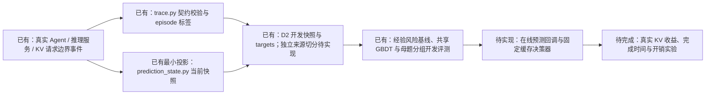

# LeasePath：混合 Agent 工作负载下的 KV 复用时间预测

LeasePath 研究一个具体问题：**一个 Agent 上下文暂时空闲后，它所对应的兼容 KV 前缀，未来何时会被真实请求再次使用？** 项目最终目标是用当前可观察的状态预测未来合法 KV lookup 的时间分布，并把预测接入缓存/调度器，检验是否减少真实 KV 重算、改善请求完成时间，同时正确计入预测开销。

**2026-11-07 新服务器路线：Qwen-Agent＋固定 Qwen2.5-Coder-32B＋受限参数数据工具。** 以 `66a34c8eb618f4849153cb3c8d72880362e8e387` 为迁移基线，工作区 `/home/liuxv/LeasePath-new-server-data`。环境与新增 CPU 边界检查已运行，32B 原始权重已完整校验，F16 转换已完成，协议门槛和 12 题试点进行中；没有新的 32B 主数据完成声明。当前入口见 [迁移报告](reports/new_server_migration_2026-11-07.md)，参数见 [冻结配置](configs/collection/new_server_v1.json)。下方旧机器路径、50 母题和 Codex/Flask 阶段均为历史记录，未随本次迁移恢复，不作为新路线前置条件。

本 README 是新对话或新开发者的项目入口。先看“当前状态”，再按“快速开始”运行现有验收。下一阶段以 [真实开发与决策收益计划](reports/real_development_lookup_plan_2026-10-31.md) 为准；原 [预测计划](reports/mixed_workload_reuse_prediction_plan_2026-10-27.md)、[数据契约](docs/prediction_contract.md) 和 [项目架构](docs/architecture.md) 保留背景与实现说明。

当前数据集的统一入口为 [数据集说明](docs/dataset_card.md)：**50 个不同母题、65 条可审计主执行、472 个 idle episode、2,414 张快照**；质量子集为 54 条执行、47 个母题、296 个 episode、1,553 张快照。已在新目录合并并完成 [经验预测/GBDT 训练 v2](reports/prediction_v2_50parents_review.md)，原轮数据保持原版本；逐文件路径、分组与哈希见 [50 母题清单](results/prediction/dataset_inventory_50parents_2026-10-31.json)，[此前 16 母题清单](results/prediction/dataset_inventory_2026-10-31.json) 保留。

研究状态与训练核对日期：2026-10-31；阶段 0 补救与本机资源核对日期：2026-11-01（Asia/Shanghai）。当前工作目录为 `/home/ma-user/takaya/leasepath`，独立 Python 环境为 `.venv/`。部署步骤与本机验收见 [部署说明](docs/deployment.md)；换机器时按实际 checkout 路径运行下列命令。

## 当前状态

**D1 人工事件契约验收已通过；D2 已扩展至 50 个母题，并完成四轮合并数据的经验基线/GBDT 开发评测。各轮均保留失败和来源清单。D2–D3 整体验收、独立来源测试及真实 KV 收益验证仍未完成。**

已验证的采集配置为 **mini-swe-agent＋Qwen2.5-Coder-7B-Instruct＋vLLM-Ascend**，采用官方文本交互配置的本地适配，并强制实际检查、修改、测试后提交。贪心组完整质量通过 8/10，采样组 6/10；运行方法见 [本轮采集说明](docs/d2_mbpp_round.md)，结果见 [本轮报告](reports/d2_mbpp_round_acceptance.md) 和 [机器摘要](results/prediction/d2_mbpp_round/summary.json)。首轮 5 个 issue 修复 0/5 的历史记录仍保留在 [首轮报告](reports/d2_first_round_acceptance.md)。

合格数据位于 `.artifacts/d2-next/datasets/qualified/`：**76 次请求、U=62、D=14、自然 C=0、285 个快照**；风险区间位于 `.artifacts/d2-next/hazards/qualified/`，共 717 行。完整主执行和 6 条质量失败均保留；逐条条件见 [质量清单](results/prediction/d2_mbpp_round/execution-quality.json)。

**旧十题离线训练记录：** 经验基线与小型强正则共享 GBDT 已完成按母题隔离的 5 折开发评测。完整集 0.1 秒累计 Brier（越低越好）为全局 0.4611、条件经验 0.3962、GBDT 0.4284。模型输出每区间 `hU/hD/h0` 与累计 `F_U/F_D/S`，不外推无风险记录的长区间。当时全套测试 **102 项通过**。配置、分状态结果与模型见 [第二部分 Review](reports/gbdt_review_2.md)；[第一部分](reports/empirical_baseline_review_1.md) 保留最初拟合记录。该轮属于十题开发诊断，最新扩量结果见下方训练 v2。

**数据扩展 v1 已完成：** 新增 CSV、JSONL、SQLite、gzip、文件排序、图最短路六个设计母题，6/6 后端可审计，5/6 通过冻结测试与执行质量条件。真实测试工具耗时 1.70–2.57 秒，最长 idle 2.61 秒；完整集 U=24、D=6、自然 C=0、173 张快照。命令类别、可见规模、工具状态和历史结果另存为 `expansion-v1`，原模型接口不变。该批没有失败后重试或 ≥3 秒样本，当时回归 **105 项通过**；详见 [运行说明](docs/d2_expansion_v1.md)、[数据 Review](reports/d2_expansion_v1_review.md) 和 [摘要](results/prediction/d2_expansion_v1/summary.json)。

**3–10 秒与修复扩展 v2 已完成：** 三个既有母题各两档规模，共 6 条主执行；14 次真实测试耗时 **3.54–8.95 秒**，最长 idle 8.99 秒。6/6 后端与修复链路可审计，4/6 通过独立测试及质量条件；完整集 U=40、D=6、自然 C=0、333 张快照。新增失败次数 0/1/2 和 8 次显式重测记录；图任务出现两次失败后成功的真实修复过程。原先陷入 sed 循环的诊断单独保留。该次回归 **114 项通过**；新特征、母题分组和诊断边界见 [运行说明](docs/d2_repair_v2.md)、[本部分 Review](reports/d2_repair_v2_review.md) 和 [摘要](results/prediction/d2_repair_v2/summary.json)。随后由新训练 v2 入口导入四轮数据，原采集结果保持原版本。

**50 母题扩展 v3 已完成：** 新增 34 个 MBPP 母题，34/34 后端可审计，31/34 独立测试及完整质量条件通过。新增 211 个 episode、1,179 张快照，U=177、D=34、自然 C=0；Bell 数、数字循环模式、PascalCase 三个失败母题原样保留。累计 50 个母题中，质量子集覆盖 47 个。34 个参考实现及空函数负对照全部通过验证，2,065 次主集/子集因果快照重建一致，该次回归 **114 项通过**。新增工具均低于 1 秒，原有秒级数据保持原版本。见 [本轮说明](docs/d2_diversity_v3.md)、[Review](reports/d2_diversity_v3_review.md) 和 [摘要](results/prediction/d2_diversity_v3/summary.json)。

**训练 v2 与后续诊断已完成：** 四轮数据按原母题合并，固定 5 折，沿用旧工具/phase/elapsed 桶信息和强正则参数。完整集 0.1 秒 Brier 为全局 **0.4986**、条件经验 **0.3889**、GBDT **0.4317**；质量子集分别为 **0.5124 / 0.4027 / 0.4440**，条件经验整体仍更好。已等待 ≥1 秒的快照上 GBDT 较好，但长时段仅少数母题，质量子集 10 秒评分另有 516 张无训练支持而排除。新增强字段只参与分层，尚未作为学习输入。30 份折内模型复现全部 11,901 份模型分布及指标，最新回归 **121 项通过**。模型与结果见 [训练 v2 Review](reports/prediction_v2_50parents_review.md)、[汇总](results/prediction/prediction_v2_50parents/summary.json)；独立来源和在线缓存收益仍待验证。

**2026-10-31 分析与路线更新：** [冻结模型诊断](reports/prediction_v2_diagnosis_and_next_steps.md) 发现当前只有 **19 个编码状态**，所有 idle-start 快照只有 1 种编码；GBDT 在训练内也落后，当前证据支持检查输入和欠拟合，不能推出复杂真实场景下条件经验必然更好。已有 472 个 episode 中 **95.8% 小于 1 秒**，自然 C=0，D 全部来自 runner 关闭。下一步优先验证真实工作负载与目标价值，暂不继续堆 MBPP 母题或直接扩大 GBDT 搜索。

CacheWise 使用“工具参数 TF-IDF/KMeans 聚类＋条件经验时长分布”，以工具剩余时间估计复用排序；论文先收集真实 Claude Code 会话，再在 Qwen2.5-Coder-32B-Instruct 服务上回放。我们的真实合法 lookup 是**监督标签**，包括 miss，不是可提前读取的输入。工具结束与 lookup 有差异，并不自动意味着可预测或有缓存收益；双方必须在相同目标、信息和决策器下验证。

下一轮按 [完整计划](reports/real_development_lookup_plan_2026-10-31.md) 分阶段执行，每阶段交付 review：

| 阶段 | 要验证什么 | 交付后再决定 |
|---|---|---|
| 0：接入与完整性 | 独占资源下验证 Codex＋Qwen2.5-Coder-32B＋vLLM-Ascend 候选链，3–5 个真实仓库任务，多卡/上下文/lookup 关联与开销 | 接入和数据证据合格后再扩大采集 |
| 1：真实差异 | 自然开发会话＋10–20 个独立仓库任务的探索预算，分解工具/依赖结束到真实 lookup 的延迟、覆盖和候选资格 | 时间差是否发生在有压力、可决策的对象上 |
| 2：决策价值 | 同一决策器比较工具时长代理与实际 lookup 条件经验，分别真实运行策略 | 直接需求目标是否减少重算或改善净完成时间 |
| 3：模型价值 | 同一新数据和因果特征下，增强条件经验 vs 共享 GBDT | GBDT 是否在独立任务/时间上有稳定净增益 |
| 4：独立确认 | 冻结配置后检查新任务/日期、容量负载、完整开销与任务质量 | 支持哪些结论、何时应停止复杂化 |

本机为 **8×910B2（每卡 64 GiB HBM）、192 CPU、约 1.5 TiB RAM**。用户随后授权释放显存，阶段 0 已实际使用独占卡运行；实验服务已停止，[最新资源快照](results/real_development/stage0_codex32b_2026-11-01/final-resource.json) 显示 8 卡均无运行进程，每卡约 3.3 GiB 为系统保留。新权重与原始证据使用 `/home/ma-user/work/leasepath/real-development-v1/` 数据盘。

**补救前阶段 0 实测（历史结果）：** 同一 32B 的 TP=2、16K、2/4/8 短请求并发及真实共享/淘汰/抢占/取消/重试等受控验收通过。Codex 两种配置未完成工具循环，按计划回退到 mini-swe-agent；3 个真实 issue 共执行 59 次请求、56 次工具，独立任务验收 **0/3**。完整后端流导出仓库 pilot 的 **U=56、D=3、C=0**，独立受控实验另有 U/D/C 各 1；这些不代表自然开发发生率。48 对开关探针请求的配对延迟增幅中位数约 **0.34%**，整项 Agent 完成时间非劣性尚未验收。项目回归 **139 项通过**，旧清单 125 个文件哈希不变。详见 [补救前阶段 0 Review](reports/real_development_stage0_review_2026-11-01.md) 和 [机器摘要](results/real_development/stage0_2026-11-01/summary.json)；[上一轮 CPU 准备 review](reports/real_development_stage0_review_2026-10-31.md) 保留历史含义。**真实 KV 策略收益尚未证明。**

**阶段 0 补救已完成本轮执行与 review，整体仍未通过：** 按 [revise.md](revise.md) 修复了宿主工具回退、加入私有环境与版本化工作流，并完成一般请求投影 v2.1。两轮原三题独立验收均为 **0/3**，按预登记停止条件结束当前链；新两题和最终五题验收未执行，完整 Agent JCT 非劣性未测量，阶段 1 暂缓。新流覆盖 **185/185 后端请求、306 次 lookup**，10 次未进入引擎的 HTTP 失败尝试单列；标签 U=172、D=11、C=1。独立投影/块审计及五项边界负例通过，项目 **151 项测试通过**，147 个历史文件哈希不变。服务已停止、8 卡无运行进程。详见 [补救 Review](reports/real_development_stage0_revise_review_2026-11-01.md)、[机器摘要](results/real_development/stage0_revise_2026-11-01/summary.json)；全部失败与旧结果均保留。

**阶段 0 修订 v2 已执行（2026-11-01）：** 按新版 [revise.md](revise.md) 完成旧失败的模型可见信息/模板核查，新增分页读取、精确编辑、自动语法反馈与请求前 token 预算。当前 32B 和预选 Qwen3.8-27B 的 L1 局部诊断均为 **0/3**；替代模型三份补丁语法通过，但功能与回归门槛仍未过。按每层 ≥2/3 的条件停止两分支，共使用 **6/21 次诊断预算、3 个来源组**，未运行 L2/L3、新五题或完整 Agent JCT，阶段 1 继续暂停。156 项测试通过，181 个历史小产物哈希不变，服务均已停止、8 卡无运行进程。详见 [最新诊断 Review](reports/real_development_stage0_diagnosis_v2_review_2026-11-01.md)、[机器摘要](results/real_development/stage0_diagnosis_v2_2026-11-01/summary.json)。两轮旧补救结果不变，其依据是 [revise v1 存档](revise_v1_2026-11-01.md)。

**当前主线：Codex CLI + 本地 32B（2026-11-01）。** 按 [指导.md](指导.md) 完成新一轮接入：CLI 0.166.0 经严格文本工具协议转换，实际执行 shell 并利用结果反馈，两个不同 fixture 的多轮闭环独立通过。随后 Flask-5063 开发联调用满 24 次模型请求，反复构造错误命令、补丁为空，独立验收 55 passed / 2 failed；按条件停止，未运行新五题或完整 JCT，阶段 0 仍不放行。45/45 后端输入 token IDs 精确对齐，42 次真实 shell，41 个唯一结果进入后续模型输入；最后一个被预算阻断，单列保留。完整回归 **180 项通过**，218 个历史结果文件哈希不变，自有服务已停止、8 卡无运行进程。见 [Codex/32B Review](reports/real_development_stage0_codex32b_review_2026-11-01.md)、[结果摘要](results/real_development/stage0_codex32b_2026-11-01/summary.json)。旧 L1 门槛没有用于阻止本次 Codex Agent 测试，旧失败结论不变。

| 状态 | 已有证据 | 不能据此声称 |
|---|---|---|
| D1 标签与因果边界 | 50 项人工/合成契约检查通过；包含有效事件、拒绝错误轨迹、快照未来隔离和回放权限检查。 | 真实采集器完整、主任务预测准确或缓存收益已验证。 |
| D1 图表 | [U/D/C 时间线 PNG](results/prediction/d1_contract/figures/timeline.png)、[未来隔离 PNG](results/prediction/d1_contract/figures/future_invariance.png)，另有 PDF 版本。 | 真实线上时间分布。图里的时间为合成 ns。 |
| D2 执行与采集链 | 旧 MBPP 轮 20 条主执行中 14 条质量合格，19 条后端可审计；之后文件、修复及母题扩展的统计见统一数据集说明。受控真实推理另验证 miss 仍为 U 和完整观测 C。 | 大型仓库修复能力、多来源覆盖、独立预测指标或完整采集开销已验证。 |
| TraceLab | 固定版本下载并校验；导出了工具结果日志跨度的辅助代理数据。 | 合法 KV 前缀复用数据。此数据没有主任务 U/D/C 标签，不得用于主模型或缓存策略收益验收。 |
| CacheWise | 固定公开快照已审计，保留了工具日志跨度代理候选。 | 合法 KV 前缀复用数据；该仓库也没有明确数据再分发许可。 |
| 缓存与本地回放 | 有 KV 块/owner 管理、BFCL 参考工具模拟、单服务器 FCFS 回放和可选 llama.cpp 原生 bridge。 | 真实 Agent 工作负载采集、预测器回调或生产调度闭环。 |

**关键判断：目前已采集的 TraceLab 与 CacheWise 都不能回答“某个已知兼容前缀下一次何时真实 lookup”。** 它们没有主任务所需的 owner–前缀关系、兼容配置、服务端 lookup 和显式 retire。脚本可以验证格式或导出辅助代理，但不能凭空补造这些事实。

## 研究对象与标签

**一次 episode** 是一个 owner–上下文版本–兼容 KV 前缀关系从进入 idle 到首个 U/D/C 结局的观测过程。**一条预测样本**是该 episode 尚未结束时，在某个时刻 `t0` 生成的状态快照；同一 episode 可以生成多张快照。采集器负责确认实际 idle 起点、前缀身份和兼容配置，模型只接收 `t0` 时已观察到的输入，标签记录从 `t0` 起的结局类型与剩余时间：

| 结局 | 事件证据 | 含义 |
|---|---|---|
| U：合法需求 | 真实 cache_lookup，请求使用相同兼容配置，且实际 token 序列以该前缀开头。缓存命中与否不改变 U。 | 观测到该 idle 前缀的一次合法需求。 |
| D：明确终止 | 明确的 context_retire 结束这个 owner–前缀关系。 | 后续不再把该关系当作可复用对象。工具结束、错误、淘汰和会话最后一行都不自动算 D。 |
| C：右删失 | 完整观测仍开放时出现 observation_end，此前没有 U 或 D。 | 只说明观测期内没看到结局；不能当作永不复用的负样本。 |

**时间窗口内尚无 U/D 对应继续等待 `h0`，不自动等于 C。** 若 2 秒后真实 U，则 0.1 秒内是已知等待，完整标签仍为 U；若只观察到 0.1 秒就结束且关系仍开放，才是 C。固定 horizon 行政截断可另建派生视图，保留原始最终标签。首轮 100 个 episode 在 idle 后 0.01 秒全部仍等待，0.1 秒有 41 个仍等待。本轮已导出逐快照风险区间与单独的行政截断视图，见 [本轮区间摘要](results/prediction/d2_mbpp_round/qualified-hazard-summary.json) 和 [契约说明](docs/prediction_contract.md#时间窗口内等待与右删失)。

要让预测能驱动调度，模型输出和调度对象必须关联到同一个 episode/前缀。模型预测的是未来时间分布，不是前缀身份；调度器/缓存管理器保留前缀到实际 KV 块的映射、共享关系、活动保护和物理占用。

例：5 秒进入 idle，9 秒拍快照，14 秒发生合法 lookup。输入中的已等待时间是 4 秒，待预测的剩余时间是 5 秒；从 idle 起算的完整 episode 时长是 9 秒。`derive_idle_labels` 导出完整 episode 标签，D2 的 `d2_dataset.py` 将其换算为各快照的剩余时间，另存于 `targets.jsonl`。

主契约与事件字段见 [docs/prediction_contract.md](docs/prediction_contract.md) 和 [schemas/trace.schema.json](schemas/trace.schema.json)。其中定义的是需要采集的事件格式，不代表公开 TraceLab/CacheWise 已提供这些字段。

目前 `derive_idle_labels` 消费显式 `legal_demand`、`context_retire` 和 `observation_end`；`legal_demand` 必须引用同一时刻真实 lookup 并通过前缀兼容校验。它不会自动从工具日志恢复请求或发现漏记需求，也不能证明上游声明的 retire 在业务上成立。真实采集链仍须负责事件完整性和关系关联。

## 当前项目框架

项目分成四个相连、但目前完成程度不同的部分：

1. **事件与标签契约**：trace.py 按真实 lookup、显式 retire 和 observation end 定义 U/D/C，并校验请求前缀兼容性。
2. **因果快照**：prediction_state.py 只把截至 t0 可见的白名单字段交给模型；没有明确事件关联时保留 unknown。已有 D2 最小快照、独立 targets 与风险区间导出；完整增强特征及独立来源切分仍待实现。
3. **缓存与工作负载回放**：cache.py 管理前缀块和 owner；source_replay.py 在 BFCL 固定任务上做单服务器 FCFS 回放。尚无共享模型的在线回调。
4. **预测与收益评估（部分实现）**：已有经验风险基线、共享 GBDT、按母题分组的开发评测与保存加载。独立来源/时间测试及在线策略闭环仍待实现，后续再验证 miss、JCT/完成时间及完整预测开销。

主线的数据流和实现状态：



当前模型的快照特征白名单是 `elapsed_idle_s`、`compatibility_id`、`prefix_tokens`、`tool_name`、`tool_elapsed_s`、`phase`、`retry_count`、`is_queued`、`queue_length`。工具/请求必须有明确 episode 关联；队列长度只有采集器保证从空队列开始完整记录服务事件时才能计算，否则保持 unknown。[扩展 v1](docs/d2_expansion_v1.md) 已单独导出当前命令/规模和已结束工具历史，尚未接入训练；完整依赖摘要与 KV 压力仍未实现。外层关系 ID 和时间用于对齐，只有嵌套的 `features` 可以传给模型。

研究计划采用同一主任务终点的条件经验风险基线与共享离散时间竞争风险 GBDT。`reuse_predictor.py` 提供经验基线，`gbdt_predictor.py` 提供共享树模型；`train_reuse_predictor.py` 保留旧十题入口，`train_prediction_v2.py` 通过 `prediction_merged.py` 导入四轮数据，`verify_prediction_v2.py` 独立重建折外预测与指标。独立来源评测和在线预测回调仍待实现。C 是训练时的删失标记，不是推理时可提前知道的未来结局。不要将回放服务成本模型 `source_cost.py` 当成复用预测器。

架构图及模块边界见 [docs/architecture.md](docs/architecture.md)。D1 的详细验收、图表及复现见 [reports/prediction_d1_acceptance.md](reports/prediction_d1_acceptance.md)。

## 文件架构

~~~text
leasepath/
├── README.md                         项目入口、状态和复现命令
├── pyproject.toml                    Python 包与依赖声明
├── docs/
│   ├── prediction_contract.md        预测单位、U/D/C、特征与因果边界
│   ├── architecture.md               数据流、模块职责、采集要求
│   ├── project_cleanup.md             旧项目清理和归档记录
│   └── deployment.md                  本机安装、资源恢复和验收步骤
├── schemas/trace.schema.json          事件 JSON Schema v0.1
├── src/leasepath/                     可复用的 Python 核心模块
│   ├── trace.py                       事件校验及 U/D/C 标签导出
│   ├── prediction_state.py            当前观测前缀的最小因果快照
│   ├── contract_fixtures.py           人工验收样例辅助函数
│   ├── cache.py                       KV 块、owner、保护、容量与淘汰
│   ├── source_replay.py               BFCL 请求的 FCFS 缓存回放
│   ├── source_cases.py                串行与 fanout/join 固定工作流
│   ├── bfcl_runtime.py                本地 BFCL 参考工具模拟器
│   ├── source_cost.py                 回放用服务成本拟合
│   ├── kv_layout.py / native.py       KV 布局镜像与可选原生接口
│   ├── measurement_clock.py           测量时钟辅助
│   ├── cachewise.py                   CacheWise 来源审计和工具跨度代理导出
│   └── tracelab.py                    TraceLab 辅助代理适配（不是主任务数据）
├── scripts/                            可执行入口，见下方
├── tests/                              核心模块与数据适配测试
├── data/
│   ├── fixtures/                      人工事件与 D1 独立预期
│   ├── sources/                       固定 BFCL、CacheWise、TraceLab 来源
│   └── processed/tracelab/            隔离保存的工具等待辅助代理
├── results/prediction/
│   ├── d1_contract/                   D1 事件、标签、快照和 PNG/PDF 图
│   ├── event_contract/                事件契约正反例的再运行结果
│   ├── cachewise_audit/               CacheWise 审计与分离代理文件
│   └── tracelab_audit/                TraceLab 全量机器核验结果
├── reports/                            研究计划、文献调研与数据/验收报告
├── patches/                            可选 llama.cpp bridge 与后端补丁
├── models/                              可选 Qwen 推理模型文件
└── .artifacts/                          可选 llama.cpp 源码、构建和原生库
~~~

`data/sources/` 是固定来源，运行产物放在 `data/processed/`、`results/` 或 `.artifacts/`；原始来源及 provenance 保持不变，质量问题在派生文件中标记。`models/` 保存推理模型资源；`.artifacts/` 还保存真实采集、合并开发样本和折内预测模型。全开发集经验/GBDT 模型在对应 `results/prediction/` 目录。D1 无需这些资源。BFCL 是固定参考任务与本地工具模拟器，不是自然到达的真实 Agent 轨迹。

旧阶段资料仅保存在原主机的 `LeasePath-archive/2026-10-28-before-prediction-cleanup/`，不随 Git 仓库分发，本机未恢复该归档，详见 [清理记录](docs/project_cleanup.md)。当前代码不依赖归档目录；旧虚拟环境不作为当前环境使用。样例中的 `run_id=d2`、原生库目录中的 `d6-native` 是历史命名，不能当作新预测计划的 D2/D6 已完成。

## 环境与安装

### CPU 开发和验收

项目要求 Python >= 3.10。依赖范围来自 [pyproject.toml](pyproject.toml)，当前没有锁定依赖的 lock 文件：

| 范围 | 声明的依赖 |
|---|---|
| 核心 | jsonschema >= 4.18, < 5；numpy >= 1.24, < 3 |
| test | pytest >= 8, < 10；mpmath >= 1.3, < 2 |
| measurement | matplotlib >= 3.7, < 4 |
| source | mpmath >= 1.3, < 2，供本地来源工具模拟使用 |

最小 CPU 验收无需 CUDA、GPU、Qwen 权重、PyTorch 或 llama.cpp。

~~~bash
cd /home/ma-user/takaya/leasepath
python3 -m venv .venv
source .venv/bin/activate
# ModelArts 默认 PYTHONPATH 注入 Ascend 包；CPU 验收先清除该注入
unset PYTHONPATH
python -m pip install --upgrade pip
python -m pip install -e '.[test,measurement]'
# 首次克隆尚无 CacheWise 快照，先运行无需下载数据的测试
python -m pytest -q -k 'not full_pinned_audit'
~~~

本机核验环境为 Huawei Cloud EulerOS 2.0（aarch64）、Python 3.12.0（`/home/ma-user/takaya/leasepath/.venv/bin/python`）、jsonschema 4.26.0、numpy 2.5.4、pytest 9.2.0、matplotlib 3.11.2、mpmath 1.4.1。恢复 CacheWise 固定快照并加入 D2、四轮合并训练与 GBDT 检查后，全套测试 **121 项通过**；CPU 与 Agent 环境先前的 `python -m pip check` 均通过。恢复步骤见 [部署说明](docs/deployment.md)。这些版本是本机已验证组合，并非锁定要求。

D1 绘图脚本使用 Agg 后端，无需桌面；中文字体会尝试文泉驿正黑、Noto Sans CJK SC、SimHei。本机字体安装位置与复现步骤见 [部署说明](docs/deployment.md)。Ubuntu 可安装 `fonts-wqy-zenhei` 或 Noto CJK 字体。LightGBM 和 vLLM 不是当前项目依赖。

### 可选 GPU 原生回放

可选后端为 Qwen2.5-3B-Instruct F16 GGUF + llama.cpp，通过 `ctypes` 调用 C++ bridge。原主机使用 Tesla V100-PCIE-32GB、NVIDIA driver 580.178.04；这些是历史环境记录。本机未提供 `nvidia-smi`，也未恢复 GGUF、llama.cpp 或原生动态库，本次仅部署并验收 CPU 路径。

| 可选资源（本机尚未恢复） | 位置 / 前提 |
|---|---|
| 原生接口 | `src/leasepath/native.py` |
| 推理模型 | `models/Qwen2.5-3B-Instruct/Qwen2.5-3B-Instruct-f16.gguf` |
| 原生动态库 | `.artifacts/d6-native/liblp_native.so` |
| 已有 llama.cpp 源码和构建 | `.artifacts/llama-src/`、`.artifacts/llama-build/bin/` |
| bridge 编译 | `python scripts/build_native.py`；需 C++17 编译器和已有 llama.cpp 头文件/库 |

`build_native.py` 只编译 bridge，不安装 CUDA、不从零构建 llama.cpp；`fetch_model.py` 下载 tokenizer/模型元数据，可用 `--weights` 下载 safetensors，但不生成上表的 GGUF。换机器需要重新确认驱动、CUDA、后端 ABI 和编译路径；现有构建带绝对路径，不能直接搬目录后假设仍可运行。

## D2 首轮真实数据采集

方案确认日期：2026-10-30（Asia/Shanghai）。目标是先跑通 **真实任务 → idle 时已确定的兼容前缀 → 服务端实际 lookup → 可追溯的 U/D/C 标签与因果快照**。首轮选择全注意力模型，以简化前缀与实际 KV 块的关联、释放和容量计量。

首轮实跑结果：**913 条统一事件、100 个 idle episodes（U=95、D=5、C=0）、456 个快照**；100 次请求全部有实际后端阶段、无观测序号缺口，95 次请求命中缓存。另存的受控检查为 U=2、C=1，不混入自主任务数据。5 个任务全部达到 20 步上限且没有补丁，公开 issue 测试均未修复；重复命令偏多，真实编辑/测试/构建覆盖不足。详细统计见 [实测摘要](results/prediction/d2_first_round/summary.json)。

完整数据保存在 `.artifacts/d2/pilot-dataset/`，冻结的原始日志和配置保存在 `.artifacts/d2/frozen-first-round/`。日志写入队列的局部微基准 P95 约 4.7 μs，**完整探针和端到端开销仍未验证**，因此目前只能确认配置与采集链运行成功，尚不满足扩大采集的全部条件。

后续审计发现，本轮使用自写简化提示词，未采用官方 SWE-bench 交互配置；回复均未触及 768 token 上限，多轮历史与错误反馈已进入实际模型输入。因此 0/5 不能直接归因于 7B 参数量。建议先保留 7B/BF16/16K，采用官方文本交互提示并以 MBPP 单文件派生任务诊断，再对照模型官方采样设置；完整任务说明、来源与建议见 [执行质量及 C 语义复核](reports/d2_quality_and_censoring_review_2026-10-30.md)。这些建议现已在 [MBPP 派生执行轮](docs/d2_mbpp_round.md) 实测：贪心组 8/10、采样组 6/10 满足完整质量条件；不覆盖本节首轮历史结果。

### 固定配置

| 项目 | 首轮选择 / 执行约束 |
|---|---|
| Agent | mini-swe-agent 2.4.6，commit `04d809ceab9df28f9adaed044884180159172930`；提示词和消息规则保存在 runner 与 trajectory 中。 |
| 推理模型 | `Qwen/Qwen2.5-Coder-7B-Instruct`，BF16、纯文本；revision `c03e6d358207e414f1eca0bb1891e29f1db0e242`，权重与 tokenizer 已交叉校验哈希。 |
| 推理服务 | vLLM `0.23.0+empty`、vLLM-Ascend `0.1.dev4229+g7495e9d69`，其他版本与接口见 [D2 部署说明](docs/d2_first_round.md)。 |
| 加速卡 | 本机 Ascend 910B2 卡 0，单卡、`tensor_parallel_size=1`。 |
| 上下文 | 首轮上限 16,384 tokens，不使用 YaRN 扩展；冻结超长输入处理规则，禁止静默截断。 |
| 缓存与执行 | 开启 prefix caching；关闭投机解码、跨实例缓存传输/外部缓存等附加机制。固定并记录缓存容量、块大小、调度参数与采样参数。 |
| 任务规模 | 先选 5–10 个可重复运行的真实 coding 任务，覆盖文件检索、修改、测试和构建；保留失败与未解决任务及退出原因。 |
| 并发 | 先串行验证，再逐步增加多个独立 agent 的并发；多 agent 并发不等于单个 workflow 的 fanout/join。 |

本机有 8 张 Ascend 910B2，本轮复用 `/home/ma-user/work/qwen-services/runtime_env.sh`，通过 `scripts/d2_service.py` 启动独立插桩服务，接口为 `http://127.0.0.1:8201/v1`，模型名为 `leasepath-qwen25-coder7b`。模型已下载至 `models/Qwen2.5-Coder-7B-Instruct`（链接到本机 work 目录）。CPU 校验、Agent 与推理分别使用 `.venv/`、`.venv-agent/` 和已有 Ascend 运行环境。

任务为 SWE-bench Lite 的五个固定 SymPy issue，在各自 upstream base commit 上运行。旧 SymPy 在 aarch64 / Python 3.12 环境中已通过导入检查及公开 issue 测试基线核对；本轮使用本机 shell 和 pytest，未使用官方 SWE-bench 容器，因此只报告本地 issue 测试结果。五个任务同属一个来源项目，全部归入开发集。

本机已挂载的 Qwen3.5-9B 保留为第二轮混合架构扩展模型，路径为 `/home/ma-user/work/qwen-services/models/qwen3.5-9b`。它包含 24 层线性注意力和 8 层全注意力，后端已有混合缓存支持；首轮改用全注意力模型是为了降低实现复杂度，不是因为 9B 参数规模不合适或已证明无法插桩。第二轮须联合验证 attention KV 与线性注意力状态的复用边界和计量。

### 采集位置与标签依据

| 采集位置 | 必须记录的事实 |
|---|---|
| Agent / 上下文管理器 | owner、context version、工具起止、明确关闭或放弃复用关系的事件；显式 `context_retire` 为 D 提供依据。 |
| 服务端模板与 tokenizer 之后 | 实际引擎输入 token IDs，以及模型、tokenizer、模板、位置编码、精度和适配器等兼容配置。 |
| 服务端请求结束与缓存生命周期处 | 该 owner 对前缀的活动使用结束时间，生成 `idle_start`；关联实际 KV 块、共享关系及活动保护状态。 |
| 服务端缓存查找入口 | request ID、实际 lookup 时间、请求 token 前缀、命中范围、缓存块关联及实际执行的 prefill 数；U 必须追到兼容 lookup，miss 也算 U。 |
| 独立观测器 | 同一单调时钟域、事件序号、完整观测区间和 `observation_end`；此前没有 U/D 且关系仍开放时，才形成 C。 |

前缀必须在进入 idle 时按固定规则选定，例如选择当时已知、实际可缓存的对齐前缀；禁止观察下一条请求后用最长公共前缀倒选预测对象。消息历史追加不保证 token 前缀不变，需核验服务端实际 tokens。客户端响应时间不能替代 idle，HTTP 请求时间不能替代 lookup；日志断流也不能自动标为 C。

mini-swe-agent 的工具主要是 bash，应额外记录当前可见的命令类别（检索、编辑、测试、构建等），不能仅依靠 `tool_name=bash`。这些增强特征须显式扩展并验证现有特征白名单后才能用于模型，未知值保留 unknown。工具结束、失败、缓存淘汰或会话最后一行都不能自行充当 D；真实 pilot 没有某类结局时报告覆盖缺失。

### 扩大采集前的验收条件

1. **前缀与输入一致**：idle 前缀在当时已确定，能逐条核验其与实际引擎 tokens、兼容配置及缓存对象的关联。
2. **实际命中可核验**：兼容请求产生真实命中时，探针记录的复用范围与引擎实际跳过/执行的 prefill 对齐；不能仅使用 API 的 `cached_tokens` 汇总值。
3. **miss 仍生成 U**：在 prefix caching 保持开启、缓存被清空或淘汰的受控检查中，后续兼容 lookup 仍生成 U。此类检查单独标记，不混入自然采集数据。
4. **生命周期与观测可追溯**：idle、retire、观测结束均有原事件依据；事件丢失或不完整观测须单独标记，不能补造标签。
5. **特征因果性与采集开销可核验**：快照只读取截至 `t0` 的可见事件；测量探针开销，避免同步写入大量日志改变工具间隔与排队时间。

第一批交付包括：原始事件、episode 标签、与标签分离的快照特征、版本/配置/来源哈希清单、项目与任务分组，以及事件缺失、前缀匹配、U/D/C 覆盖、物理命中和采集开销统计。快照标签使用“结局时间减去快照时间”的剩余时长；同一 episode、完整 session、同任务重复运行及共享来源项目不得跨训练/测试切分。

上述检查通过后，在 D2–D3 扩大到约 60–100 个完整 workflows，逐步加入并发、长工具和真实并行依赖。若 7B 在 pilot 中大量陷入格式错误或无效循环，先记录失败分布，再评估同系列 14B；模型变更须另记配置并重新验收。TraceLab/CacheWise 继续作为辅助代理资料，不进入主任务 U/D/C 训练集。

## 快速开始：复现已有证据

从仓库根目录运行：

~~~bash
# 全部自动化测试
python -m pytest -q

# D1：重新展开人工轨迹、运行 50 项契约检查并写出机器验收结果
python scripts/check_prediction_d1.py

# D1：从验收导出文件生成两张中文 PNG 和 PDF
python scripts/plot_prediction_d1.py

# 独立运行事件契约 8 个正例与 16 个反例
python scripts/check_event_contract.py
~~~

默认 D1 结果写入 `results/prediction/d1_contract/`，图表在其 `figures/`，`summary.json` 记录输入/输出哈希；绘图先校验验收输出哈希，再生成 PNG/PDF，并写 `figures/manifest.json`。预期为 D1 **50 项通过**，独立事件契约 **8 个正例接受、16 个反例拒绝**。结果属于人工合成契约证据。

复核时若不想覆盖仓库内已有产物，可以指定新目录：

```bash
python scripts/check_prediction_d1.py --output /tmp/leasepath-d1-review
python scripts/plot_prediction_d1.py --input /tmp/leasepath-d1-review
```

可校验任意符合 schema 的事件 JSONL 并另行导出标签：

~~~bash
python scripts/validate_trace.py results/prediction/d1_contract/legal_demand_physical_miss.events.jsonl --labels /tmp/leasepath-labels.jsonl
~~~

## Git 仓库范围

Git 仓库保留项目代码、文档、测试、D1 合成验收结果及图表、BFCL 参考任务和公开数据来源说明。模型权重、构建目录、CacheWise/TraceLab 下载快照与大型派生数据不上传，已有本地文件不受影响。首次克隆后，涉及 CacheWise 全量快照的测试需要先恢复 `data/sources/cachewise/upstream/`（其余测试可用 `python -m pytest -q -k "not full_pinned_audit"` 运行）。可用 `python scripts/collect_cachewise.py --source /tmp/leasepath-cachewise` 下载到一个尚不存在的目录，再将其中的 `upstream/` 复制到 `data/sources/cachewise/`，具体命令见 [部署说明](docs/deployment.md)。本机已恢复此 CacheWise 快照；TraceLab 的压缩原始数据和大型派生文件尚未下载。TraceLab 辅助数据通过 `python scripts/prepare_tracelab.py` 获取和生成。这些公开数据仍不是主任务真实 U/D/C 训练集。

## 数据现状与用途边界

### 主任务数据：已有开发集，扩大采集验收仍待完成

当前主任务开发集由本机实际 Agent 和插桩推理服务采集，规模、质量和逐轮路径见 [统一数据集说明](docs/dataset_card.md)。训练数据必须记录 owner/context version/idle episode、token 前缀和兼容配置、真实 cache lookup 及其请求 token、显式 retire、完整 observation end，以及同一单调时钟。只有这些事实才能把事件归为可追溯的 U/D/C。命中/未命中是缓存结果；需求标签 U 的定义是兼容 lookup，即使当时物理 KV 已被淘汰也算需求。

要验证调度收益，还要把 episode 映射到真实 KV 块和共享 owner，记录缓存容量、active/pin、淘汰、实际 cached/executed prefill tokens、策略动作、miss、请求完成时间和预测开销。仅有标签文件不足以评估缓存收益。采集要求和验收顺序见 docs/architecture.md 的“主任务采集链”。

### TraceLab 与 CacheWise：公开辅助数据，不是主任务训练集

两份来源的当前盘点：

| 来源 | 固定来源与规模 | 本地目录及报告 |
|---|---|---|
| TraceLab | v0.0.2，commit `61fea8f97277d0aa247cc2e4c7e31f90ed2bea1c`；665,453 个轮次，743,819 条工具调用，8,058 个会话 ID；CC BY 4.0。 | [来源说明](data/sources/tracelab/v0.0.2/README.md)、[派生代理说明](data/processed/tracelab/v0.0.2/README.md)、[审计报告](reports/tracelab_dataset_audit_2026-10-29.md) |
| CacheWise | commit `181c435a090d328d00bbbee4c8eeb27d32f3abd2`；11 个项目、94 个会话文件（81 个非空）、11,617 条工具事件。 | [来源说明](data/sources/cachewise/README.md)、[审计报告](reports/cachewise_dataset_audit_2026-10-29.md) |

这些工具调用/结果日志缺少主任务需要的前缀身份、服务端 lookup 和显式 retire。对当前目标，二者都不能生成真实 U/D/C，不能训练主模型，也不能验证预测驱动的 KV 收益。TraceLab 派生文件只保留为工具响应日志跨度辅助代理；`exact_kv_label_supported=false`、`exact_kv_outcome=null` 明确表示缺少真实标签。不能把工具返回时间重命名为 lookup 时间。

若需要复查 TraceLab 派生辅助数据，可在数据已下载的情况下运行：

~~~bash
# 校验固定源，重新生成分组后的辅助代理并全量核验
python scripts/prepare_tracelab.py --offline

# 只校验已有的来源及派生文件
python scripts/prepare_tracelab.py --offline --verify-only
~~~

TraceLab 默认目录为 `data/sources/tracelab/v0.0.2/` 与 `data/processed/tracelab/v0.0.2/`，机器核验记录在 `results/prediction/tracelab_audit/`。原始来源保持不变，上游辅助脚本只阅读，未执行。派生目录中的 features/labels/quality 是工具跨度代理文件；字段分离、分组切分或百万张快照均不能弥补主任务标签缺失。

CacheWise 的本地审计命令：

~~~bash
python scripts/collect_cachewise.py --offline
~~~

该固定快照未发现明确数据许可证；保持本地审计用途，不要对外再分发。来源、哈希、质量规则和许可细节分别见各自审计报告。

## 命令行入口

| 脚本 | 用途 |
|---|---|
| `check_prediction_d1.py` | D1 人工契约、快照未来隔离和现有回放权限检查。 |
| `plot_prediction_d1.py` | 校验 D1 导出哈希并生成两张中文 PNG/PDF 图。 |
| `check_event_contract.py` | 独立事件契约正反例。 |
| `validate_trace.py` | 校验事件 JSONL，可单独导出 U/D/C 标签。 |
| `d2_service.py` | 启动、查看或停止本机 D2 Ascend 推理服务。 |
| `prepare_d2_model.py`、`prepare_d2_tasks.py` | 校验固定模型快照，准备固定真实 issue 的独立源码与来源清单。 |
| `check_d2_backend.py`、`run_d2_pilot.py` | 分别运行受控真实缓存检查和自主 coding 任务；保留失败。 |
| `evaluate_d2_tasks.py`、`export_d2_dataset.py` | 在独立目录评测公开 issue 测试，严格审计并分开导出事件、标签、快照与 targets。 |
| `prepare_d2_mbpp.py`、`run_d2_mbpp.py` | 准备固定 MBPP 派生任务，执行直接生成诊断与 Agent 对照。 |
| `evaluate_d2_mbpp.py`、`finalize_d2_mbpp.py` | 独立评测、逐 workflow 审计、冻结原始证据与导出质量子集。 |
| `prepare_d2_expansion.py`、`run_d2_expansion.py`、`finalize_d2_expansion.py` | 准备不同文件处理任务、校准真实秒级测试、采集、独立复测与导出增强状态。 |
| `prepare_d2_repair.py`、`prepare_d2_repair_guided.py` | 校准 3–10 秒受控修复任务，并从相同冻结缺陷派生新的主执行工作区。 |
| `run_d2_repair_guided.py`、`finalize_d2_repair.py`、`verify_d2_repair.py` | 主执行要求复现失败、真实修改、同套件重测；冻结证据，复测并逐快照重建。`run_d2_repair.py` 保留为最初诊断协议。 |
| `prepare_d2_diversity.py`、`check_d2_diversity_tasks.py` | 固定 34 个新增 MBPP 母题、独立期望值，验证参考实现与空函数负对照。 |
| `run_d2_diversity.py`、`finalize_d2_diversity.py`、`verify_d2_diversity.py` | 采集新增母题、独立测试、冻结后端证据并重建因果快照。 |
| `inventory_d2_datasets.py` | 核对四轮数据哈希、身份、权重及母题去重，生成 50 母题逻辑清单。 |
| `export_d2_hazards.py` | 导出逐快照风险区间与单独的行政删失视图。 |
| `fit_empirical_risk.py` | 拟合全局/条件经验竞争风险基线，保存模型并生成训练内概率预览；第一部分 Review 入口。 |
| `train_reuse_predictor.py` | 固定母题分组、折内拟合经验基线/GBDT、折外概率与评分、全开发集重拟合；第二部分 Review 入口。 |
| `train_prediction_v2.py`、`verify_prediction_v2.py` | 导入四轮 50 母题数据，保持旧输入/参数进行 5 折对照和分层评分；独立复现折内模型、折外概率和指标。 |
| `collect_cachewise.py` | 下载/验证固定 CacheWise 快照并运行辅助数据审计。 |
| `prepare_tracelab.py` | 下载/验证固定 TraceLab 发布并构建辅助工具等待数据。 |
| `environment_probe.py` | 用 `--output` 指定环境记录文件；只有传 `--cuda-device` 才运行微型 CUDA 算子检查。 |
| `preflight_real_development.py`、`prepare_real_development_model.py` | 阶段 0 只读资源门槛、固定 32B 模型下载及哈希核验。 |
| `prepare_real_development_tasks.py`、`check_real_development_tasks.py` | 固定真实 issue 源码和独立环境预检；参考修复仅在隔离评测副本中使用。 |
| `preflight_real_development_tools.py`、`run_real_development_tasks_v2.py`、`evaluate_real_development_pilot_v2.py` | 阶段 0 补救：私有工具环境、版本化修复工作流、全新 checkout 独立验收。 |
| `export_real_development_v2.py`、`check_real_projection_v2.py`、`check_real_projection_v2_boundaries.py` | 一般请求关系 v2.1、全请求覆盖、独立源引用/首次需求核验及损坏边界负例。 |
| `audit_stage0_failure_visibility.py`、`run_stage0_diagnostics_v3.py`、`preflight_diagnostic_template.py` | 修订 v2：实际可见信息核查、冻结的 L1/L2/L3 条件诊断及前端模板 token 对齐。 |
| `real_development_boundary.py` | 请求前记录 producer 清单；排空后 TP checkpoint 并停止本轮自有服务。 |
| `check_real_development_protocol.py` | 在返回 503 的 loopback 捕获端检查 Codex 客户端协议；不做推理或后端验收。 |
| `fetch_model.py` | 下载可选 Qwen2.5-3B-Instruct 模型文件。 |
| `build_native.py` | 使用已有 llama.cpp build 编译可选原生 bridge。 |

## 接手时从哪里开始

1. 先读本 README、“当前状态”、docs/prediction_contract.md 和 docs/architecture.md 的主任务采集要求。不要把 CacheWise/TraceLab 工具跨度当成 KV 复用标签。
2. 运行 python -m pytest -q 与 D1 检查，确认事件语义仍通过。
3. 阅读 [训练 v2 Review](reports/prediction_v2_50parents_review.md)、[诊断](reports/prediction_v2_diagnosis_and_next_steps.md) 和 [统一数据集说明](docs/dataset_card.md)：已有结果是开发证据，原 [50 母题采集 Review](reports/d2_diversity_v3_review.md) 保留来源；不以快照数量代替独立任务数。
4. 按 [新阶段计划](reports/real_development_lookup_plan_2026-10-31.md) 先完成资源/接入/生命周期验收并 review，再调查真实开发的工具代理差异，区分等待、可决策状态与已保护的排队状态。
5. 先验证同一决策器下工具代理与真实 lookup 目标的价值，再比较同信息条件经验与 GBDT。冻结未参与选择的任务/时间留出；策略分别真实运行，不能把固定 lookup 时间线当作另一策略的真实结果。

新采集链的最低验收标准：能逐条核查 idle 前缀与兼容性；U 追到真实 lookup（包含 miss）；D 追到显式 retire；C 追到完整观测结束。所有特征只读快照前事件。缺失记录保留 unknown，不能用工具结束、会话结束或人为等待补造结局。真实 pilot 没有某类结局时报告覆盖缺失，不为凑齐分类造样本。

主任务切分须隔离完整 session、owner/context 及共享来源项目；同一 episode 的所有快照必须同组。模型和基线先比较同一组可见输入，再做增强特征消融。测试标签和未来缓存结果不得进入预测器或因果策略。

## 文档导航与维护

| 需要了解 | 阅读位置 |
|---|---|
| 下一阶段：真实工具/lookup 差异、缓存价值、模型比较与服务器安排 | [执行计划与 review 节点](reports/real_development_lookup_plan_2026-10-31.md)、[只读硬件快照](results/planning/real_development_2026-10-31/hardware_snapshot.json) |
| 阶段 0 已执行准备、资源限制、任务环境与未通过项 | [阶段 0 Review](reports/real_development_stage0_review_2026-10-31.md)、[机器摘要](results/real_development/stage0_2026-10-31/summary.json) |
| 研究主线、模型和 D1–D10 | [预测计划](reports/mixed_workload_reuse_prediction_plan_2026-10-27.md) |
| 当前数据集组成、数量、字段、路径、质量与使用方式 | [统一数据集说明](docs/dataset_card.md)、[50 母题清单](results/prediction/dataset_inventory_50parents_2026-10-31.json)、[真实样本](results/prediction/dataset_record_example_2026-10-31.json) |
| D2 新增 34 个母题、固定独立测试与质量复核 | [说明](docs/d2_diversity_v3.md)、[Review](reports/d2_diversity_v3_review.md)、[机器摘要](results/prediction/d2_diversity_v3/summary.json) |
| D2 3–10 秒工具、真实失败/重测与母题分组 | [说明](docs/d2_repair_v2.md)、[Review](reports/d2_repair_v2_review.md)、[机器摘要](results/prediction/d2_repair_v2/summary.json) |
| D2 六类任务、1–3 秒工具和增强状态 v1 | [扩展说明](docs/d2_expansion_v1.md)、[Review](reports/d2_expansion_v1_review.md)、[机器摘要](results/prediction/d2_expansion_v1/summary.json) |
| D2 当前执行协议、独立评测与质量数据 | [本轮说明](docs/d2_mbpp_round.md)、[本轮报告](reports/d2_mbpp_round_acceptance.md)、[机器摘要](results/prediction/d2_mbpp_round/summary.json) |
| 最新训练 v2：50 母题经验预测/GBDT、秒级分层与支持范围 | [Review](reports/prediction_v2_50parents_review.md)、[汇总](results/prediction/prediction_v2_50parents/summary.json)、[分层指标](results/prediction/prediction_v2_50parents/stratified-metrics.json) |
| GBDT 落后原因、输入信息与后续取舍 | [诊断及推进建议](reports/prediction_v2_diagnosis_and_next_steps.md)、[描述性诊断数据](results/prediction/prediction_v2_diagnosis/diagnostics.json) |
| 旧十题训练第二部分：共享 GBDT 与分组开发评测 | [Review 说明](reports/gbdt_review_2.md)、[结果摘要](results/prediction/gbdt_review_2/summary.json) |
| 离线训练第一部分：经验竞争风险基线 | [Review 说明](reports/empirical_baseline_review_1.md)、[结果摘要](results/prediction/empirical_baseline_review_1/summary.json) |
| D2 首轮模型、采集位置与扩大采集条件 | [D2 首轮真实数据采集](#d2-首轮真实数据采集) |
| D2 启动、运行、导出与实测结果 | [D2 部署说明](docs/d2_first_round.md)、[首轮报告](reports/d2_first_round_acceptance.md) |
| 标签、输入、未来隔离和当前快照限制 | [数据契约](docs/prediction_contract.md) |
| 模块接口、真实采集要求与后续扩展位置 | [项目架构](docs/architecture.md) |
| D1 的人工预期、50 项检查和图表 | [D1 验收报告](reports/prediction_d1_acceptance.md) |
| 文献与预测动机 | [预测调研](reports/kv_reuse_time_prediction_survey_2026-10-27.md) |
| 已采集公开数据为什么不满足主任务 | [TraceLab 审计](reports/tracelab_dataset_audit_2026-10-29.md)、[CacheWise 审计](reports/cachewise_dataset_audit_2026-10-29.md) |
| 旧文件与环境归档位置 | [项目清理记录](docs/project_cleanup.md) |

维护时同步更新本 README 的状态、环境核验日期与接手入口。每份历史报告的测试数量只对应报告当日，不同于当前测试总数。更改契约或验收输入后重跑关联证据并记录新哈希，不用新文件覆盖旧证据后宣称来源未变；保持“合成、回放、实测”三类证据的区别。

## 研究计划

当前推进顺序以 [2026-10-31 真实开发计划](reports/real_development_lookup_plan_2026-10-31.md) 为准：接入验收 → 真实差异 → 决策收益 → 公平模型比较 → 独立确认，各部分先 review。原 D1–D10 计划保存在 reports/mixed_workload_reuse_prediction_plan_2026-10-27.md。D1 受控契约验收完成，D2 已有真实可链接事件与 50 母题开发评测；多来源复杂开发、完整 KV 生命周期和在线收益仍未完成。
