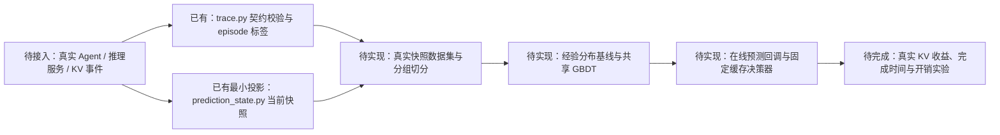

# LeasePath：混合 Agent 工作负载下的 KV 复用时间预测

LeasePath 研究一个具体问题：**一个 Agent 上下文暂时空闲后，它所对应的兼容 KV 前缀，未来何时会被真实请求再次使用？** 项目最终目标是用当前可观察的状态预测未来合法 KV lookup 的时间分布，并把预测接入缓存/调度器，检验是否减少真实 KV 重算、改善请求完成时间，同时正确计入预测开销。

本 README 是新对话或新开发者的项目入口。先看“当前状态”，再按“快速开始”运行现有验收。研究细节见 [预测计划](reports/mixed_workload_reuse_prediction_plan_2026-10-27.md)、[数据契约](docs/prediction_contract.md) 和 [项目架构](docs/architecture.md)。

状态核对日期：2026-10-29（Asia/Shanghai）。当前工作目录为 `/home/liuxv/LeasePath`；换机器时按实际 checkout 路径运行下列命令。

## 当前状态

**D1 的人工事件契约验收已通过；主任务真实 U/D/C 样本数为 0，D2–D3 尚未完成；没有训练主模型，也没有完成在线预测器接入或真实 KV 收益实验。**

| 状态 | 已有证据 | 不能据此声称 |
|---|---|---|
| D1 标签与因果边界 | 50 项人工/合成契约检查通过；包含有效事件、拒绝错误轨迹、快照未来隔离和回放权限检查。 | 真实采集器完整、主任务预测准确或缓存收益已验证。 |
| D1 图表 | [U/D/C 时间线 PNG](results/prediction/d1_contract/figures/timeline.png)、[未来隔离 PNG](results/prediction/d1_contract/figures/future_invariance.png)，另有 PDF 版本。 | 真实线上时间分布。图里的时间为合成 ns。 |
| TraceLab | 固定版本下载并校验；导出了工具结果日志跨度的辅助代理数据。 | 合法 KV 前缀复用数据。此数据没有主任务 U/D/C 标签，不得用于主模型或缓存策略收益验收。 |
| CacheWise | 固定公开快照已审计，保留了工具日志跨度代理候选。 | 合法 KV 前缀复用数据；该仓库也没有明确数据再分发许可。 |
| 缓存与本地回放 | 有 KV 块/owner 管理、BFCL 参考工具模拟、单服务器 FCFS 回放和可选 llama.cpp 原生 bridge。 | 真实 Agent 工作负载采集、预测器回调或生产调度闭环。 |

**关键判断：目前已采集的 TraceLab 与 CacheWise 都不能回答“某个已知兼容前缀下一次何时真实 lookup”。** 它们没有主任务所需的 owner–前缀关系、兼容配置、服务端 lookup 和显式 retire。脚本可以验证格式或导出辅助代理，但不能凭空补造这些事实。

## 研究对象与标签

**一次 episode** 是一个 owner–上下文版本–兼容 KV 前缀关系从进入 idle 到首个 U/D/C 结局的观测过程。**一条预测样本**是该 episode 尚未结束时，在某个时刻 `t0` 生成的状态快照；同一 episode 可以生成多张快照。采集器负责确认实际 idle 起点、前缀身份和兼容配置，模型只接收 `t0` 时已观察到的输入，标签记录从 `t0` 起的结局类型与剩余时间：

| 结局 | 事件证据 | 含义 |
|---|---|---|
| U：合法需求 | 真实 cache_lookup，请求使用相同兼容配置，且实际 token 序列以该前缀开头。缓存命中与否不改变 U。 | 观测到该 idle 前缀的一次合法需求。 |
| D：明确终止 | 明确的 context_retire 结束这个 owner–前缀关系。 | 后续不再把该关系当作可复用对象。工具结束、错误、淘汰和会话最后一行都不自动算 D。 |
| C：右删失 | 完整观测仍开放时出现 observation_end，此前没有 U 或 D。 | 只说明观测期内没看到结局；不能当作永不复用的负样本。 |

要让预测能驱动调度，模型输出和调度对象必须关联到同一个 episode/前缀。模型预测的是未来时间分布，不是前缀身份；调度器/缓存管理器保留前缀到实际 KV 块的映射、共享关系、活动保护和物理占用。

例：5 秒进入 idle，9 秒拍快照，14 秒发生合法 lookup。输入中的已等待时间是 4 秒，待预测的剩余时间是 5 秒；从 idle 起算的完整 episode 时长是 9 秒。当前 `derive_idle_labels` 导出的是完整 episode 标签，后续主任务样本构造器还需换算为各快照的剩余时间。

主契约与事件字段见 [docs/prediction_contract.md](docs/prediction_contract.md) 和 [schemas/trace.schema.json](schemas/trace.schema.json)。其中定义的是需要采集的事件格式，不代表公开 TraceLab/CacheWise 已提供这些字段。

目前 `derive_idle_labels` 消费显式 `legal_demand`、`context_retire` 和 `observation_end`；`legal_demand` 必须引用同一时刻真实 lookup 并通过前缀兼容校验。它不会自动从工具日志恢复请求或发现漏记需求，也不能证明上游声明的 retire 在业务上成立。真实采集链仍须负责事件完整性和关系关联。

## 当前项目框架

项目分成四个相连、但目前完成程度不同的部分：

1. **事件与标签契约**：trace.py 按真实 lookup、显式 retire 和 observation end 定义 U/D/C，并校验请求前缀兼容性。
2. **因果快照**：prediction_state.py 只把截至 t0 可见的白名单字段交给模型；没有明确事件关联时保留 unknown。当前只有最小快照投影，尚无完整真实数据集构造器。
3. **缓存与工作负载回放**：cache.py 管理前缀块和 owner；source_replay.py 在 BFCL 固定任务上做单服务器 FCFS 回放。尚无共享模型的在线回调。
4. **预测与收益评估（待实现）**：先用主任务真实样本建立经验分布基线，再比较共享离散时间竞争风险模型；随后在真实可观测的缓存环境评估校准、miss、JCT/完成时间和预测开销。训练、测试和在线策略闭环目前都没有完成。

主线的数据流和实现状态：



当前快照特征白名单是 `elapsed_idle_s`、`compatibility_id`、`prefix_tokens`、`tool_name`、`tool_elapsed_s`、`phase`、`retry_count`、`is_queued`、`queue_length`。工具/请求必须有明确 episode 关联；队列长度只有采集器保证从空队列开始完整记录服务事件时才能计算，否则保持 unknown。历史、完整依赖摘要与 KV 压力等增强特征尚未实现。外层关系 ID 和时间用于对齐，只有嵌套的 `features` 可以传给模型。

研究计划采用同一主任务终点的条件经验分布基线与共享离散时间竞争风险 GBDT。后者计划输出各时间窗内的合法需求累计概率、终止累计概率及继续等待概率；C 是训练时的删失标记，不是推理时可提前知道的未来结局。`prediction_dataset.py`、`reuse_predictor.py`、训练/评估入口和在线预测回调目前都不存在，不要将回放服务成本模型 `source_cost.py` 当成复用预测器。

架构图及模块边界见 [docs/architecture.md](docs/architecture.md)。D1 的详细验收、图表及复现见 [reports/prediction_d1_acceptance.md](reports/prediction_d1_acceptance.md)。

## 文件架构

~~~text
LeasePath/
├── README.md                         项目入口、状态和复现命令
├── pyproject.toml                    Python 包与依赖声明
├── docs/
│   ├── prediction_contract.md        预测单位、U/D/C、特征与因果边界
│   ├── architecture.md               数据流、模块职责、采集要求
│   └── project_cleanup.md             旧项目清理和归档记录
├── schemas/trace.schema.json          事件 JSON Schema v0.1
├── src/leasepath/                     可复用的 Python 核心模块
│   ├── trace.py                       事件校验及 U/D/C 标签导出
│   ├── prediction_state.py            当前观测前缀的最小因果快照
│   ├── contract_fixtures.py           人工验收样例辅助函数
│   ├── cache.py                       KV 块、owner、保护、容量与淘汰
│   ├── source_replay.py               BFCL 请求的 FCFS 缓存回放
│   ├── source_cases.py                串行与 fanout/join 固定工作流
│   ├── bfcl_runtime.py                本地 BFCL 参考工具模拟器
│   ├── source_cost.py                 回放用服务成本拟合
│   ├── kv_layout.py / native.py       KV 布局镜像与可选原生接口
│   ├── measurement_clock.py           测量时钟辅助
│   ├── cachewise.py                   CacheWise 来源审计和工具跨度代理导出
│   └── tracelab.py                    TraceLab 辅助代理适配（不是主任务数据）
├── scripts/                            可执行入口，见下方
├── tests/                              核心模块与数据适配测试
├── data/
│   ├── fixtures/                      人工事件与 D1 独立预期
│   ├── sources/                       固定 BFCL、CacheWise、TraceLab 来源
│   └── processed/tracelab/            隔离保存的工具等待辅助代理
├── results/prediction/
│   ├── d1_contract/                   D1 事件、标签、快照和 PNG/PDF 图
│   ├── event_contract/                事件契约正反例的再运行结果
│   ├── cachewise_audit/               CacheWise 审计与分离代理文件
│   └── tracelab_audit/                TraceLab 全量机器核验结果
├── reports/                            研究计划、文献调研与数据/验收报告
├── patches/                            可选 llama.cpp bridge 与后端补丁
├── models/                              可选 Qwen 推理模型文件
└── .artifacts/                          可选 llama.cpp 源码、构建和原生库
~~~

`data/sources/` 是固定来源，运行产物放在 `data/processed/` 或 `results/`；原始来源及 provenance 保持不变，质量问题在派生文件中标记。`models/` 和 `.artifacts/` 是可选推理资源，不是复用预测模型；D1 与当前测试无需加载它们。BFCL 是固定参考任务与本地工具模拟器，不是自然到达的真实 Agent 轨迹。

旧阶段资料已归档至 `/home/liuxv/LeasePath-archive/2026-10-28-before-prediction-cleanup/`，详见 [清理记录](docs/project_cleanup.md)。当前代码不依赖归档目录；旧虚拟环境不作为当前环境使用。样例中的 `run_id=d2`、原生库目录中的 `d6-native` 是历史命名，不能当作新预测计划的 D2/D6 已完成。

## 环境与安装

### CPU 开发和验收

项目要求 Python >= 3.10。依赖范围来自 [pyproject.toml](pyproject.toml)，当前没有锁定依赖的 lock 文件：

| 范围 | 声明的依赖 |
|---|---|
| 核心 | jsonschema >= 4.18, < 5；numpy >= 1.24, < 3 |
| test | pytest >= 8, < 10；mpmath >= 1.3, < 2 |
| measurement | matplotlib >= 3.7, < 4 |
| source | mpmath >= 1.3, < 2，供本地来源工具模拟使用 |

最小 CPU 验收无需 CUDA、GPU、Qwen 权重、PyTorch 或 llama.cpp。

~~~bash
cd /home/liuxv/LeasePath
python3 -m venv .venv
source .venv/bin/activate
python -m pip install --upgrade pip
python -m pip install -e '.[test,measurement]'
python -m pytest -q
~~~

本机核验环境为 Ubuntu 22.04.5 LTS、Python 3.13.9（`/opt/anaconda3/bin/python`）、jsonschema 4.25.0、numpy 2.3.5、pytest 8.4.2、matplotlib 3.10.6、mpmath 1.3.0。当前全套测试 **67 项通过**。这组版本是已验证参考，并不是额外锁定要求；其他 Python 3.10+ 组合仍需运行验收。

D1 绘图脚本使用 Agg 后端，无需桌面；中文字体会尝试文泉驿正黑、Noto Sans CJK SC、SimHei。本机使用 `/usr/share/fonts/truetype/wqy/wqy-zenhei.ttc`。新环境缺中文字体时，在 Ubuntu 可安装 `fonts-wqy-zenhei` 或 Noto CJK 字体。LightGBM 和 vLLM 不是当前项目依赖，本机当前 Python 环境中也未安装。

### 可选 GPU 原生回放

现有主机可选后端为 Qwen2.5-3B-Instruct F16 GGUF + llama.cpp，通过 `ctypes` 调用 C++ bridge；主机有 Tesla V100-PCIE-32GB，当前 NVIDIA driver 580.178.04。这些是本地资源现状，本次没有执行 GPU 性能或兼容性验收。

| 本地资源 | 位置 / 前提 |
|---|---|
| 原生接口 | `src/leasepath/native.py` |
| 推理模型 | `models/Qwen2.5-3B-Instruct/Qwen2.5-3B-Instruct-f16.gguf` |
| 原生动态库 | `.artifacts/d6-native/liblp_native.so` |
| 已有 llama.cpp 源码和构建 | `.artifacts/llama-src/`、`.artifacts/llama-build/bin/` |
| bridge 编译 | `python scripts/build_native.py`；需 C++17 编译器和已有 llama.cpp 头文件/库 |

`build_native.py` 只编译 bridge，不安装 CUDA、不从零构建 llama.cpp；`fetch_model.py` 下载 tokenizer/模型元数据，可用 `--weights` 下载 safetensors，但不生成上表的 GGUF。换机器需要重新确认驱动、CUDA、后端 ABI 和编译路径；现有构建带绝对路径，不能直接搬目录后假设仍可运行。

## 快速开始：复现已有证据

从仓库根目录运行：

~~~bash
# 全部自动化测试
python -m pytest -q

# D1：重新展开人工轨迹、运行 50 项契约检查并写出机器验收结果
python scripts/check_prediction_d1.py

# D1：从验收导出文件生成两张中文 PNG 和 PDF
python scripts/plot_prediction_d1.py

# 独立运行事件契约 8 个正例与 16 个反例
python scripts/check_event_contract.py
~~~

默认 D1 结果写入 `results/prediction/d1_contract/`，图表在其 `figures/`，`summary.json` 记录输入/输出哈希；绘图先校验验收输出哈希，再生成 PNG/PDF，并写 `figures/manifest.json`。预期为 D1 **50 项通过**，独立事件契约 **8 个正例接受、16 个反例拒绝**。结果属于人工合成契约证据。

复核时若不想覆盖仓库内已有产物，可以指定新目录：

```bash
python scripts/check_prediction_d1.py --output /tmp/leasepath-d1-review
python scripts/plot_prediction_d1.py --input /tmp/leasepath-d1-review
```

可校验任意符合 schema 的事件 JSONL 并另行导出标签：

~~~bash
python scripts/validate_trace.py results/prediction/d1_contract/legal_demand_physical_miss.events.jsonl --labels /tmp/leasepath-labels.jsonl
~~~

## Git 仓库范围

Git 仓库保留项目代码、文档、测试、D1 合成验收结果及图表、BFCL 参考任务和公开数据来源说明。模型权重、构建目录、CacheWise/TraceLab 下载快照与大型派生数据不上传，已有本地文件不受影响。首次克隆后，涉及 CacheWise 全量快照的测试需要先恢复 `data/sources/cachewise/upstream/`（其余测试可用 `python -m pytest -q -k "not full_pinned_audit"` 运行）。可用 `python scripts/collect_cachewise.py --source /tmp/leasepath-cachewise` 下载到一个尚不存在的目录，再将其中的 `upstream/` 复制到 `data/sources/cachewise/`。TraceLab 辅助数据通过 `python scripts/prepare_tracelab.py` 获取和生成。这些公开数据仍不是主任务真实 U/D/C 训练集。

## 数据现状与用途边界

### 主任务数据：尚未采集

真正的训练集必须由同一实际服务运行记录：owner/context version/idle episode、token 前缀和兼容配置、真实 cache lookup 及其请求 token、显式 retire、完整 observation end，以及同一单调时钟。只有这些事实才能把事件归为可追溯的 U/D/C。命中/未命中是缓存结果；需求标签 U 的定义是兼容 lookup，即使当时物理 KV 已被淘汰也算需求。

要验证调度收益，还要把 episode 映射到真实 KV 块和共享 owner，记录缓存容量、active/pin、淘汰、实际 cached/executed prefill tokens、策略动作、miss、请求完成时间和预测开销。仅有标签文件不足以评估缓存收益。采集要求和验收顺序见 docs/architecture.md 的“主任务采集链”。

### TraceLab 与 CacheWise：公开辅助数据，不是主任务训练集

两份来源的当前盘点：

| 来源 | 固定来源与规模 | 本地目录及报告 |
|---|---|---|
| TraceLab | v0.0.2，commit `61fea8f97277d0aa247cc2e4c7e31f90ed2bea1c`；665,453 个轮次，743,819 条工具调用，8,058 个会话 ID；CC BY 4.0。 | [来源说明](data/sources/tracelab/v0.0.2/README.md)、[派生代理说明](data/processed/tracelab/v0.0.2/README.md)、[审计报告](reports/tracelab_dataset_audit_2026-10-29.md) |
| CacheWise | commit `181c435a090d328d00bbbee4c8eeb27d32f3abd2`；11 个项目、94 个会话文件（81 个非空）、11,617 条工具事件。 | [来源说明](data/sources/cachewise/README.md)、[审计报告](reports/cachewise_dataset_audit_2026-10-29.md) |

这些工具调用/结果日志缺少主任务需要的前缀身份、服务端 lookup 和显式 retire。对当前目标，二者都不能生成真实 U/D/C，不能训练主模型，也不能验证预测驱动的 KV 收益。TraceLab 派生文件只保留为工具响应日志跨度辅助代理；`exact_kv_label_supported=false`、`exact_kv_outcome=null` 明确表示缺少真实标签。不能把工具返回时间重命名为 lookup 时间。

若需要复查 TraceLab 派生辅助数据，可在数据已下载的情况下运行：

~~~bash
# 校验固定源，重新生成分组后的辅助代理并全量核验
python scripts/prepare_tracelab.py --offline

# 只校验已有的来源及派生文件
python scripts/prepare_tracelab.py --offline --verify-only
~~~

TraceLab 默认目录为 `data/sources/tracelab/v0.0.2/` 与 `data/processed/tracelab/v0.0.2/`，机器核验记录在 `results/prediction/tracelab_audit/`。原始来源保持不变，上游辅助脚本只阅读，未执行。派生目录中的 features/labels/quality 是工具跨度代理文件；字段分离、分组切分或百万张快照均不能弥补主任务标签缺失。

CacheWise 的本地审计命令：

~~~bash
python scripts/collect_cachewise.py --offline
~~~

该固定快照未发现明确数据许可证；保持本地审计用途，不要对外再分发。来源、哈希、质量规则和许可细节分别见各自审计报告。

## 命令行入口

| 脚本 | 用途 |
|---|---|
| `check_prediction_d1.py` | D1 人工契约、快照未来隔离和现有回放权限检查。 |
| `plot_prediction_d1.py` | 校验 D1 导出哈希并生成两张中文 PNG/PDF 图。 |
| `check_event_contract.py` | 独立事件契约正反例。 |
| `validate_trace.py` | 校验事件 JSONL，可单独导出 U/D/C 标签。 |
| `collect_cachewise.py` | 下载/验证固定 CacheWise 快照并运行辅助数据审计。 |
| `prepare_tracelab.py` | 下载/验证固定 TraceLab 发布并构建辅助工具等待数据。 |
| `environment_probe.py` | 用 `--output` 指定环境记录文件；只有传 `--cuda-device` 才运行微型 CUDA 算子检查。 |
| `fetch_model.py` | 下载可选 Qwen2.5-3B-Instruct 模型文件。 |
| `build_native.py` | 使用已有 llama.cpp build 编译可选原生 bridge。 |

## 接手时从哪里开始

1. 先读本 README、“当前状态”、docs/prediction_contract.md 和 docs/architecture.md 的主任务采集要求。不要把 CacheWise/TraceLab 工具跨度当成 KV 复用标签。
2. 运行 python -m pytest -q 与 D1 检查，确认事件语义仍通过。
3. 当前首要工程工作是接入真实推理服务/Agent 与 KV cache 的统一事件采集，并用小规模真实 pilot 验收标签可追溯性；在这之前不要训练或报告主模型指标。
4. pilot 通过后，再按完整 owner/context/session 分组切分，建立主任务快照数据集与经验基线；随后训练模型并实现只接收当前快照特征的在线回调。
5. 最后在固定外部工作负载和明确对照条件下运行调度实验，记录真实 lookup、物理 KV 收益、请求完成时间与预测开销。策略会改变服务和后续时序，不能把一个策略采到的时间线不加验证地当成另一个策略的真实结果。

新采集链的最低验收标准：能逐条核查 idle 前缀与兼容性；U 追到真实 lookup（包含 miss）；D 追到显式 retire；C 追到完整观测结束。所有特征只读快照前事件。缺失记录保留 unknown，不能用工具结束、会话结束或人为等待补造结局。真实 pilot 没有某类结局时报告覆盖缺失，不为凑齐分类造样本。

主任务切分须隔离完整 session、owner/context 及共享来源项目；同一 episode 的所有快照必须同组。模型和基线先比较同一组可见输入，再做增强特征消融。测试标签和未来缓存结果不得进入预测器或因果策略。

## 文档导航与维护

| 需要了解 | 阅读位置 |
|---|---|
| 研究主线、模型和 D1–D10 | [预测计划](reports/mixed_workload_reuse_prediction_plan_2026-10-27.md) |
| 标签、输入、未来隔离和当前快照限制 | [数据契约](docs/prediction_contract.md) |
| 模块接口、真实采集要求与后续扩展位置 | [项目架构](docs/architecture.md) |
| D1 的人工预期、50 项检查和图表 | [D1 验收报告](reports/prediction_d1_acceptance.md) |
| 文献与预测动机 | [预测调研](reports/kv_reuse_time_prediction_survey_2026-10-27.md) |
| 已采集公开数据为什么不满足主任务 | [TraceLab 审计](reports/tracelab_dataset_audit_2026-10-29.md)、[CacheWise 审计](reports/cachewise_dataset_audit_2026-10-29.md) |
| 旧文件与环境归档位置 | [项目清理记录](docs/project_cleanup.md) |

维护时同步更新本 README 的状态、环境核验日期与接手入口。每份历史报告的测试数量只对应报告当日，不同于当前测试总数。更改契约或验收输入后重跑关联证据并记录新哈希，不用新文件覆盖旧证据后宣称来源未变；保持“合成、回放、实测”三类证据的区别。

## 研究计划

原计划 D1–D10 与逐阶段交付在 reports/mixed_workload_reuse_prediction_plan_2026-10-27.md。当前只有 D1 受控契约验收完成；D2–D3 需要先获得真实、可链接的 KV 事件，不应因为公开代理集已导出就标记完成。
