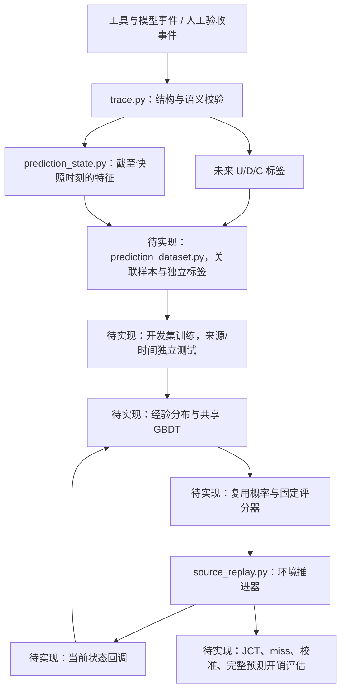

# 项目架构

项目分为事件与样本、预测模型、缓存验证三层。当前 D1 仅验证人工事件契约；TraceLab 是单独的工具等待代理，不能进入主任务训练。主任务真实 U/D/C 样本数为 0，必须先建设可观测真实 lookup 与兼容前缀身份的采集链。

## 数据流

未来结果只可进入标签和离线评分。环境可以持有后续请求来推进回放，但未来请求、工具实际总耗时、未来命中等不能交给在线预测器。

## 已有代码

| 模块 | 输入、输出与边界 |
|---|---|
| `cachewise.py` | 校验固定公开来源哈希，核对 raw/parsed 工具关联，保留全量并导出工具日志跨度代理、质量标记和分组清单；不生成精确 KV 标签。 |
| `tracelab.py` | 校验固定 TraceLab release，连接共享项目/session 的匿名用户后切分；分离输入、未来标签和质量文件，按固定 elapsed 点流式生成剩余工具日志跨度样本。单独核验哈希、对齐、特征白名单和切分隔离；不生成精确 KV 标签。 |
| `trace.py` | 输入 JSONL 事件，校验时间、请求阶段、兼容前缀和结局引用，导出从空闲开始计时的 episode 标签；不能证明采集器没有漏事件。 |
| `prediction_state.py` | 输入事件前缀和快照时间，输出关联 ID 与 `features` 白名单；模型只能接收 `features`。无归属信息保持未知，队列长度需服务事件完整性保证。 |
| `contract_fixtures.py` | 展开 JSON 人工样例，按手写预期比对标签或拒绝原因；只服务验收，不生成真实训练数据。 |
| `cache.py` | 管理兼容前缀块、active/pin owner、保护期限、容量和 LRU 淘汰；共享容量按物理并集核算。 |
| `source_replay.py` | 单服务器 FCFS，按依赖和工具延迟推进工作流；缓存策略改变服务完成、后继 ready 和排队时间。支持固定基线及明确标记的离线脚本；还没有预测回调。 |
| `source_cases.py`、`bfcl_runtime.py` | 组合已有来源任务并在本地 BFCL 模拟器执行参考工具调用；不是自主 Agent 或真实慢工具采集器。 |
| `source_cost.py` | 用开发测量拟合回放服务时间；与预测“下一次复用时间”的模型是两回事。 |
| `kv_layout.py`、`native.py`、`measurement_clock.py` | 原生 KV 布局镜像、GPU 接口和测量时钟；保留用于后续原生验证，D1 无需加载 GPU。 |

## 文件放置规则

| 目录 | 放什么 |
|---|---|
| `src/leasepath/` | 可导入的业务和实验模块；不把命令行脚本当作核心库。 |
| `scripts/` | 薄命令行入口；当前有 9 个有明确用途的入口。 |
| `tests/` | 当前模块的自动化测试；旧阶段实验测试已移出。 |
| `data/fixtures/` | 人工验收输入和预期。合成数据不能冒充真实训练样本。 |
| `data/sources/` | 固定来源、许可状态、来源哈希和现有本地模拟器；不混入运行结果。`cachewise/upstream/` 原样保留，派生结果放到 `results/prediction/cachewise_audit/`。 |
| `data/processed/tracelab/v0.0.2/` | 隔离保存的辅助工具等待代理。真实 KV U/D/C 字段不可用；禁止进入主任务训练和缓存收益评估。 |
| `schemas/` | 事件格式和后续样本格式的结构定义。 |
| `results/prediction/` | 当前可再生实验结果、分离标签、快照、图表和哈希清单。 |
| `reports/` | 预测计划、相关调研与验收报告，不再放旧阶段报告。 |
| `docs/` | 数据契约、架构及项目维护说明。 |
| `models/` | 已下载的推理模型资源；未来复用预测器应明确单独命名。 |
| `patches/`、`.artifacts/` | 原生 bridge 源码与后端补丁，以及本地 llama.cpp 源码、构建和动态库。 |

尚未有预测配置，因此不保留空 `configs/`；后续需要时新增 `configs/prediction/`。不要在预测实验中恢复旧 `configs/w1/` 的阶段入口。

TraceLab 的独立辅助通路是：固定来源压缩包 → 来源哈希核验 → 用户/共享项目/session 连通组切分 → 分离的工具等待代理文件。它与上图真实 lookup 的 U/D/C 主任务通路分开。`prepare_tracelab.py` 不是 D2–D3 或模型验收。

## 后续扩展位置

主任务采集链必须先满足以下条件，才能进入模型训练：

| 采集位置 | 必须记录的事实 |
|---|---|
| Agent/上下文管理器 | owner、context version、idle episode、实际进入空闲时间、显式 retire。工具结束、会话最后一行不能代替 retire。 |
| 请求提交与缓存查找入口 | ready/enqueue/dispatch/lookup 的真实时间与 request ID；实际请求 token 序列、固定 tokenizer/chat template/模型与适配器等兼容配置，以核查当前请求是否含 idle 的合法前缀。前缀长度相同不能证明身份相同。 |
| 观测器 | 同一单调时钟、不中断的观测范围、明确 observation end。观测中断不能悄悄当成持续观测。 |
| 缓存与调度环境 | 当前 episode 到实际 KV 块的关联、共享/active/pin、容量与淘汰、实测 cached/executed prefill token、策略动作、请求完成时间及预测开销。主标签 U 与物理 hit/miss 分开记录。 |

最小验收应能从每条标签追到原事件：U 引用同一时刻的真实 lookup 并验证兼容前缀（miss 也算需求）；D 引用明确 retire；C 引用完整观测结束。至少逐条展示各结局的真实证据，不能为凑齐 U/D/C 人工插入事件。若 pilot 没有某类结局，报告覆盖缺失并继续采集。

前缀到物理块的关联在模型外维护。模型接收当前可见状态并返回该 episode 的时间分布，调度器再按 episode 找到实际候选块，处理共享容量与活动保护；不用让模型预测前缀身份。

策略收益验证需要让请求、真实工具依赖和服务队列随环境推进。更换缓存策略会影响服务和后续 lookup 时间，不能把一次采集的固定 lookup 时间无条件套给另一策略。固定外部工作负载、模型与容量等对照条件，分别运行策略，并记录各自真实 lookup、miss 与 JCT。现有原生 bridge 和 CPU 回放只能复用部分基础设施，尚未实现这条采集与预测回调闭环。

- `src/leasepath/prediction_dataset.py`：真实事件到快照，转换快照剩余时间标签、记录缺失、按完整来源分组切分。
- `src/leasepath/reuse_predictor.py`：统一 `predict(features, horizons)`，实现经验基线与共享 GBDT。
- `scripts/train_reuse_predictor.py`、`scripts/evaluate_reuse_prediction.py`：训练冻结、校准、独立测试；文件目前不存在。
- `source_replay.py` 的 observer/policy callback：只暴露当前状态，接入固定评分器；目前不存在。

## 可选后端资源

`native.py` 仍使用 `.artifacts/d6-native/liblp_native.so` 和 `models/Qwen2.5-3B-Instruct/Qwen2.5-3B-Instruct-f16.gguf`。其中 `d6-native` 是保留下来的二进制目录名，不表示新计划的 D6 已完成。没有为整理目录移动 llama.cpp 源码/构建，否则旧构建中的绝对路径会失效。

`scripts/build_native.py` 使用 `patches/native_bridge.cpp` 链接现有 `.artifacts/llama-build/bin`。它只编译 bridge，不从零安装 CUDA 或构建 llama.cpp。两个 `llama-*.patch` 保留后端修改依据；旧后端从零准备流程在项目外归档，尚未迁移为新的安装入口。
