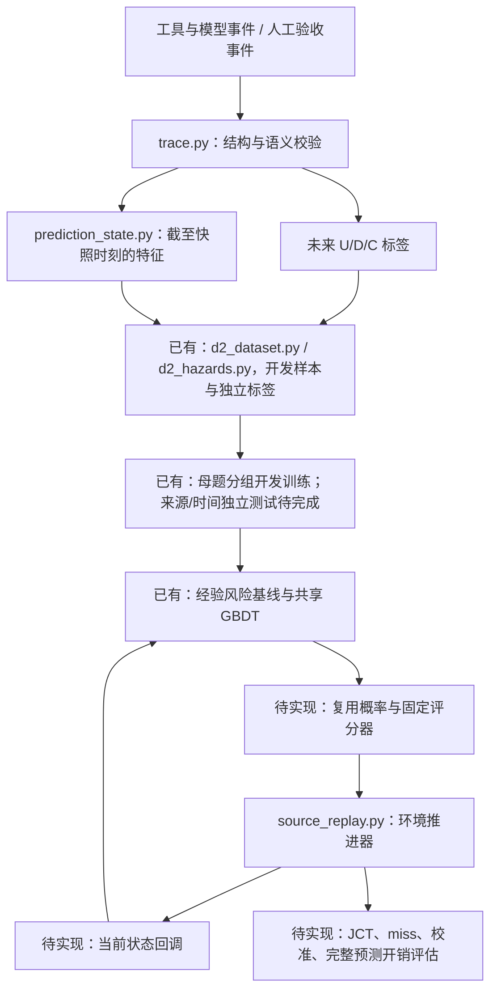

# 项目架构

项目分为事件与样本、预测模型、缓存验证三层。D1 验证人工事件契约；D2 已接入 mini-swe-agent、Qwen2.5-Coder-7B-Instruct 和 vLLM-Ascend，提供真实 lookup、固定兼容前缀、U/D 标签与快照，C 另由受控真实推理检查覆盖。首轮 issue 执行质量不足；后续 [MBPP 派生执行轮](d2_mbpp_round.md) 增加独立测试、执行质量筛选和风险区间导出，同时保留失败。运行与范围见 [D2 部署](d2_first_round.md)、[首轮报告](../reports/d2_first_round_acceptance.md) 和 [本轮报告](../reports/d2_mbpp_round_acceptance.md)。TraceLab 是单独的工具等待代理，不能进入主任务训练。

当前跨轮的数据规模、文件结构、特征版本及母题分组统一见 [数据集说明](dataset_card.md)。[训练 v2](../reports/prediction_v2_50parents_review.md) 已按冻结清单合并四轮最小输入，进行 50 母题固定分组的经验基线/GBDT 对照及独立核验；增强字段暂用于分层，原轮数据和旧模型保持原版本。

## 数据流

未来结果只可进入标签和离线评分。环境可以持有后续请求来推进回放，但未来请求、工具实际总耗时、未来命中等不能交给在线预测器。

## 已有代码

| 模块 | 输入、输出与边界 |
|---|---|
| `cachewise.py` | 校验固定公开来源哈希，核对 raw/parsed 工具关联，保留全量并导出工具日志跨度代理、质量标记和分组清单；不生成精确 KV 标签。 |
| `tracelab.py` | 校验固定 TraceLab release，连接共享项目/session 的匿名用户后切分；分离输入、未来标签和质量文件，按固定 elapsed 点流式生成剩余工具日志跨度样本。单独核验哈希、对齐、特征白名单和切分隔离；不生成精确 KV 标签。 |
| `trace.py` | 输入 JSONL 事件，校验时间、请求阶段、兼容前缀和结局引用，导出从空闲开始计时的 episode 标签；不能证明采集器没有漏事件。 |
| `prediction_state.py` | 输入事件前缀和快照时间，输出关联 ID 与 `features` 白名单；模型只能接收 `features`。无归属信息保持未知，队列长度需服务事件完整性保证。 |
| `d2_raw.py`、`d2_probe.py` | 可选 vLLM general plugin；记录同主机单调时钟、进程序号、实际 tokens、lookup、调度 prefill 与请求释放时块快照；不改变缓存决策。 |
| `d2_dataset.py` | 审计实测事件与运行配置，导出事件、episode 标签、最小白名单快照和独立 targets；拒绝证据缺失，不补造 C。 |
| `d2_expansion.py` | 在明确 episode 工具关联下，只投影快照前已知命令、规模和已完成工具历史；单独 `expansion-v1` 文件，不改变现有预测器白名单。 |
| `d2_repair.py`、`d2_repair_guidance.py`、`d2_repair_audit.py` | 受控修复协议、编辑/测试命令分离、显式失败引用与源码修改审计；只投影已观测的尝试、失败和重测状态，保存独立 `repair-v2`。 |
| `d2_hazards.py` | 从快照和离线 targets 导出 U/D/waiting 风险区间；屏蔽真实删失的未知部分，行政截断视图单独保存。 |
| `reuse_predictor.py`、`gbdt_predictor.py` | 全局/条件经验风险及共享多分类 GBDT，输出区间 hazard 和累计概率，保存为 JSON；推理只接收特征白名单。 |
| `prediction_training.py` | 后端证据完整的开发数据校验、workflow 权重、按母题分组和可观测结局评分；未知删失窗口不当负例。 |
| `prediction_merged.py` | 按固定 inventory 校验四轮输入/分组/时间起点，合并 workflow 权重快照；评测元数据与模型特征隔离，缺失历史保持 unknown。 |
| `contract_fixtures.py` | 展开 JSON 人工样例，按手写预期比对标签或拒绝原因；只服务验收，不生成真实训练数据。 |
| `cache.py` | 管理兼容前缀块、active/pin owner、保护期限、容量和 LRU 淘汰；共享容量按物理并集核算。 |
| `source_replay.py` | 单服务器 FCFS，按依赖和工具延迟推进工作流；缓存策略改变服务完成、后继 ready 和排队时间。支持固定基线及明确标记的离线脚本；还没有预测回调。 |
| `source_cases.py`、`bfcl_runtime.py` | 组合已有来源任务并在本地 BFCL 模拟器执行参考工具调用；不是自主 Agent 或真实慢工具采集器。 |
| `source_cost.py` | 用开发测量拟合回放服务时间；与预测“下一次复用时间”的模型是两回事。 |
| `kv_layout.py`、`native.py`、`measurement_clock.py` | 原生 KV 布局镜像、GPU 接口和测量时钟；保留用于后续原生验证，D1 无需加载 GPU。 |

## 文件放置规则

| 目录 | 放什么 |
|---|---|
| `src/leasepath/` | 可导入的业务和实验模块；不把命令行脚本当作核心库。 |
| `scripts/` | 命令行入口，包含契约验收、公开来源审计及 D2 部署、采集、评测与导出。 |
| `tests/` | 当前模块的自动化测试；旧阶段实验测试已移出。 |
| `data/fixtures/` | 人工验收输入和预期。合成数据不能冒充真实训练样本。 |
| `data/sources/` | 固定来源、许可状态、来源哈希和现有本地模拟器；不混入运行结果。`cachewise/upstream/` 原样保留，派生结果放到 `results/prediction/cachewise_audit/`。 |
| `data/processed/tracelab/v0.0.2/` | 隔离保存的辅助工具等待代理。真实 KV U/D/C 字段不可用；禁止进入主任务训练和缓存收益评估。 |
| `schemas/` | 事件格式和后续样本格式的结构定义。 |
| `results/prediction/` | 当前可再生实验结果、分离标签、快照、图表和哈希清单。 |
| `reports/` | 预测计划、相关调研与验收报告，不再放旧阶段报告。 |
| `docs/` | 数据契约、架构及项目维护说明。 |
| `models/` | 已下载的推理模型资源；未来复用预测器应明确单独命名。 |
| `patches/`、`.artifacts/` | 原生 bridge 源码与后端补丁，以及本地 llama.cpp 源码、构建和动态库。 |

`configs/prediction/d2_first_round.json` 保存首轮采集配置，`configs/prediction/d2_mbpp_round.json` 保存 MBPP 派生任务、最终贪心/采样对照和质量条件；`configs/prediction/empirical_risk_baseline.json` 保存第一部分经验基线配置。`configs/prediction/gbdt_review_2.json` 保存第二部分固定 GBDT 与分组配置。不要在预测实验中恢复旧 `configs/w1/` 的阶段入口。

TraceLab 的独立辅助通路是：固定来源压缩包 → 来源哈希核验 → 用户/共享项目/session 连通组切分 → 分离的工具等待代理文件。它与上图真实 lookup 的 U/D/C 主任务通路分开。`prepare_tracelab.py` 不是 D2–D3 或模型验收。

最新 [D2 扩展 v1](d2_expansion_v1.md) 使用 `configs/prediction/d2_expansion_v1.json`，新增六类文件处理母题和实际秒级测试。原最小快照旁保存增强特征文件；真实标签、质量过滤和状态覆盖分别报告。该轮未重新训练，完整集为 6 条执行，5 条通过冻结质量条件。

随后 [修复扩展 v2](d2_repair_v2.md) 使用 `configs/prediction/d2_repair_v2.json`，复用其中三个母题的两档工作量，补上 3–10 秒和失败后重测。6 条主执行后端可审计，4 条通过独立测试；原诊断循环单独保留。`workflow-groups.json` 将两个规模与 v1 原母题同组；采集阶段未训练，后续由训练 v2 入口导入这一分组映射。

[母题扩展 v3](d2_diversity_v3.md) 使用 `configs/prediction/d2_diversity_v3.json`，新增 34 个 MBPP 任务定义，每题一次真实 Agent 执行。`prepare_d2_diversity.py` 固定输入域及独立期望值，`check_d2_diversity_tasks.py` 验证参考实现与空函数负对照；采集、独立复测和快照前缀重建分别由 run/finalize/verify 脚本完成。数据保存于 `.artifacts/d2-diversity-v3/`，使用原九字段及 `expansion-v1` sidecar。跨轮清点由 `inventory_d2_datasets.py` 按记录身份、哈希和母题去重，输出逻辑清单。最终数量与质量边界见 [统一说明](dataset_card.md) 和 [v3 Review](../reports/d2_diversity_v3_review.md)。

`configs/prediction/prediction_v2_50parents.json` 固定合并输入哈希、50 母题分组规则及旧模型参数。`train_prediction_v2.py` 在训练前冻结来源/配置/划分，分别产生主集和质量子集的 5 折 OOF、分层指标及全量重拟合模型；`verify_prediction_v2.py` 重建训练折风险计数、加载折内模型并复现预测与评分。最终时长/质量只进入 `evaluation-metadata-only.jsonl`，不作为学习特征。详细输出和支持范围见 [训练 v2 Review](../reports/prediction_v2_50parents_review.md)。

## 后续扩展位置

主任务采集链必须先满足以下条件，才能进入模型训练：

| 采集位置 | 必须记录的事实 |
|---|---|
| Agent/上下文管理器 | owner、context version、idle episode、实际进入空闲时间、显式 retire。工具结束、会话最后一行不能代替 retire。 |
| 请求提交与缓存查找入口 | ready/enqueue/dispatch/lookup 的真实时间与 request ID；实际请求 token 序列、固定 tokenizer/chat template/模型与适配器等兼容配置，以核查当前请求是否含 idle 的合法前缀。前缀长度相同不能证明身份相同。 |
| 观测器 | 同一单调时钟、不中断的观测范围、明确 observation end。观测中断不能悄悄当成持续观测。 |
| 缓存与调度环境 | 当前 episode 到实际 KV 块的关联、共享/active/pin、容量与淘汰、实测 cached/executed prefill token、策略动作、请求完成时间及预测开销。主标签 U 与物理 hit/miss 分开记录。 |

最小验收应能从每条标签追到原事件：U 引用同一时刻的真实 lookup 并验证兼容前缀（miss 也算需求）；D 引用明确 retire；C 引用完整观测结束。至少逐条展示各结局的真实证据，不能为凑齐 U/D/C 人工插入事件。若 pilot 没有某类结局，报告覆盖缺失并继续采集。

前缀到物理块的关联在模型外维护。模型接收当前可见状态并返回该 episode 的时间分布，调度器再按 episode 找到实际候选块，处理共享容量与活动保护；不用让模型预测前缀身份。

策略收益验证需要让请求、真实工具依赖和服务队列随环境推进。更换缓存策略会影响服务和后续 lookup 时间，不能把一次采集的固定 lookup 时间无条件套给另一策略。固定外部工作负载、模型与容量等对照条件，分别运行策略，并记录各自真实 lookup、miss 与 JCT。现有原生 bridge 和 CPU 回放只能复用部分基础设施，尚未实现这条采集与预测回调闭环。

- `src/leasepath/d2_dataset.py` 已提供真实事件到最小快照及剩余时间标签；`d2_hazards.py` 导出离线风险区间和独立的行政删失视图。MBPP 轮同时保存完整执行与合格子集，全部标记 pilot development；按同一题目聚合各配置，不能按快照随机切分。扩大特征和按多个独立来源建立训练/验证/测试切分仍待实现。
- `reuse_predictor.py` 与 `gbdt_predictor.py` 已提供 `predict(features, horizons)`；固定共享树与基线的开发对照见 [第二部分](../reports/gbdt_review_2.md)。
- `scripts/train_reuse_predictor.py` 保留旧十题协议，`train_prediction_v2.py` 已实现四轮合并开发训练，`verify_prediction_v2.py` 复播保存的折内模型与评分。评测后校准及独立来源测试仍待实现。
- `source_replay.py` 的 observer/policy callback：只暴露当前状态，接入固定评分器；目前不存在。

## 可选后端资源

2026-11-08 新服务器进展：`predictive_cache.py` 已提供独立因果淘汰控制器，`replay_qwen_cache_policy.py` 将冻结条件经验／GBDT 接入相同压力淘汰规则，按 active 保护、共享 owner 和前缀祖先闭包管理元数据。它未改写旧 `source_replay.py`，也尚未接到当前 32B 真机；固定服务时间的压力回放不产生 JCT 收益证据。当前 32B `qwen_data_cuda.cpp` 仍为单序列，下一步多 owner 实际 KV enactment 与端到端验收见 [新服务器缓存阶段报告](../reports/qwen_cache_stage1_2026-11-08.md)。

`native.py` 仍使用 `.artifacts/d6-native/liblp_native.so` 和 `models/Qwen2.5-3B-Instruct/Qwen2.5-3B-Instruct-f16.gguf`。其中 `d6-native` 是保留下来的二进制目录名，不表示新计划的 D6 已完成。没有为整理目录移动 llama.cpp 源码/构建，否则旧构建中的绝对路径会失效。

`scripts/build_native.py` 使用 `patches/native_bridge.cpp` 链接现有 `.artifacts/llama-build/bin`。它只编译 bridge，不从零安装 CUDA 或构建 llama.cpp。两个 `llama-*.patch` 保留后端修改依据；旧后端从零准备流程在项目外归档，尚未迁移为新的安装入口。
