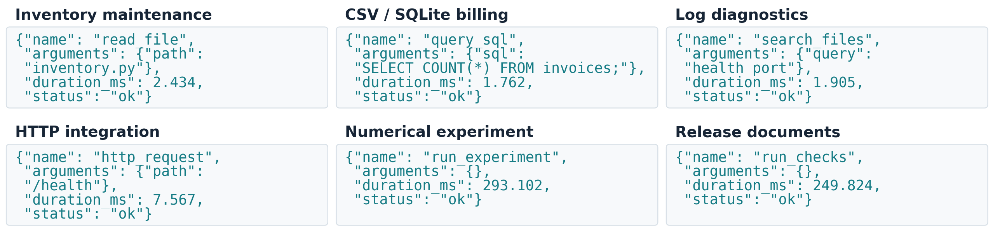

# LeasePath 当前持续 Agent 数据：结构与真实示例

本说明对应论文采用的 `continuous_pilot_v7_2026-11-11` 合格开发采集。包含6个项目、每项目8个用户轮次，共48轮、244次模型请求、196次工具调用、9种工具、1079个预测快照。不是旧50题数据，也不是自然用户日志：需求、初始材料与用户返回计划由实验构造，模型和工具真实执行。快照属于234个观察到的episode，不能当成1079个独立任务；238个完整续接间隔又是另一计数单位。

## 数据以什么形式保存

| 层次 | 实际文件 | 核心字段与用途 |
|---|---|---|
| 会话与模型交互事件 | `raw/raw/controller.jsonl` | 每行一个事件，外层`kind / ts_ns / data`；记录用户到达、request_input、工具提交及反馈、交付与上下文退休。完整request_input保存prompt、token_ids和prompt_sha256；compact导出省略prompt和token_ids。 |
| 原生模型与KV请求 | `raw/raw/backend.jsonl` | engine_request保存owner、request_id、tokens、output_tokens、lookup_ns、release_ns、hit、prefill及prefill_ns/decode_ns，另有策略审计。可核对输入token=hit+prefill。 |
| 工具调用 | `raw/tools/<owner>/calls.jsonl` | 每行一次真实调用：call_id、name、arguments、round、started_ns、ended_ns、status、result、result_sha256。不仅有工具名和耗时，还保留参数与真实反馈。 |
| 预测训练快照 | `audit/prediction-snapshots.json` | episode_id / snapshot_id连接样本；features含工具名、等待阶段、已等时间、prefix_tokens、queue_length等；event / remaining_s是事后标签。 |
| 质量与轮次结果 | `raw/rounds/<owner>-<round>.json` | success、acceptance、final、generations、tool_calls、response_s及产物哈希，可核对每轮是否交付。 |
| 分析导出 | `requests.csv / tools.csv / intervals.csv / rounds.csv / projects.csv` | 从原始记录导出逐请求、逐工具、逐间隔、逐轮与逐项目统计，便于绘图。 |

上表除分析导出外均相对于该次采集目录。原始JSONL是事件日志；不是把每个工具调用当成一道题。工具文件按owner分组，通过owner、原始round和时间顺序与controller事件对齐，不能假设所有事件都有call_id。模型请求用owner/request_id/prompt_sha256等字段连接；snapshot用episode_id关联其起始请求。

## 六条可直接展示的真实工具记录

以下固定选择每个项目中指定工具的第一次调用，均来自第1轮，覆盖9种工具中的6种；未按时长排序或挑选长工具。



展示保留原始name、arguments与status，新增duration_ms=(ended_ns-started_ns)/1e6，四舍五入到0.001毫秒。结果、ID、轮次、原始纳秒时间戳和结果哈希为节省版面省略；完整原记录见[选定记录JSON](leasepath_isca_v3_assets/examples/selected_tool_records.json)。这里duration_ms只计算实际工具执行，不含模型排队、控制器消费延迟或用户等待；它不等于预测目标“下一次兼容KV需求的剩余时间”。

## 一轮任务如何连起来

真实库存项目第一轮要求修复available(stock, sku)对不存在SKU的处理。Agent的实际工具序列为：list_files → read_file → write_file → run_checks；随后最终交付，通过独立验收。这一轮共5次模型调用、4次工具调用。

| 模型调用 | 输入tokens | 与前次输入兼容的tokens | 实际hit | 实际prefill |
|---|---:|---:|---:|---:|
| 1 | 821 | 0 | 0 | 821 |
| 2 | 877 | 768 | 768 | 109 |
| 3 | 968 | 768 | 768 | 200 |
| 4 | 1164 | 896 | 896 | 268 |
| 5 | 1243 | 1152 | 1152 | 91 |

“与前次输入兼容”指先前完整输入的块对齐可复用机会；实际hit还取决于当时缓存状态及其他共享前缀，因此两列定义不同。原始round从0开始，展示中的用户轮次从1开始。

对应第一个idle episode的一条原始快照如下。features是当时可见状态；event、remaining_s、terminal_s属于后续观测标签，训练时不能反向当作输入。

```json
{
  "owner": "continuous_inventory",
  "features": {
    "elapsed_idle_s": 0.04314054292626679,
    "compatibility_id": "4a1d131e0f522268f7ac4a2a35b35de14742990b83bb2b9cb825aee2cdac9e5d",
    "prefix_tokens": 768,
    "tool_name": "list_files",
    "tool_elapsed_s": 0.014310978818684816,
    "phase": "waiting_tool",
    "retry_count": 0,
    "is_queued": false,
    "queue_length": 5
  },
  "event": "U",
  "remaining_s": 10.299293315038085,
  "weight": 0.2
}
```

[完整关联示例JSON](leasepath_isca_v3_assets/examples/inventory_turn1_linked_example.json)包含该轮全部5次请求、4次原始工具记录、1条快照及最终验收结果。[来源哈希与选择规则](leasepath_isca_v3_assets/examples/source_manifest.json)记录取样和转换过程。另提供[简化工具JSONL](leasepath_isca_v3_assets/examples/tool_invocations_display.jsonl)，可与CATraces展示形式直接对照。

此例snapshot的waiting_tool是控制器观察阶段，不能据此认定工具在该时刻仍物理运行：本原型在模型调用之间消费工具通知。当前工具大多很短，队列和控制器延迟更长；示例展示真实覆盖，不增加新实验或扩大覆盖声明。
