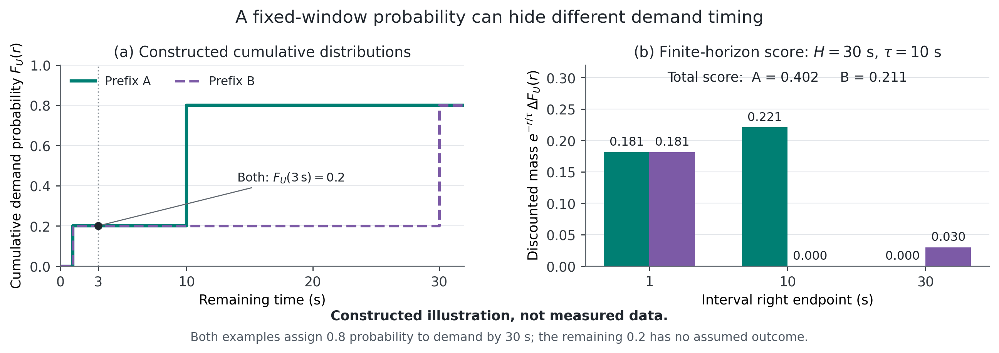

**Draft status.** This manuscript develops the November 10 outline into a complete first draft. Performance claims refer exclusively to the completed development experiments described below. The independent evaluation and pressure matrix are not reported as completed. The PDF uses a reading layout, not an official conference template. Local evidence is indexed in Appendix G; the companion Chinese revision notes identify remaining work.

# Abstract

c

# 1 Introduction

An LLM agent often pauses model execution to run a tool, inspect its result, and continue generation with an extended conversation. The KV state of the preceding context can save substantial prefill work when that conversation resumes. During the pause, however, the state occupies capacity that other sessions could use. Retaining every idle prefix is infeasible under pressure, while immediately discarding it can turn a later continuation into redundant computation. The useful question is therefore whether an idle prefix will be needed again, when that demand will occur, and which physically feasible retention choice is worth its capacity.

Recency captures when a prefix was last used, but it does not directly describe progress through external computation. A tool that has been running for several seconds may be close to completion or may still have a long remaining duration. Workflow step distance also need not correspond to elapsed time: one step can be a short lookup or a long numerical computation. Even when the next-use time can be estimated, a single scalar need not preserve all information relevant to retention. Two prefixes can have the same probability of demand within a short window yet assign the remaining demand probability to very different times.

Prior work already uses tool durations, elapsed-time conditioning, empirical distributions, workflow structure, and termination probabilities to manage agent KV caches. In particular, CacheWise estimates remaining tool time, Continuum selects time-to-live values from distributions, and PBKV uses discounted probabilistic lookahead over future invocations. LeasePath does not claim these ideas individually. We investigate a more specific connection: a distribution over **wall-clock time to the next legal prefix demand**, evaluated at a causal decision snapshot, can be mapped to a retention score and applied to the currently feasible physical eviction actions. The resulting hypothesis is testable with a fixed predictor: preserving timing information across a common horizon may change which useful prefixes survive compared with evaluating the same distribution at one time threshold.

Three issues make that hypothesis nontrivial. First, the prediction target must correspond to demand. Tool completion, request readiness, and cache lookup are separate events. A lookup that misses still establishes demand, while an observation window ending does not establish that reuse will never occur. Second, scores act on a constrained cache. Active references cannot be evicted, a retained descendant requires its prefix, and several owners can share one physical block. Third, avoided prefill is only one component of completion time. Tool variation, queueing, generation differences, and controller overhead can offset a cache improvement.

LeasePath addresses these issues through a demand-based event definition, a finite-horizon discounted score, and a controller that repeatedly chooses legal leaves of the resident prefix structure. The score integrates unconditional demand probability mass; it neither conditions on eventual reuse nor reallocates unresolved tail mass into the supported window. The main configuration gives all candidates the same recomputation-cost multiplier, allowing the distribution-to-decision mapping to be examined separately from an estimated cost model.

The present evidence is deliberately limited to a completed prototype and development experiments. On three known tasks, equal-cost distribution scoring improves observed reuse, aggregate prefill time, and mean submission-to-validated-answer time relative to two internal baselines. The results also expose two limitations: a more complex predictor is less accurate than conditional empirical estimation on the current data, and adding a separately calibrated marginal-cost multiplier worsens the observed result. These findings make predictor choice, score choice, and end-to-end benefit distinct empirical questions.

This draft makes three contributions within that scope:

1. A prediction and measurement formulation that separates the first legal KV demand, explicit retirement of an owner–context relationship, and observation censoring, while keeping physical hit outcomes out of demand labels.
2. An implemented mapping from finite-horizon demand distributions to legal, pressure-triggered KV eviction, with explicit treatment of prefix dependencies, shared ownership, support failure, and deterministic tie-breaking.
3. An audited preliminary evaluation that measures actual prefill and validated-answer completion time, alongside predictor comparisons and a negative result for the cost extension.

These contributions establish an implementation and an initial empirical case. They do not establish superiority to CacheWise or Continuum, broad generalization, or optimal cache control.

# 2 Background and Related Work

## 2.1 Agent execution and prefix reuse

During prefill, a transformer constructs KV state for input tokens; during decoding, it extends the state as it generates output. A compatible cached token prefix can reduce the input portion that must be processed again. Compatibility depends on the actual tokens and the model, tokenizer, position treatment, and KV configuration. Similar text or a shared task identifier is insufficient.

When a model call finishes, its context may become idle while an external tool runs. A subsequent request typically appends tool feedback and protocol text. The tool can finish before the client constructs this request, and a ready request can wait before the backend performs its lookup. For a simple serial dependency, the remaining time to lookup can be decomposed as

$$
R_{\mathrm{lookup}}=R_{\mathrm{tool}}+D_{\mathrm{client}}
 +W_{\mathrm{queue}}+D_{\mathrm{dispatch\to lookup}}.
$$

For parallel tools or branches, dependency completion replaces the single-tool term. This decomposition explains why tool duration is an imperfect label for cache demand; it does not imply that all components are observable to the current predictor. Our frozen predictor has no measured queue-state feature.

Our prototype runs concurrent agent sessions and tools, while serving model requests serially in first-come, first-served (FCFS) order. Changing retention can change service time, subsequent tool launches, and later arrivals. Consequently, replaying a fixed baseline lookup timeline is useful for diagnosing decisions but cannot reproduce another policy's natural completion time.

## 2.2 Time-aware KV management

InferCept estimates interception duration to choose among preservation, recomputation, and swapping (Abhyankar et al., 2024). Continuum uses empirical tool-duration distributions to choose KV time-to-live values, incorporating prefill or reload costs and queueing effects, and combines retention with program-level scheduling (Li et al., 2025, version 7). CacheWise clusters tool arguments using TF-IDF and KMeans, conditions historical duration distributions on elapsed waiting time, and ranks candidates using estimated next-use time (Tiwari et al., 2026).

These systems establish direct precedents for using distributions, tool metadata, and elapsed time. Our controlled question concerns the decision functional applied to a common prediction: a fixed-window demand probability versus discounted mass across a finite horizon, under the same prefix constraints. The fixed-window baseline in this draft is $F_U(3\,\mathrm{s})$. It is a cumulative probability, not a point estimate of return time and not an implementation of CacheWise. Complete-system comparisons must additionally account for scheduling, prediction features, and available storage tiers.

## 2.3 Workflow structure, lifecycle, and sharing

KVFlow uses an Agent Step Graph and steps-to-execution to prioritize shared prefix nodes (Pan et al., 2025). Its dependencies include both all-predecessor and alternative-predecessor conditions, and its full system includes prefetching and scheduling. PBKV predicts future agent invocations from workflow history, graph structure, and prefill representations (Zheng et al., 2026). Its multistep score already combines termination probabilities, survival across steps, confidence discounting, and aggregation across workflows. LeasePath therefore does not present probabilistic lookahead, termination-aware scoring, or discounting as new in themselves. Its target is a first compatible demand in wall-clock time, and its implementation evaluates that target through legal prefix eviction.

Lifecycle information is also an important baseline. KVTether maps message lifecycle information to KV states, reclaims dead state first, and applies MRU among live-but-idle entries to exploit delayed reuse (Fu et al., 2026). PBKV likewise prioritizes entries whose associated workflows have terminated. Any claimed gain from distribution information must be separated from reclaiming already retired state. We therefore use retired-first LRU as an internal comparator; this does not reproduce the full KVTether policy.

## 2.4 Learned prediction and competing risks

Prediction-guided caching has a broader history, including Learning Relaxed Belady for content distribution networks (Song et al., 2020). Competing-risk time-to-event modeling is also established; DeepHit learns time distributions for multiple competing outcomes (Lee et al., 2018). LeasePath uses standard discrete-time competing-risk semantics, instantiated with empirical estimators and a shared boosted-tree hazard model. The intended contribution is the link between demand semantics, feasible KV actions, and measured execution benefit. Neither a tree-based predictor nor competing-risk modeling alone constitutes that contribution. The LRB bibliographic entry still requires an independent source recheck, as noted in Appendix G.

# 3 Problem Formulation

## 3.1 The next legal demand

A prediction object is an idle relationship between an owner–context version and a compatible token prefix. At decision time $t$, its causal history is $\mathcal H_t$. The first subsequent outcome is represented by $(R,J)$, where $R>0$ is the remaining time and $J\in\{U,D\}$ is the event type. A relationship can also remain unresolved throughout the observation window.

**Demand ($U$).** The first compatible backend lookup whose request begins with the relationship's prefix. Both a physical hit and a physical miss establish demand. Evicting the cached state therefore does not turn a future positive label into a negative one.

**Retirement ($D$).** An explicit event terminating this owner–context relationship. Tool completion, cache eviction, or retirement of another owner is insufficient. A shared physical block can remain useful to its other owners after one relationship ends.

**Censoring ($C$).** Observation ends while the relationship remains open and before an observed $U$ or $D$. Censoring limits what is known about the future; it is not a third competing event. Missing logs likewise cannot be converted into retirement.

If events share a timestamp, recorded event order determines the first outcome, including its ordering relative to observation end. Conditioned on the relationship being open at $t$, define the cumulative incidence functions

$$
F_j(r\mid\mathcal H_t)=\Pr(R\le r,J=j\mid\mathcal H_t),
\qquad j\in\{U,D\},
$$
$$
S(r\mid\mathcal H_t)=1-F_U(r\mid\mathcal H_t)-F_D(r\mid\mathcal H_t).
$$

Unlike a return-time distribution conditioned on eventual reuse, $F_U$ can have total mass below one. This distinction matters: a prefix with a small chance of an early demand need not be preferable to one with a large chance of a somewhat later demand. The current dataset contains no natural censoring, so correct censoring semantics are an implementation property rather than an empirically established robustness result.

## 3.2 Feasible retention and physical occupancy

Let $b$ denote a resident prefix block, $B_b$ its payload bytes, and $\mathcal O_b$ its current live owner bindings. Shared blocks count once toward physical occupancy. Feasible eviction must preserve active references, the currently admitted request's required prefix, prefix continuity, and consistent shared references. In the resident prefix structure, removing an unprotected leaf preserves ancestor availability for all remaining descendants. Removing an internal block while retaining its dependent descendants would not.

The candidate set changes after each logical removal. A parent can become a leaf, and the continuously reachable prefix of an owner can shorten. A single initial ranking is therefore insufficient to describe the implemented procedure. A request that is ready but not currently being admitted does not acquire additional hard protection merely from being ready.

## 3.3 Evaluation objective

The external objective is shorter validated-answer completion time under fixed resource and quality constraints. For the completed experiment, the measured endpoint is precisely

$$
\mathrm{JCT}_i=t_i^{\mathrm{validated\ answer}}-t_i^{\mathrm{submission}}.
$$

All three tasks in a batch share a submission timestamp taken before per-task preparation. Thus the endpoint includes preparation, queueing, model execution, tools, controller work, and final validation. Model loading, residency preparation, pre-batch cache clearing, and post-validation retirement and archival work are outside this window. This submission timestamp is distinct from each model request's cache admission time.

LeasePath does not directly optimize expected JCT over future arrivals, tool branches, and outputs. It uses a computable retention proxy and measures whether the resulting actions improve the external endpoint. No global optimality or approximation guarantee for JCT is assumed.

# 4 LeasePath

## 4.1 Predicting remaining-time distributions

Choose interval boundaries $0=r_0<r_1<\cdots<r_K$. For a fixed snapshot, the predictor produces interval-conditional probabilities $h_k^U,h_k^D,h_k^0$ summing to one. Here $h_k^0$ denotes survival through the interval, not censoring. The unconditional masses follow the standard recursion

$$
S_0=1,\qquad p_k^U=S_{k-1}h_k^U,\qquad
p_k^D=S_{k-1}h_k^D,\qquad S_k=S_{k-1}h_k^0,
$$
$$
F_U(r_k)=\sum_{q=1}^{k}p_q^U,\qquad
F_D(r_k)=\sum_{q=1}^{k}p_q^D.
$$

Using $h_k^U$ directly as unconditional mass would overcount outcomes after an earlier event. Because the model already predicts remaining time from the current snapshot, its output is not conditioned a second time by subtracting elapsed time.

We implement global and conditional empirical estimates and a shared LightGBM multiclass hazard model. Conditional empirical estimation groups tool, phase, and elapsed-time bucket, with shrinkage or fallback for small groups. The boosted-tree model receives the same information plus interval index. Task identity, future tool output, future remaining duration, the next request's actual length, and future cache outcomes are excluded. Prefix identity and length are used by cache management and validation; they are not learned features in the frozen model.

For training, completely observed survival intervals receive the waiting label, and the event interval receives $U$ or $D$. A censored partial interval and unobserved later intervals are excluded. With snapshot weights $a_n$ and interval masks $m_{nk}$, the model uses a weighted multiclass loss of the form

$$
\mathcal L=-\sum_{n,k}a_n m_{nk}\log h_k^{y_{nk}}(x_n).
$$

Snapshots from the same parent task remain in one split. Snapshot weights sum to one per parent, with equal episode weights within a parent and equal snapshot weights within an episode. Each observed risk row inherits its snapshot weight; the loss is not additionally normalized by the number of observed intervals. This prevents a parent from dominating merely through snapshot count, while allowing its observed risk duration to affect its total contribution to the interval loss. It does not make snapshots independent or correct informative censoring.

## 4.2 A finite-horizon retention score

For a common supported horizon $H=r_m$ and discount scale $\tau>0$, define

$$
W_i=\sum_{k=1}^{m}\exp(-r_k/\tau)
\left[F_{U,i}(r_k)-F_{U,i}(r_{k-1})\right].
$$

The frozen configuration uses $H=30$ seconds and $\tau=10$ seconds. The exponential is a deterministic preference for earlier demand, not an estimated probability that the cache will survive. Unresolved mass after $H$ remains unresolved; the in-window mass is not renormalized to imply certain reuse. Retirement already competes with demand through the hazard recursion, so multiplying the score again by $1-F_D$ would count that effect twice.

The equal-cost block score is

$$
V_b=\frac{\max_{i\in\mathcal O_b}W_i}{B_b}.
$$

Low-scoring legal leaves are preferred for eviction, after unbound leaves have been considered. Equal cost means that all recomputation-cost multipliers are set to one; it does not assert equal real prefill cost. All blocks in the current experiment have the same size, so the byte denominator does not change their order. The maximum over owners is an aggregation heuristic inherited by the implementation. It is neither the exact probability that any owner will demand the block nor the expected value of multiple future uses.

**Why more than one window can matter.** Consider a constructed example with demand masses at 1, 10, and 30 seconds. Prefix A has masses $(0.2,0.6,0)$, while B has $(0.2,0,0.6)$; the remaining 0.2 is left unresolved. Both have $F_U(3\,\mathrm{s})=0.2$. With $\tau=10$ seconds, however,

$$
W_A=0.2e^{-0.1}+0.6e^{-1}\approx0.402,
\qquad W_B=0.2e^{-0.1}+0.6e^{-3}\approx0.211.
$$

The fixed-window score cannot distinguish them, whereas the discounted score prefers retaining A under equal costs and feasibility. This illustrates an information difference, not a measured benefit or a claim that A always yields lower JCT.

{#fig:distribution-example width=95%}

The score has simple interpretive properties. Right-endpoint discounting lower-bounds the corresponding continuous discounted functional of the same distribution; pointwise dominance of cumulative demand probabilities on the grid preserves the discrete score ordering. Appendix B gives these facts and a conditional perturbation bound. They explain the proxy and do not establish optimal cache decisions.

## 4.3 Pressure-triggered legal eviction

Algorithm 1 describes the main equal-cost policy. The controller fixes one decision time for an admission and memoizes each encountered owner's prediction. It removes one logical leaf at a time, recomputing feasible leaves and live bindings. The completed deletion plan is then submitted to the native backend; the implementation does not invoke a separate native deletion after every logical comparison.

**Algorithm 1: LeasePath admission and eviction.**

```text
Input: compatible request prefix, resident tree, references,
       frozen predictor, admission timestamp t0
1. Validate ancestry, request size, and protected-capacity feasibility.
2. Protect active blocks and the current request's prefix.
3. Initialize an owner memo using fixed t0, and an empty drop plan.
4. fallback <- false
5. While the request cannot fit within the persistent quota:
     Recompute unprotected leaves and reachable owner bindings.
     If unbound leaves exist:
         Choose one by (touched, -depth, key).
     Otherwise:
         Predict newly encountered owners once, using state at t0.
         If any required distribution score is unavailable:
             fallback <- true
         If fallback:
             Choose a leaf by the retired-first LRU ordering.
         Otherwise:
             Choose the minimum (V_b, touched, -depth, key).
     Remove the leaf from the logical tree; append to drop plan.
6. Submit the drop plan to native KV storage; verify mappings/cells.
7. Call native generation, which checks native request bounds.
8. On normal model completion, release its context to idle.
   On abort, clean up unmaterialized suffix and active ownership.
```

Admission fails when protected active state makes the request infeasible; the controller does not violate active-reference constraints to force progress. The fixed timestamp is passed to the logical controller at admission. Native generation bounds are checked when generation is invoked, after the deletion plan has been applied; the prototype does not guarantee that every backend rejection precedes all cache changes. A missing or invalid distribution triggers LRU ordering for the remainder of that admission. Previously selected actions are not retroactively undone. Without capacity pressure, scoring is unnecessary.

The current implementation scans candidates and updates the logical structure repeatedly. Its prediction memo reduces repeated calls within an admission, but it does not provide a heap-based logarithmic eviction algorithm. Scalability depends on the number of owners, candidate leaves, and required removals, and needs measurement beyond the present small setting.

## 4.4 Support and fallback

The distribution score requires the horizon to coincide with an available right endpoint and every interval through $H$ to have at least five training workflows in its global risk support. At the 30-second interval, the frozen training data provide only six workflows. Passing the support gate therefore does not imply a reliable statistical confidence bound.

Unseen tool, phase, or elapsed categories invoke the predictor's training-global fallback; an unsupported compatibility class yields an unsupported distribution. These are different from the controller falling back to LRU because the common window is unavailable. Invalid probability output is recorded as an error, not silently interpreted as zero demand or retirement.

The fixed-window comparator checks support at its three-second output. Its implementation does not impose the distribution policy's additional five-workflow condition across the whole 30-second horizon. These support rules must not be described as identical. No distribution fallback was observed in the completed natural experiment, but comparisons under support failure require separate analysis.

## 4.5 Cost-weighted extension

We also implement a cost multiplier using an independently calibrated prefill table. Let $P_i$ be the currently observed, block-aligned prefix length and $\ell_i$ the continuously resident prefix length. For 128-token blocks, the estimated marginal cost is

$$
\widehat C_{i,b}=\widehat T(P_i+1,\ell_i-128)
 -\widehat T(P_i+1,\ell_i),
\qquad
V_b^{\mathrm{cost}}=\frac{\max_{i\in\mathcal O_b}
 (\widehat C_{i,b}W_i)}{B_b}.
$$

The extra token satisfies the backend's requirement to leave an uncached token in the calibration request; it is not a prediction of the future suffix. The table uses exact supported grid points without interpolation or extrapolation. Missing cost support switches the remaining admission comparisons to equal cost, separately from distribution-to-LRU fallback. Continuous resident length and marginal cost are updated after logical removals.

This extension is an ablation, not part of the main successful configuration. It underperforms equal-cost scoring in the current experiment. A good fit on calibration prompts does not by itself establish a good estimate of the cost of a future request containing new tool output.

## 4.6 Native realization

The adapter executes real KV reference deletion and checks physical token/cell mappings around requests. Shared payload is counted once, and generated outputs and consumed tool feedback are linked to the event stream. The backend preallocates its device KV buffer. Eviction frees used cells and references for reuse within that allocation; it does not shrink reserved CUDA memory. We distinguish the persistent payload quota, used physical cells, and reserved device bytes. The logical blocks should not be equated with the implementation of paged blocks in another serving engine.

# 5 Experimental Design

## 5.1 Questions and evidence units

The completed experiments address whether a different functional of the same predictor changes actual reuse and measured completion time, whether the frozen predictor improves on empirical estimates, and whether a marginal-cost multiplier helps. Independent-task generalization, comparison with complete prior systems, broad cache pressure, and full overhead amortization remain open.

Table 1 separates the data used for these questions. A parent task is the grouping unit for prediction evaluation. The online experiment repeats three known parents in four time cycles; it does not contain 48 independent task types.

| Evidence set | Parent tasks | Episodes / snapshots | Role |
|:--|--:|:--|:--|
| Current-server development collection | 50 | 150 / 347 | Data and predictor development |
| Internal training subset | 40 | 119 / 275 | Frozen estimators |
| Internal evaluation subset | 10 | 31 / 72 | Same-source prediction evaluation |
| Natural policy experiment | 3 known parents | 48 task executions, 16 batches | Four-policy comparison |

Table 1: Completed evidence only. The 50-task collection has episode outcomes $U/D/C=100/50/0$; train and evaluation subsets have $79/40/0$ and $21/10/0$, respectively. Online task executions and prediction episodes are different units.

The development tasks are local data-analysis workloads spanning SQL, machine learning, cleaning, statistics, time series, and numerical analysis. They share authorship, libraries, and some data structures. The collection initially succeeded on 49 of 50 parents; after retaining the failed attempt and rerunning the complete 38-task extension batch, the accepted collection contains 50 successful parents. The prediction results therefore describe the accepted collection, not a 100% first-attempt success rate. Historical data from a different server and earlier Codex/MBPP workflows are not merged into these counts.

## 5.2 Prediction protocol

The 40/10 split was fixed by semantic strata and a hash-based ordering with seed 23 before fitting. Entire parents, their episodes, and snapshots remain together. All 50 tasks had already been inspected during development, so the split is an internal holdout, not an untouched final test. The estimators use training-only vocabularies and support counts, with no parameter search, early stopping, or refit on all 50 parents.

We report the parent-weighted cumulative three-class Brier score for $(F_U,F_D,S)$; its range is 0–2, and lower is better. It is not answer accuracy. The same snapshots and supported windows are used across predictors. Appendix C specifies time bins and model settings. The test snapshots contain no demand within 0.1 seconds, even though that horizon was the original primary prediction metric. Longer, decision-relevant horizons are therefore reported alongside it.

## 5.3 Execution platform and controlled comparisons

The native backend serves Qwen2.5-Coder-32B-Instruct from an unquantized F16 GGUF model with F16 KV storage, using llama.cpp/CUDA and three V100 GPUs with 32 GiB each. The model is split by layers across GPUs. The physical context is 16,384 tokens. Each managed block holds 128 tokens and represents 32 MiB of KV payload. The completed experiment uses 24 persistent blocks, equivalent to 3,072 tokens or 768 MiB of payload, and 2,048 tokens of transient headroom. Model requests run serially in FCFS order; three sessions and their tools can overlap. Each tool uses one numerical thread.

The four policies share inputs, model, execution protocol, native controller, legal action space, unbound-state reclamation, tie-breaking, resource settings, and auditing:

- **A, retired-first LRU:** reclaim unbound legal leaves first, then order live candidates by recency.
- **B, fixed-window probability:** use $F_U(3\,\mathrm{s})$ from the frozen GBDT, with equal costs.
- **C, LeasePath equal cost:** use the same GBDT and $W$ with $H=30$ seconds and $\tau=10$ seconds.
- **D, LeasePath with cost:** multiply the same discounted mass by calibrated marginal cost.

The code identifier `gbdt_point` refers to B, but we use “fixed-window probability” throughout the paper to avoid confusing it with a time prediction. Conditional empirical prediction has been evaluated offline; its online combination with the same distribution controller remains a required comparator.

The online parents are logistic holdout evaluation, ridge cross-validation, and temporal as-of matching. All three belong to the previously viewed ten-parent internal evaluation subset. Each policy executes one three-session batch in each of four cycles, using a Williams order: A–B–D–C, B–C–A–D, C–D–B–A, and D–A–C–B. Every policy occupies each position once, and each directed adjacent pair appears once. This balances order in this small experiment; it does not create additional independent workloads.

## 5.4 Measurement, quality, and interference

JCT is measured from common batch submission to independently validated final answers as defined in Section 3.3. Cached tokens, actual prefill tokens, prefill time, and controller measurements are aggregated per three-session batch. JCT is averaged per task. Overlapping tool times and aggregate model times cannot simply be added to reconstruct a task's critical path.

All policies run real tools and consume their results in subsequent actual prompts. Final acceptance checks the response schema, output artifacts, task references, and feedback consumption. The completed experiment contains 144 live generations and 13 native probes; a separate traced diagnostic is excluded from natural timing. We report all 48 task executions in the completed comparison, all of which pass validation.

The server is shared. Fixed CPU affinity, numerical thread limits, NUMA/THP controls, pinned model and dependency pages, and prospective I/O and major-fault gates reduce specific interference sources. They do not reserve CPU cores or memory bandwidth. A violation stops the attempt and remains in the evidence; slow observations are not replaced based on JCT. Natural timing excludes tracing, while audit work performed inside the controller remains included.

We report cycle-paired differences descriptively. Four cycles and three known parents do not support a population significance claim or a reliable tail-latency estimate. A future analysis must freeze repetitions, source-family weighting, and uncertainty estimation before observing the final independent results.

# 6 Results and Analysis

## 6.1 Conditional empirical prediction is stronger on current data

Table 2 shows that the conditional empirical estimator outperforms both the global estimator and the frozen GBDT at every displayed window. At three seconds, for example, its Brier score is 0.4677 versus 0.5227 for GBDT. The result argues against treating model complexity as the contribution: the online GBDT is a frozen candidate used to control prediction information across policies, not the best predictor established by this offline comparison.

| Horizon | Global empirical | Conditional empirical | Frozen GBDT |
|--:|--:|--:|--:|
| 0.1 s | 0.4388 | **0.2976** | 0.3903 |
| 1 s | 0.6682 | **0.4900** | 0.5791 |
| 3 s | 0.5900 | **0.4677** | 0.5227 |
| 10 s | 0.4977 | **0.3689** | 0.4297 |
| 30 s | 0.4750 | **0.3423** | 0.3975 |

Table 2: Parent-weighted cumulative Brier score on 72 snapshots from ten internal evaluation parents. Lower is better; scores are squared errors, not percentages. All displayed horizons use the same snapshots.

The 0.1-second result primarily distinguishes retirement from continued waiting because no test snapshot has a demand within that horizon. The longest test episode is approximately 52.4 seconds, with no test episode reaching 60 seconds. The two parents with episodes at least 60 seconds long are in training. The 600-second interval has no training risk support and is excluded rather than filled using test outcomes. These coverage limits prevent a claim of accurate long-tail demand prediction.

Single-call median prediction latency in the recorded CPU microbenchmark is approximately 0.067 ms for global empirical estimation, 0.087 ms for conditional empirical estimation, and 0.648 ms for GBDT. These figures exclude full online state preparation and cache control. Whether the stronger empirical estimator yields better online retention remains unmeasured.

## 6.2 Distribution scoring changes real reuse and prefill

Table 3 reports the completed natural comparison. Relative to A, equal-cost distribution scoring C reuses 768 additional tokens per batch and reduces executed prefill by the same number of tokens. Aggregate prefill time falls from 10.7162 to 9.1516 seconds per batch, a reduction of 1.5646 seconds or 14.600%. Mean JCT falls from 52.8505 to 51.3025 seconds, a reduction of 1.5480 seconds or 2.929%.

| Policy | Cached tokens / batch | Prefill tokens / batch | Prefill s / batch | JCT s / task | JCT reduction vs A |
|:--|--:|--:|--:|--:|--:|
| A: LRU | 7,424 | 7,130 | 10.7162 | 52.8505 | — |
| B: $F_U(3\,\mathrm{s})$ | 7,808 | 6,746 | 9.9087 | 52.2020 | 1.227% |
| C: Distribution | **8,192** | **6,362** | **9.1516** | **51.3025** | **2.929%** |
| D: Distribution × cost | 7,808 | 6,746 | 10.0575 | 51.9522 | 1.700% |

Table 3: Preliminary natural execution, 24 blocks and three concurrent sessions. A is retired-first LRU; B–D share the same frozen GBDT. Each policy has four batches and twelve task executions from the same three known parents; 48/48 executions validate. Relative changes use unrounded aggregates. The setting is shared-server development evaluation.

Compared with B, C reuses 384 additional tokens per batch, reduces prefill time by 0.7571 seconds, and reduces mean JCT by 0.8995 seconds or 1.723%. Because B and C use the same frozen predictor, this comparison associates the changed score functional with a different physical reuse outcome in this workload. It does not establish that the frozen distribution is well calibrated or that a complete external system would be slower.

{#fig:preliminary-results width=100%}

Both C–A and C–B mean-JCT differences are negative in all four cycles (Figure 3). C–A ranges from −1.999 to −1.053 seconds; C–B ranges from −1.621 to −0.423 seconds. The consistency is descriptive evidence within these cycles, not a statistical generalization claim. Mean batch makespan is 68.2116 seconds for A, 67.6207 for B, 66.4738 for C, and 67.1262 for D.

{#fig:paired-cycles width=95%}

## 6.3 A calibrated cost multiplier does not improve the result

Adding marginal cost worsens mean JCT by 0.6497 seconds, or 1.266%, relative to equal-cost distribution scoring. D is slower than C in all four cycles and reuses 384 fewer tokens per batch. This occurs despite an independent 79-point calibration validation with mean absolute error of 2.607 ms on its fixed prompt/length grid. There is no observed cost or distribution fallback in these runs.

The request-level evidence helps identify the mismatch without resolving its full cause. Relative to C, D loses 256 cached tokens on logistic evaluation and 256 on temporal matching, while gaining 128 on ridge validation. C and D have identical corresponding input and output tokens. For one first-cycle logistic continuation, the actual request has 1,777 tokens, while the previously observed block-aligned prefix has 1,536. C reuses 1,152 tokens and D reuses 896, with measured prefill of 0.87787 and 1.39069 seconds, respectively. The future 241-token extension is used only in this post hoc diagnosis; it was not available to the policy.

The cost table is calibrated on the observed prefix plus one token, whereas later prompts include tool results and protocol text. Native 512-token batch boundaries and prefix dependencies can further change the marginal value of a leaf. These are plausible explanations for the proxy's failure, not independently isolated causal effects. The result supports keeping equal cost as the current primary configuration, while leaving the value of better causal cost models open.

## 6.4 Completion-time attribution and controller overhead

The natural experiment includes controller work, but it does not isolate all causes of the observed JCT differences. Corresponding input tokens are identical across policies. A and B average 651 generated tokens per batch; C and D average 650. Thus comparisons between these groups include a small output-length difference. Tool wall times also vary; for example, mean logistic tool time is 9.3854 seconds under C and 10.5710 seconds under D. Even C–D, with matched input and output tokens, cannot attribute its entire JCT difference to caching.

| Policy | Prediction ms / batch | Logical admission + shadows ms / batch | Controller prepare ms / batch |
|:--|--:|--:|--:|
| A | 8.663 | 34.858 | 177.519 |
| B | 8.807 | 39.472 | 176.460 |
| C | 9.591 | 33.525 | 252.049 |
| D | 10.478 | 36.846 | 179.393 |

Table 4: Observed instrumentation categories, averaged over four three-session batches per policy. Categories overlap and must not be added. Controller preparation includes native inspection, deletion, and mapping work; it is not a direct timing of score integration alone.

LRU also incurs shadow-prediction auditing in this experiment. Therefore, the observed improvement over A is a net difference between these instrumented configurations, not an established net gain over a minimal LRU without shadow computation. Initialization and page-residency preparation are outside the JCT window and have not been amortized over workload size.

Physical and protocol audits support the validity of the measurement chain: 157/157 requests map to the ledger, all 48 final answers validate, and 96 real tool results are consumed by later requests. All 16 batches pass the specified zero-increment parent read-byte, major-fault, and block-input gates. These checks cannot prove absence of shared-host noise. Recorded CPU pressure spans 0.393%–60.482%, and I/O pressure spans 1.094%–5.777%. The conclusions therefore remain paired observations under this shared-server configuration.

## 6.5 Independent evaluation remains open

No independent main-result table is filled in this version. The outline's evidence cutoff precedes new natural results from the registered $24/32/64$-block by $3/6/10$-session matrix. Its future results must be reported separately from the older 24-block experiment because the resource configuration changes. The registered matrix uses three policies and all six policy permutations, totaling eighteen batches per cell; it is not the four-policy Williams experiment above.

Twelve local candidate instances have been prepared with a six-development/six-held-out source-family split and exclusion of the old 50 parents. They are small authored protocol instances, not representative samples imported from an external benchmark. Source-family naming alone does not establish independent authorship or problem structure. Their manifest and reference checks are preparation evidence, not proof that new model-driven iterative loops have passed. This draft does not use their held-out answers or outcomes to select the method.

The main unresolved comparisons are conditional empirical distributions with the same controller, conditional-mean or quantile ordering derived under a clearly stated support window, faithful CacheWise and TTL comparators, and lifecycle-matched baselines. Workload variation must include low pressure, meaningful competition, overload, prefix lengths, sharing, and genuine tool-time variation. Independent results may narrow or reverse the preliminary finding.

# 7 Limitations and Responsible Evaluation

The current data mainly cover short local data-analysis trajectories with simple termination. All observed episode outcomes are demand or explicit retirement; there is no natural censoring. Complex cancellation, version replacement, open-ended coding, network tools, human waiting, and broad branching behavior remain underrepresented. More snapshots from the same trajectory would not fix this lack of independent coverage.

The predictor uses coarse features. Elapsed buckets stop at one second, so sessions with the same tool and phase can receive unchanged predictions throughout much longer waits. Repeated calls do not create fine-grained adaptation. Tail support is sparse, queue features are absent, and lookup-time distributions can shift when policy-induced service times change. The scoring horizon, discount, maximum-owner aggregation, and leaf-greedy procedure are engineering choices rather than an optimal control solution.

The system evidence covers one model, one native adapter, layer splitting over three GPUs, a fixed 16K context, and serial FCFS model service. It does not establish behavior under production continuous batching or a different offload hierarchy. The few-percent JCT observation requires independent repeated measurements, matched quality reporting, stronger baselines, and comparison without unnecessary auditing overhead before a broader performance claim is warranted.

Tool execution retains its existing permission and resource boundaries. A cache policy must not alter those boundaries to improve timing. Released traces require review for sensitive inputs, code, and tool output, together with source and redistribution permissions. Reproducibility should retain failed attempts and distinguish constructed mechanism examples, fixed-state diagnostics, and natural execution. Public tool logs lacking actual compatible lookup events cannot be relabeled as ground-truth demand data.

# 8 Conclusion

LeasePath studies the use of remaining-time distributions of legal prefix demand for KV retention in tool-augmented agents. It maps finite-horizon discounted probability mass to a feasible sequence of prefix-leaf removals, then executes and audits the resulting native KV actions. In a restricted three-task development experiment, this mapping increases actual reuse and reduces measured prefill and mean validated-answer completion time relative to two internal baselines. Conditional empirical prediction is stronger than the frozen GBDT offline, and a calibrated cost extension does not improve the online result. The present evidence supports investigating the demand-to-decision connection while leaving independent generalization, complete-system comparisons, and broader net benefit unresolved.

\clearpage

# References

Abhyankar, Reyna, Zijian He, Vikranth Srivatsa, Hao Zhang, and Yiying Zhang. 2024. *InferCept: Efficient Intercept Support for Augmented Large Language Model Inference*. arXiv:2402.01869v2. [Specified version](https://arxiv.org/abs/2402.01869v2).

Fu, Kaihua, et al. 2026. *Capture the lifecycle: KV Cache management in ReAct Agents with KVTether*. arXiv:2609.39819v1. [Specified version](https://arxiv.org/abs/2609.39819v1).

Lee, Changhee, William R. Zame, Jinsung Yoon, and Mihaela van der Schaar. 2018. *DeepHit: A Deep Learning Approach to Survival Analysis with Competing Risks*. AAAI. [Official paper](https://cdn.aaai.org/ojs/11842/11842-13-15370-1-2-20201228.pdf).

Li, Hanchen, et al. 2025. *Continuum: Efficient and Robust Multi-Turn LLM Agent Scheduling with KV Cache Time-to-Live*. arXiv:2511.02230. Version consulted: v7, September 8, 2026. [Specified version](https://arxiv.org/abs/2511.02230v7).

Pan, Zaifeng, et al. 2025. *KVFlow: Efficient Prefix Caching for Accelerating LLM-Based Multi-Agent Workflows*. arXiv:2507.07400v1. [Specified version](https://arxiv.org/abs/2507.07400v1).

Song, Berger, Li, and Lloyd. 2020. *Learning Relaxed Belady for Content Distribution Network Caching*. NSDI. [Original publication page](https://www.usenix.org/conference/nsdi20/presentation/song). **Bibliographic recheck pending:** the official site returned HTTP 403 during preparation of v1; this entry retains the earlier local survey's record.

Tiwari, Shubham, Tapan Chugh, Nash Rickert, Simon Peter, Ratul Mahajan, and Haiying Shen. 2026. *CacheWise: Understanding Workloads and Optimizing KVCache Management for Efficiently Serving LLM Coding Agents*. arXiv:2606.16824v1. [Specified version](https://arxiv.org/abs/2606.16824v1).

Zheng, Haoyu, et al. 2026. *Efficient Serving for Dynamic Agent Workflows with Prediction-based KV-Cache Management*. arXiv:2605.06472v1. [Specified version](https://arxiv.org/abs/2605.06472v1).

\clearpage

# Appendix A. Event and measurement contract

The idle episode begins at $t_{\mathrm{idle}}$, while a prediction snapshot is taken later at $t$. Elapsed idle time is $t-t_{\mathrm{idle}}$ and the label is the remaining time from $t$. These quantities must not be interchanged. Features are reconstructed only from events observed by $t$; fields such as the first future lookup identifier and future compatible request tokens belong exclusively to labeling and audit data.

The first compatible lookup closes the episode with $U$, regardless of whether its KV is still physically resident. Explicit retirement closes it with $D$. An incompatible lookup alone does not demonstrate permanent nonreuse. At equal timestamps, the recorded event sequence chooses the first endpoint: a demand recorded before observation end remains an observed demand. Censoring at an interval endpoint permits the completed survival interval to be labeled waiting; censoring inside an interval masks that partial interval. No later intervals are generated.

This contract depends on complete collection and correct relationship declarations. Validating a submitted event stream cannot prove that the collector recorded every real lookup. It also cannot prove that a claimed retirement was semantically warranted. Coverage and collection audits are therefore separate from schema checks.

In the completed natural runner, the common submission timestamp is taken after the engine is cleared and before per-task preparation. Each owner's recorded submission is this same timestamp. Final validation precedes the recorded completion timestamp, while context retirement follows it. The field `jct_to_validated_answer_s` is the difference. This precise endpoint replaces the outline's provisional “admission-to-answer” terminology.

# Appendix B. Elementary properties of the retention score

The following statements concern a fixed snapshot and a given valid competing-risk distribution, not the quality of its estimate. Let $R\in(0,\infty]$ and assume $F_U(0)=0$. Demand mass can be defective: neither eventual demand nor eventual resolution is required. Fix $0=r_0<\cdots<r_m=H$, $\tau>0$, and $w_k=e^{-r_k/\tau}$. Write $\Delta F_U(k)=F_U(r_k)-F_U(r_{k-1})$.

## B.1 Discretization and truncation

Define the continuous discounted functional

$$
J_H=\int_{(0,H]}e^{-r/\tau}\,dF_U(r),
\qquad W=\sum_{k=1}^{m}w_k\Delta F_U(k).
$$

Because the discount decreases within each interval,

$$
0\le J_H-W\le D_{\mathrm{grid}}
=\sum_{k=1}^{m}(e^{-r_{k-1}/\tau}-e^{-r_k/\tau})\Delta F_U(k).
$$

**Proof.** On $(r_{k-1},r_k]$, the integrand lies between the two endpoint weights. Integrate both inequalities against the nonnegative mass of that interval and sum. Mass exactly at a right endpoint belongs to that interval; no zero-time atom is omitted under the stated assumption.

For any extension beyond $H$ consistent with the same first-event $U/D$ distribution,

$$
0\le J_\infty-J_H\le e^{-H/\tau}S(H),
\qquad
0\le J_\infty-W\le D_{\mathrm{grid}}+e^{-H/\tau}S(H).
$$

**Proof.** First demand after $H$ has probability at most the unresolved mass $S(H)$, and its discount is at most $e^{-H/\tau}$. Demand after retirement belongs to another relationship and is not part of this tail. If applied to a predicted distribution, this bound concerns its own possible extension; predicted survival is not a confidence bound for the true unknown tail.

## B.2 Cumulative-incidence dominance

Summation by parts gives

$$
W=w_mF_U(r_m)+\sum_{k=1}^{m-1}(w_k-w_{k+1})F_U(r_k).
$$

All coefficients are nonnegative. Therefore, if $F_{U,A}(r_k)\ge F_{U,B}(r_k)$ at every common endpoint, then $W_A\ge W_B$. This result does not require equal total demand probability. It applies to the discrete score; endpoint dominance alone does not compare the continuous functionals when event locations within intervals differ. Dominance of time conditioned on eventual demand is also insufficient when eventual demand probabilities differ.

## B.3 Perturbations and conditional ordering stability

If two valid cumulative incidence estimates satisfy

$$
\max_k|\widehat F_U(r_k)-F_U(r_k)|\le\epsilon,
$$

the preceding identity and the triangle inequality imply

$$
|\widehat W-W|\le
\left[w_m+\sum_{k=1}^{m-1}(w_k-w_{k+1})\right]\epsilon
=w_1\epsilon.
$$

For a fixed nonempty owner set and positive block size, the maximum aggregation is nonexpansive:

$$
|\widehat V_b-V_b|\le B_b^{-1}
\max_{i\in\mathcal O_b}|\widehat W_i-W_i|.
$$

If two candidates have error bounds $\eta_a,\eta_b$ and their true proxy gap obeys $V_a-V_b>\eta_a+\eta_b$, their estimated order is preserved. Equality may permit a tie. No empirical uniform $\epsilon$ is established by this draft's Brier results. The argument assumes fixed feasible candidates, owner sets, costs, and bytes, and does not cover fallback, later tree changes, or policy-induced distribution shift. It is not an eviction-accuracy or JCT guarantee.

# Appendix C. Predictor and implementation settings

The remaining-time boundaries, in seconds, are

$$
(0.01,0.03,0.1,0.3,1,3,10,30,60,120,300,600).
$$

Elapsed-time bucket boundaries are $(0.03,0.1,0.3,1)$ seconds. Conditional empirical groups require at least three training workflows and use prior weight one for shrinkage. The distribution controller's five-workflow support requirement is a separate setting.

The LightGBM configuration uses 40 boosting iterations, learning rate 0.05, maximum depth two, at most four leaves, minimum leaf sample count 20, L1 penalty 0.1, and L2 penalty 10. Training produces 1,552 risk-interval rows and 120 trees, with at most three leaves actually used. Input feature vocabularies, global support, and fitted distributions derive only from the 40-parent training subset. No new feature selection or model fitting is performed for this manuscript.

The main policy fixes $H=30$ seconds, $\tau=10$ seconds, 128 tokens per block, 33,554,432 payload bytes per block, equal costs, and maximum-owner aggregation. The predictor identity and implementation hashes are recorded in the frozen baseline configuration. Adaptive discount selection, prefetching, offload, request reordering, and online retraining are not components of the measured configuration.

For reproducibility, the F16 model SHA256 in the natural-run configuration is `0c2f9e4daac78e72b24f7c054416232a523f0fd2aeb37653747d3c21f7dca078`; the frozen predictor SHA256 is `283b3c829a48460360ccf6a1ac311e2e7989a90d74d2338e15e25b08f7e78c5c`. Backend, CUDA, GPU, runtime, and cost-table identities should be recovered from the archived run manifests rather than inferred from the manuscript's current checkout. The outline and writing-time code audit use checkout `096d6c7`; the accepted policy freeze records baseline commit `284b5b634bb82bce1fa61e2b29f1d28c61da019d`. Neither is a replacement for per-run provenance.

# Appendix D. Additional completed measurements

| Difference in mean JCT, seconds | Cycle 0 | Cycle 1 | Cycle 2 | Cycle 3 |
|:--|--:|--:|--:|--:|
| C − A | −1.998932 | −1.053428 | −1.759916 | −1.379614 |
| C − B | −0.484385 | −1.069419 | −1.621289 | −0.423087 |
| D − C | +0.617347 | +0.268583 | +1.454166 | +0.258732 |

Table 5: Descriptive cycle-paired differences underlying Figure 3. Each value averages the same three task types within one policy batch. The cycles retain repeated-task dependence.

| Policy | Decode s / batch | Logistic tool s | Ridge tool s | Temporal tool s |
|:--|--:|--:|--:|--:|
| A | 53.4469 | 9.9869 | 18.7593 | 5.5644 |
| B | 53.3942 | 9.4514 | 18.9837 | 5.1240 |
| C | 53.2491 | 9.3854 | 19.1502 | 5.3735 |
| D | 53.2813 | 10.5710 | 18.8187 | 5.1952 |

Table 6: Observed decode and tool wall times. Tool computations overlap with other sessions. These values cannot be summed with prefill to recover average task JCT.

The separate cost validation uses 79 points from block-aligned prefix lengths 1,152, 1,280, 1,536, 1,664, 1,792, and 1,920 tokens and their legal cached lengths. Calibration requests contain one additional uncached token. Mean absolute error is 2.607 ms, approximately 0.2465% of mean calibration prefill time. The median positive marginal block cost is 92.991 ms. These measurements characterize the calibration grid, not unknown future tool suffixes.

All recorded natural comparison batches are retained. Earlier failed preparations, traced diagnostics, and historical experiments remain separate artifacts and are not inserted into the completed comparison's mean. In particular, an instrumented diagnostic that validates physical actions is not an additional natural performance replication.

# Appendix E. Evaluation required for broader claims

The following work is unfinished in this version. This appendix records research requirements, not changes to any running or frozen experiment.

**Pressure and independent workloads.** Complete the registered capacity/concurrency evaluation, retaining failed cells and negative gains. Report its new resource configuration separately. Validate new development instances through actual model output, real tool parameters, execution, feedback consumption, subsequent model decisions, and independent final acceptance before freezing the independent evaluation. A successful one-pass answer remains a success but should not be counted as iterative revision.

**Predictor and decision-function separation.** Cross empirical and learned predictors with fixed-window, discounted, and supported mean/quantile scores under a common information set. A mean derived only within a finite window must be described as restricted or truncated. Faithful external comparisons need to disclose extra features, scheduling, prefetching, storage tiers, and reproduction differences. Fixed-state replay may explain why actions differ, while natural execution supplies JCT.

**Mechanism and failure boundaries.** Record candidate sets, protection, support, score differences, actual deletion, and subsequent executed prefill. Vary prefix length, sharing, real tool-time distributions, and cache pressure. Include no-pressure and retired-only comparisons to distinguish distribution value from lifecycle reclamation. Test the observed-prefix cost proxy separately from future suffix effects and native batch boundaries.

**Uncertainty and total cost.** Freeze the main comparison, aggregation weights, repeated time blocks, and source-family-aware interval estimation before independent results are viewed. Preserve correlations among snapshots, episodes, parents, and repeated time blocks. Report quality and time for all attempts rather than only successful ones. Any budget-penalized endpoint for failure must be defined prospectively and kept distinct from actual failed-run duration. Compare versions with matched necessary auditing and report initialization separately from prepared-service JCT, including amortization where appropriate.

**Data coverage.** Review source and near-duplicate independence, tool and lifecycle coverage, missing-event semantics, and redistribution rights. The current twelve-instance preparation is a pilot scale. More independently sourced tasks and measured variance are needed to choose a defensible evaluation size. Synthetic waits and repeated small computation should not be presented as representative long-running tools.

# Appendix F. Reproducibility and release scope

The reproducibility package should preserve fixed task manifests, grouped splits, input and reference hashes, prediction models, per-run backend identities, successful and failed attempt ledgers, event schemas, native audit records, raw timing, and resource gates. Audit code should make it possible to follow a demand label to its lookup, a cache action to its physical mapping, and a tool result to the subsequent prompt that consumed it.

This draft adds no new training or runtime experiment. Its figures are generated from the existing natural-comparison JSON and the explicitly constructed example. The figure script and provenance hashes are included with the manuscript. The scalar tables use the existing reports and machine summaries, with relative changes computed from unrounded aggregates.

The available local artifacts include private runtime paths and source-dependent material. A public package requires path restoration instructions, dependency version records, and a review of what may be redistributed. Keeping an artifact locally does not establish permission to publish third-party data or model files.

# Appendix G. Evidence index and reference status

Paths below are relative to the repository containing this manuscript. They identify audit inputs rather than new results.

- **Collection and labels:** `reports/extension50_collection_2026-11-07.md` and `results/migration/extension50_2026-11-07/fifty-parent-dataset-card.json` support Table 1 and the accepted-collection counts. The report retains first-attempt and rerun distinctions.
- **Offline prediction:** `reports/qwen50_prediction_holdout_2026-11-08.md` and `results/prediction/qwen50_holdout_2026-11-08/` support Table 2, split construction, predictor settings, and coverage restrictions.
- **Natural comparison:** `reports/kv_distribution_natural_2026-11-09.md` and `results/cache_policy/kv_distribution_natural_2026-11-09/natural-comparison.json` support Tables 3–6 and Figures 2–3. Task-specific request deltas are retained in the same result directory.
- **Calibration:** `reports/kv_distribution_v1_2026-11-09.md` and its linked calibration artifacts support the cost-grid validation.
- **Frozen method:** `configs/baselines/kv_equal_cost_distribution_v1.json`, `src/leasepath/distribution_cache.py`, and `src/leasepath/qwen_cache_backend.py` support the score, support rules, logical removal sequence, and batched native deletion.
- **Endpoint:** `scripts/qwen_cache_resident_tree_batch.py` supports the shared submission timestamp and validation boundary. `configs/prediction/qwen_distribution_natural_2026-11-09.json` records the measured protocol and resource settings.
- **Event semantics:** `docs/prediction_contract.md`, the current exporters, and the frozen method sources distinguish event definitions from historically available features.
- **Prepared future evaluation:** `docs/pressure_and_independent_agent_next_stage_2026-11-10.md` and the candidate manifest/family review linked by the outline document preparation status only. Their existence is not an evaluation result.

During preparation of v1, the specified arXiv versions of CacheWise, Continuum, InferCept, KVFlow, PBKV, and KVTether were checked against their metadata and relevant method text. DeepHit was checked against the official AAAI PDF. The official LRB publication page and PDF were inaccessible with HTTP 403, so its earlier local-survey entry remains marked for recheck. Abbreviated author lists should be expanded and all references checked against the eventual conference bibliography requirements. No arXiv entry is asserted here to be a published conference paper merely because it has an arXiv record.
