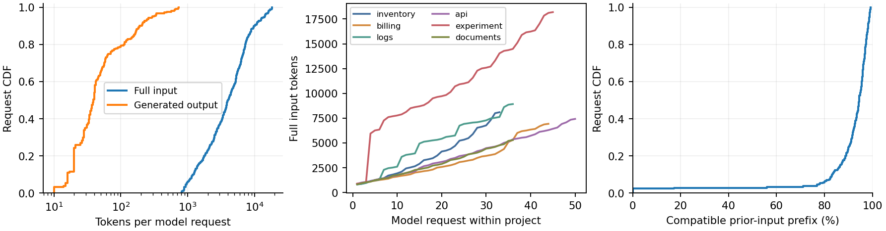
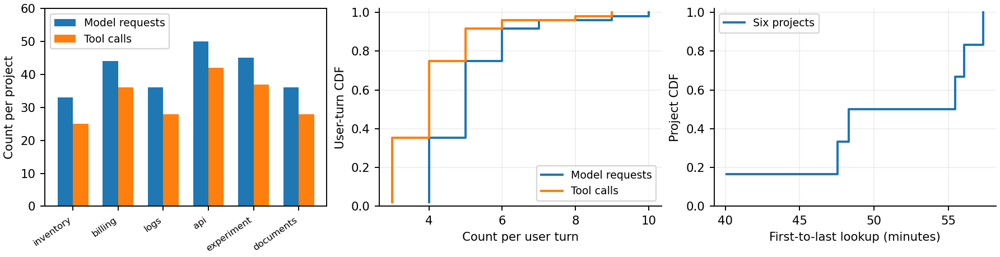
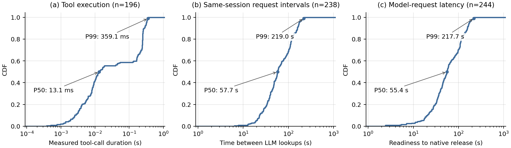
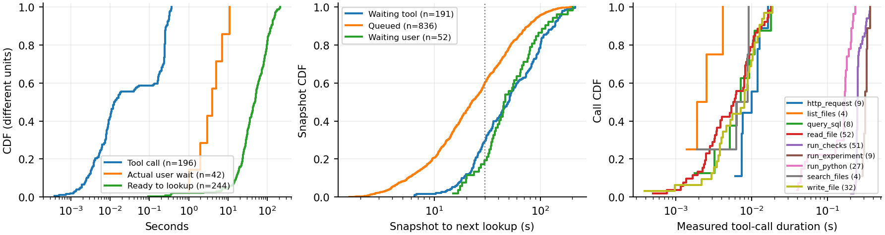
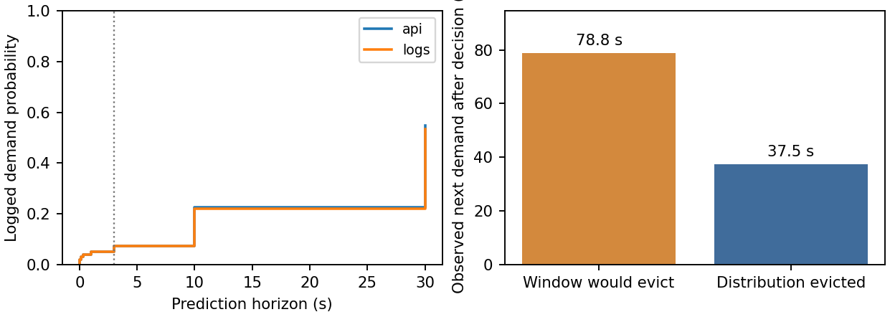

# LeasePath 持续 Agent 负载特征分析

日期：2026-11-11。状态：已完成只读统计、原始哈希核验、图表生成和论文补充；新增模型推理0次，未访问留出集。

分析对象是 `continuous_pilot_v7_2026-11-11` 的合格采集，评分分歧另用 `continuous_workflow_v6_2026-11-11/e2e/gbdt_static_distribution` 的已部署静态GBDT日志。采集192块，E2E150块，两者不混为重复实验。此前失败版本与v2论文保留。

- [新版论文PDF](../docs/leasepath_isca2027_paper_v3_2026-11-11.pdf) · [TeX](../docs/leasepath_isca2027_paper_v3_2026-11-11.tex)
- [结构与口径说明](../docs/leasepath_isca2027_paper_v3_notes_2026-11-11.md)
- [机器可读统计](../results/analysis/agent_workload_v1_2026-11-11/summary.json)
- [数据与图表来源哈希](../docs/leasepath_isca_v3_assets/manifest.json)

## 1. 这些分析回答什么

借鉴 CacheWise 的 workload characterization 逻辑，先说明场景包含哪些可复用历史、真实工具往返及时间差异，再评价缓存策略。统计描述的是现有开发负载，不能用来替代独立任务或端到端性能对照。

数据表区分旧50母题、当前持续项目、公开CATraces日志。当前用户需求与项目材料由开发者编写，模型自主选工具、参数、修改与停止，工具实际执行。固定用户需求序列和用户思考时间不等于自然人类交互。没有把自行设计需求标为“真实用户任务”，也没有逐项照搬CacheWise的勾叉表。

公开CATraces仅作为来源与字段覆盖参照：固定提交提供11个项目、94个会话文件，其中81非空；参数/文本脱敏，没有我们的精确前缀、lookup或队列事件。其日志跨度不与独立探针测得的工具时间画在同一组可比曲线上。详见[既有审计](cachewise_dataset_audit_2026-10-29.md)。

## 2. 统计单位与项目规模

一次用户需求轮次是从揭示当前需求到独立验收交付；一次模型请求是一次native LLM调用；项目是保持完整历史的持续会话。CacheWise的turn采用模型请求含义，不能将我们的8个用户轮次直接当作8次模型调用。

| 项目 | 用户轮次 | 模型请求 | 工具调用 | 工具种类 | 初始输入token | 最后输入token |
|---|---:|---:|---:|---:|---:|---:|
| continuous_inventory | 8 | 33 | 25 | 4 | 821 | 8,095 |
| continuous_billing | 8 | 44 | 36 | 5 | 880 | 6,928 |
| continuous_logs | 8 | 36 | 28 | 5 | 808 | 8,919 |
| continuous_api | 8 | 50 | 42 | 5 | 881 | 7,421 |
| continuous_experiment | 8 | 45 | 37 | 5 | 879 | 18,196 |
| continuous_documents | 8 | 36 | 28 | 4 | 813 | 5,285 |
| 合计 | 48 | 244 | 196 | 9种不同工具 | — | — |

每用户轮次模型请求中位数5、范围4–10；工具调用中位数4、范围3–9。196次模型请求由工具反馈触发，占80.33%；48次由用户到达触发。共有4次非零退出/错误工具结果，涉及3个用户轮次，后续反馈被模型消费并最终交付通过。没有强制每轮必须失败或重复，不能由这4次错误推断广泛分支覆盖。

所有48轮通过是开发修复后的合格采集，不是原始首次成功率。早期协议、环境、容量或任务规格问题仍在历史尝试归档；本报告不把无效轨迹混入该分布，也不删除本轮的4次工具错误。

238个完整相邻请求间隔与234个有可用决策快照的episode是不同单位：有些相邻间隔没有被其他请求的缓存决策采样。1079个快照不能视为1079个独立项目。

## 3. 输入、输出、增长与真实兼容前缀

| 量 | 中位数 | P95 | 最大值 | 口径 |
|---|---:|---:|---:|---|
| 输入长度 | 3,989.5 tokens | 13,929.85 | 18,196 | 244次请求的完整native输入，包含可复用历史 |
| 输出长度 | 39 tokens | 296.25 | 735 | 同244次请求的实际生成token |
| 输入合计 | 1,227,620 tokens | — | — | 重复出现的历史也按每次请求计入 |
| 输出合计 | 19,850 tokens | — | — | 输入/输出token总量比61.84 |

完整输入长度不是缓存后的实际prefill token数；61.84也不是计算速度比。CDF按请求计权、量化方法为线性插值，不插入独立样本置信区间；上下文增长逐项目逐请求展示，不平滑、不外推到500轮。

我们逐token比较同项目相邻实际输入。所有238次continuation都保留前一个输入可管理的完整128-token对齐前缀（`floor((previous_input_tokens−1)/128)*128`），总计1,157,760 tokens，占全部输入94.31%。该兼容前缀与物理命中无关，已被淘汰仍然计入复用机会；不包含上一输出新生成后缀或跨owner共享，因此不是全局最优命中率估计。

这支持“持续历史有很大复用机会”；不能把94.31%直接写成实际cache hit rate。实际策略命中与prefill节省仍使用此前五臂结果。

## 4. 持续工具循环与会话时长

每项目33–50次模型请求，25–42次真实工具调用，4–5种工具。首个到最后一个native lookup跨度40.10–57.36分钟，中位51.88分钟，与CacheWise图中的first-to-last request口径近似，但这里强烈受模型串行、六会话竞争、固定需求和1–11秒用户等待影响。

不能据此称“自然用户平均工作一小时”，也不能把51.88分钟当作KV两次复用之间的间隔。模型请求串行服务、工具与会话可并发，不是六路模型并行。

## 5. 工具、用户、控制器与实际需求时间

新增与参考图形式一致的对数横轴CDF；曲线来自现有实测数据，不平滑、不沿用参考图数字。正文放在§3.4的时间分析开头。

| 新图口径 | 样本数 | P50 | P99 | 起止事件 |
|---|---:|---:|---:|---|
| 工具执行 | 196 | 13.1毫秒 | 359.1毫秒 | 工具call开始→结束 |
| 同会话请求间隔 | 238 | 57.715秒 | 219.031秒 | 前一次native lookup开始→后一次开始 |
| 单模型请求响应 | 244 | 55.354秒 | 217.705秒 | recorded ready→native release |

请求间隔按owner分别排序计算，包含上一次模型执行，以及后续工具/用户、控制器和队列等待；不是全局相邻会话请求的间隔，也不是下文release→lookup的idle间隔。单模型请求响应包含排队、准备和模型执行，不包含后续工具链或独立交付验收，因此不等于用户轮次响应。

分位数采用线性插值，CDF保留全部实测点。P99只是六个相关开发项目的描述统计，不作为总体尾延迟保证。[新增统计JSON](../results/analysis/agent_workload_v1_2026-11-11/request_duration_summary.json)及[逐请求时长CSV](../results/analysis/agent_workload_v1_2026-11-11/request_durations.csv)保留定义、样本数和源哈希。

| 量 | 样本单位/数量 | 中位数 | P95 | 最大值 |
|---|---|---:|---:|---:|
| 工具实际调用耗时 | 196次工具调用 | 0.01314秒 | 0.31803秒 | 0.36646秒 |
| 用户等待事件至下一到达 | 42次已登记思考等待 | 4.00057秒 | 11.00053秒 | 11.00564秒 |
| ready到native lookup | 244次模型请求 | 48.225秒 | 151.373秒 | 212.986秒 |
| 实际工具通知至控制器消费 | 196次工具结束通知 | 9.214秒 | 37.398秒 | 92.757秒 |
| 前次release到下一lookup | 238个完整间隔 | 51.215秒 | 152.644秒 | 213.870秒 |
| 决策快照至下一lookup | 1079个相关快照 | 28.350秒 | 115.207秒 | 213.096秒 |

工具耗时是工具call文件中end−start，不能用反馈被主线程处理的时间替代。工具累计21.051秒属于采集，本轮五臂E2E各约20秒另表。ready→lookup包括结果通知处理延迟、FCFS等待、prompt准备与准入，不全部称“纯GPU排队时间”。

一个需要显式报告的系统限制是：控制器在两次串行模型调用之间才消费异步通知，所以工具早已结束而阶段仍显示`waiting_tool`。这不等于用未来状态；恰好是控制器当时尚未观察完成。但它限制了对真实工具时长预测的解释，后续异步编排或continuous batching需单独验证，不能静默修改现有实验来去除该现象。

快照阶段：queued 836/1079=77.48%，waiting_tool 191=17.70%，waiting_user 52=4.82%。所有快照标签为U；终止事件存在不等于训练快照已有D/C。每条完整间隔只计一次；快照是在不同已等待时刻观察的剩余时间，不能合并两种CDF。

30秒内发生需求的比例：完整间隔27.73%，原始快照52.83%，每episode总权重1的快照54.08%。这说明剩余时间目标与完整暂停时间不同，也说明固定H30只覆盖部分近期概率质量。没有把30秒外的质量重新归一或丢掉长标签。

当前工具全部小于0.37秒，尚未覆盖真实长计算/网络等待长尾；按工具类型画出的短时长差异不能证明预测泛化或“工具名无用”。后续继续增加有实际用途的长工具、输入规模和自然返回来源。

## 6. 分布评分是否真的改变合法选择

额外使用已经运行的静态GBDT分布策略，读出每次准入**首次**淘汰的相同候选叶子、已部署预测、max-owner规则、物理块大小和确定性tie-break。不重新拟合预测器，不启动替代闭环，也不新增LRU shadow开销。

| 同状态诊断 | 数量 |
|---|---:|
| 至少2个候选叶且两个评分均支持、无回退的首次淘汰状态 | 135 |
| 分布W与F_U(3s)选择不同首个victim | 11（8.15%） |
| 两评分均严格有序的候选对 | 526 |
| 其中严格顺序反转 | 22 |
| 窗口概率相同而分布分数区分 | 14 |
| 11个不同选择中，分布victim实际更早/更晚被需求 | 6 / 5 |

候选对与状态相关，不能当成独立样本检验。无淘汰、不足两个候选、支持缺失/回退的状态不进入该特定分母；保留在原始日志，筛选仅定义可比较状态。只比较首次动作，后续树结构与轨迹可能改变，不声称完整窗口策略最终会保留相同块。

选取按时间顺序第一个分歧，不依据结果挑选正例：

请求ID `r667d264482cc494dbc1b8b061ac020d7`，决策时间 `1556905.910647234`（CLOCK_MONOTONIC秒）。

| owner | F_U(3s) | W(H30,τ10) | 实际下一次需求 |
|---|---:|---:|---:|
| continuous_api | 0.072674006 | 0.138100176 | 78.810秒 |
| continuous_logs | 0.072786907 | 0.134960834 | 37.469秒 |

窗口会淘汰API，实际分布淘汰logs；logs在37.47秒后先回来，API在78.81秒后回来。这个局部负例说明多用分布信息会改变选择，却不保证更好。未来需求时间来自分布策略的实际轨迹，不能当成另一个策略的潜在JCT。

它与此前E2E结论一致：本轮GBDT动态/静态/窗口非常接近；额外收益仍需共同checkpoint、共同支持、平衡重复与独立项目验证。

## 7. 论文如何组织

新增 **Agent Workload Characterization**，位于Background之后、Problem Formulation之前。包含来源/覆盖表、六项目统计表、上下文三联图、时长三联图、循环与会话附录；Results中加入真实同状态评分分歧与负例。所有旧手工表图引用改为标签引用，避免新增内容后错指。

当前仅展示实测数据，不画“预期扩到60题后的CDF”，不将CATraces脱敏计数当本地native token。后续独立项目采集沿用同一输出定义并分别展示其分布，再检验覆盖是否扩大。

## 8. 文件与复现

- `requests.csv`：逐请求输入/输出、兼容前缀、触发来源及ready/lookup。
- `rounds.csv`：逐用户轮次模型/工具次数与质量。
- `projects.csv`：逐项目规模、来源组和会话跨度。
- `tools.csv`：逐真实调用耗时、工具名和错误标记。
- `intervals.csv`：238个完整release→ready→lookup可加分解。
- `first_sweep_comparisons.csv`：135个首次合法选择对照。
- `request_durations.csv`、`request_duration_summary.json`：请求开始间隔、单请求响应及P50/P95/P99分位数；与用户轮次响应分开。
- `summary.json`：定义、分位数、来源范围和原始评分案例。

这些文件位于[分析目录](../results/analysis/agent_workload_v1_2026-11-11/)。读取两组controller/backend原始文件时逐字节核对既有归档SHA256；然后从已核验事件生成紧凑只读中间表。复现脚本位于 `docs/leasepath_isca_v3_assets/`：extract_characterization.py → analyze_workload.py → generate_request_duration_figures.py → assemble_paper.py → build_paper.sh。`assemble_paper.py`会从v2重建并覆盖v3，不覆盖v2；人工改v3后仅运行build_paper.sh即可。

量化与完整性检查包含244/48/196计数、输入总量、每请求hit+prefill、完整前缀连续性、间隔分解、48/48终验、首次victim原始排序复算。此分析未新增性能重复、训练、留出访问或系统修复。
