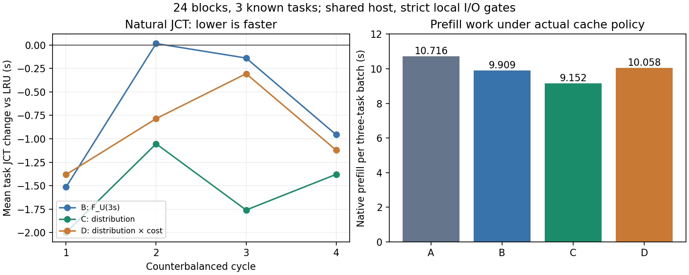

# 分布折现 KV 策略：四策略自然 JCT 结果

**当前优选为等成本分布评分C。** 在固定24块×128tokens、3个真实开发会话、4周期Williams平衡交叉试验中，C相对LRU平均任务JCT下降2.929%，相对原GBDT F_U(3s)下降1.723%，两个比较均4/4周期更快。加入独立校准边际成本的D相对C慢1.266%，4/4周期更慢。成本表通过校准验证并不代表其已观察前缀代理适合未来完整请求。

本轮是新控制器与策略的实测，旧自然轮结果未混入均值；三母题仍是已查看的开发题。共享服务器CPU／内存带宽未独占，结果是该负载的配对观测，不称统计显著或保证泛化。

## 策略与预先设计

- A：retired-first LRU。
- B：冻结GBDT的F_U(3s)，等成本。
- C：相同GBDT，`W=Σ exp(-r/10)·ΔF_U(r)`，H=30s、等成本。
- D：同一W，`max_owner(C_i,b·W_i)/B_b`，C取独立校准T(P,h)边际差分。

四策略均使用同一新增控制器／shadow LRU和shadow F_U(3s)审核、实际FCFS模型队列、真实工具、同一私有Python／数值库、相同输入／参数和CPU亲和配置。工具一线程，三个工具并行；亲和不代表独占。预测器没有重训，τ不自适应，不预取／交换／重排请求。

执行顺序冻结为 `A B D C`、`B C A D`、`C D B A`、`D A C B`。每策略在每位置一次，12种相邻有序策略对各一次。16批、48次任务执行；每个周期单独有界封存账本，预期144次live＋13次原生probe，实际恰为157次。总尝试上限301包含可能协议纠错余量，未使用的预算不补采。

开始前另开完整strace诊断：13次原生＋9次live＝22次生成，3/3任务正确，完整父控制器与后代76份trace，共识别22858个实际文件（含私有runtime）；系统／仓库／CUDA依赖清单扩至434文件、937546035字节，模型文件由独立keeper锁页。模型已全量SHA256核验且device/inode/size/mtime/ctime固定。诊断耗时不用于以下比较。

自然runner启动时核对诊断审计、文件清单、后端／成本表hash，并要求TracerPid=0；完整run_batch范围内事前规定父进程read_bytes、ru_majflt、ru_inblock增量全部为0，任一非零立即停止。工具沿用自exec起IO与wait4全生命周期／后代计数。不得事后放宽阈值或替换失败批次。

## 平均结果

prefill、tokens、decode和控制耗时按**每个三会话批次**平均；JCT按**每个任务**平均。正的“收益”表示相对A减少或多复用。

| 策略 | 复用tokens/批 | 多复用tokens vs A | 实际prefill tokens/批 | prefill秒/批 | prefill时间收益 vs A | 平均JCT秒 | JCT收益 vs A | makespan秒/批 |
|---|---:|---:|---:|---:|---:|---:|---:|---:|
| A LRU |7424|—|7130|10.7162|—|52.8505|—|68.2116|
| B GBDT 3秒点 |7808|384|6746|9.9087|0.8075s（7.535%）|52.2020|0.6484s（1.227%）|67.6207|
| C 分布、等成本 |8192|768|6362|9.1516|1.5646s（14.600%）|51.3025|1.5480s（2.929%）|66.4738|
| D 分布×边际成本 |7808|384|6746|10.0575|0.6586s（6.146%）|51.9522|0.8983s（1.700%）|67.1262|

C相对B每批多复用384tokens，prefill少0.7571秒，平均JCT少0.8995秒。D相对C每批少复用384tokens，prefill多0.9059秒，平均JCT多0.6497秒。D相对B同样复用7808tokens，但prefill多0.1488秒；JCT少0.2498秒，存在decode／工具／排队差异，不能将这0.2498秒称为成本模型节约。

| 配对比较（后者−前者） | 周期0 JCT差（秒） | 周期1 | 周期2 | 周期3 | 后者较慢周期 |
|---|---:|---:|---:|---:|---:|
| A→B |−1.514547|+0.015991|−0.138627|−0.956527|1/4|
| A→C |−1.998932|−1.053428|−1.759916|−1.379614|0/4|
| A→D |−1.381585|−0.784844|−0.305750|−1.120882|0/4|
| B→C |−0.484385|−1.069419|−1.621289|−0.423087|0/4|
| C→D |+0.617347|+0.268583|+1.454166|+0.258732|4/4|

## 成本项为什么没有带来额外收益

独立校准的79个验证点MAE仅2.607ms，约为平均prefill的0.2465%；中位正边际块成本92.991ms。表在其固定通用prompt和长度网格内有效。本轮D没有发生成本或分布回退，后端模型、GPU UUID、精度、线程、batch=512和KV配置身份均匹配。

问题在于该表用于**已观察前缀P+1**的代理，而下一次真实prompt会加入工具输出／协议文本；原生512-token批处理边界也使不同命中位置的边际成本不相同。删除当前便宜块，不保证未来完整prompt的实际重算便宜。逐块贪心还可能保留其他会话的局部高成本叶子，挤掉更有用的前缀。这些是与当前证据一致的限制，尚未通过独立消融确定各自因果占比。

C和D各周期对应请求的**输入及输出token逐个完全相同**。逐请求比较表明：

| 任务 | D−C命中tokens/批 | D−C prefill秒/批 |
|---|---:|---:|
| logistic_holdout |−256|+0.51348|
| temporal_asof |−256|+0.51457|
| ridge_validation |+128|−0.12211|
| 合计 |−384|+0.90594|

例如第一周期logistic最终请求实际1777tokens，前一已观察块前缀1536tokens，新增241tokens；C命中1152、D命中896，实际prefill为0.87787s／1.39069s。ridge最终1994tokens，前一前缀1664、增加330tokens，D虽多保留128tokens并节约约0.134s，抵不过另两题损失。这些真实未来长度仅用于**事后评估**，没有输入预测器或淘汰器。

旧90个压力状态的补充同状态机制审计：C×W相对“只用成本C”改变37个集合，相对“C×F_U(3s)”仅改变2个集合；因此不能把成本版54次动作改变全部归因于完整时间分布。当前C的额外JCT收益与D的退步，必须分别解释。

## 工具、输出与控制开销

所有策略对应输入token完全相同。A/B输出也完全相同；C/D彼此完全相同，但相对A/B，asof的部分协议输出每批少1个token，平均输出分别651、651、650、650tokens。因此C相对A/B的收益包含少量decode差异。最终JSON答案完全正确，未做事后归一化。

| 策略 | decode秒/批 | 预测秒/批 | 逻辑接纳+两影子毫秒/批 | 全部controller prepare秒/批 |
|---|---:|---:|---:|---:|
| A |53.4469|0.008663|34.858|0.17752|
| B |53.3942|0.008807|39.472|0.17646|
| C |53.2491|0.009591|33.525|0.25205|
| D |53.2813|0.010478|36.846|0.17939|

A也承担影子预测审核开销；上述开销已包括在JCT内。controller prepare还包含原生inspect/drop/映射准备等，不等同评分算法耗时，不能只凭C的0.252s推断分布积分更贵。

| 策略 | logistic工具wall秒 | ridge工具wall秒 | asof工具wall秒 |
|---|---:|---:|---:|
| A |9.9869|18.7593|5.5644|
| B |9.4514|18.9837|5.1240|
| C |9.3854|19.1502|5.3735|
| D |10.5710|18.8187|5.1952|

工具真实运行，没有睡眠替代、固定返回窗口或请求重放。C相对D的logistic工具wall也更短，故JCT差不能全部归于cache。主机CPU PSI区间0.393%–60.482%，I/O PSI区间1.094%–5.777%；只完成本地驻留／I/O控制，未宣称共享主机整体稳定或独占。

## 审计与当前决策

独立审计通过：157/157请求映射账本、原生token／cells及实际叶子淘汰，48/48任务正确，32个封存事件流，96次真实工具结果被后续请求消费，无结构化拒绝。48次live compute＋15次哨兵compute全部通过参考与生命周期资源检查。16批父进程read_bytes／major_faults／block_input_ops均为0，所有锁页对象无缺页，C/D成本与分布回退均为0。完整评分审核重新调用冻结预测器并独立计算CDF差分、max owner价值和成本表差分。

本轮策略代码、native/校准、完整追踪及自然轮共新增452次模型生成；两个启动失败均0次，已知项目累计1727次。失败证据与全部慢周期保留。可用全量代码测试260通过，1项依赖缺失的外部full_pinned_audit跳过。

**后续主线采用C作为候选基线，D保留为未获益消融，暂不加容量自适应τ。** 下一阶段在固定C参数下扩大容量／并发，并加入新的独立母题与真实agent循环检验泛化。若继续研究成本，应先验证“当前状态→未来完整请求边际代价”的代理误差，或以可因果获得的后缀长度分布积分成本；不得直接使用未来实际长度，也不以本轮JCT反向选择τ或改成本曲线。

原始汇总见 `results/cache_policy/kv_distribution_natural_2026-11-09/natural-comparison.json`，表格为 `policy-comparison.csv`、`paired-cycles.csv`、`tool-comparison.csv` 和 `cost-vs-distribution-request-deltas.csv`。原生校准及动作审核见 `reports/kv_distribution_v1_2026-11-09.md`。

附：12个任务观测（每策略3母题×4轮，非独立样本）的描述性P95 JCT依次为68.291秒、67.652秒、66.653秒、67.030秒（A/B/C/D）；不作为总体尾延迟估计。逐题均值与每轮原始值分别保存在 `task-jct-comparison.csv` 和审计JSON。

完整诊断未复现历史4KiB读取，不能逆推其具体源文件；本轮证明的是当前完整控制循环的前瞻门控通过。原始数据和私有runtime已复制到持久磁盘，归档及逐文件验证信息在 `archive-verification.json`；临时路径清理后如需重跑原路径型审计，应按清单恢复本轮自建runtime／路径。
