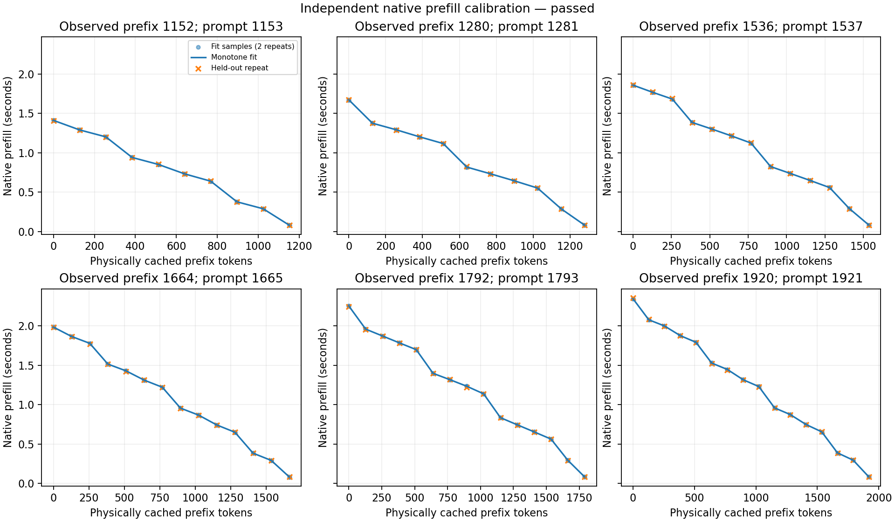

# 分布折现 KV 策略 v1：实现、合法动作审核与校准

本轮依据 `docs/kv_distribution_policy_v1_2026-11-09.md`，以 `81b49e0` 为基线，新增版本化控制器与原生接入，固定 H=30s、τ=10s、各区间至少5个训练workflow支持。冻结GBDT／经验预测器均未重训，FCFS执行次序不变。当前是开发单元机制验收，不将已看过的母题重新称为独立测试集。

## 已实现的策略

新增 `src/leasepath/distribution_cache.py`，使用 `W=Σ exp(-r/10)·ΔF_U(r)`，物理块评分为 `max_owner(C·W)/真实块字节`。只在容量压力下删除合法叶子；优先处理无存活owner的叶子，保护活动引用和本次接纳前缀。删除后重建叶子及当前驻留前缀，重新查边际成本。一次接纳共用一个时间快照，每个需要的owner仅预测一次，两个影子策略共享该快照。

支持不足统一回退retired-first LRU；任何当前候选成本缺支持统一回退常数成本，后续步骤保持回退。日志明确区分无量纲等成本与prefill秒。D竞争风险不重复相乘，窗口外质量不补齐、不归一化。共享块先在各owner内部计算C×W，再取max，不相加、不拼接不同owner的最大值。

新增 `src/leasepath/distribution_cache_backend.py` 接入已有原生slot/drop/abort接口，保留旧控制器、旧runner和旧实验文件。成本表核对后端身份、校准验收状态、block geometry及单调性，采用精确网格，无插值或外推。固定τ实现已落地；容量自适应τ仍留作独立消融。

## 实际历史状态上的合法动作

`scripts/audit_kv_distribution_actions.py` 从18批原始backend/controller事件重建162次请求的缓存状态，独立复核原生token对应的块、历史实际受害块及shadow LRU；每次比较后恢复沿用记录的实际淘汰，因此没有生成新缓存轨迹。此前方案审核只有48个带预测的压力快照，此处包含所有策略的90个压力状态，并非同一分母。

| 冻结预测器 | 压力状态 | 相对原F_U(3s)淘汰集合改变 | 回退 |
|---|---:|---:|---:|
| 条件经验 | 90 | 0（0%） | 0 |
| GBDT | 90 | 4（4.44%） | 0 |

其中54个状态确实存在多个存活候选叶子的比较，GBDT改变4/54（7.41%）；其余36个状态可由无绑定块清理满足缺口。60个历史预测策略压力动作与旧控制器重新执行一致。GBDT的4次改变分别来自旧GBDT轨迹2次、旧LRU轨迹2次，旧经验轨迹0次；只在旧GBDT自身30个压力状态上比较为2/30。变化涉及每次3、4、6或7个块。它们是同状态的合法淘汰集合差异，**不是已实现命中增量、prefill节约或JCT收益**。

典型交叉：已等待compute的ridge，F_U(3s)=0.547116、W=0.528622；较新idle的asof，F_U(3s)=0.56、W=0.498346。新排序优先保留前者。分布折现确实可能改变方向，但在当前负载中机会较少，不据此扩跑完整容量／并发矩阵。

详见 `results/cache_policy/kv_distribution_v1_2026-11-09/action-audit.json` 和逐状态 `action-comparison.csv`。

## 原生验收与成本校准契约

GPU执行前冻结 `configs/prediction/qwen_distribution_v1_2026-11-09.json`。计划上限273次新生成：原生18次（原13项协议／共享／超时／取消／恢复检查，加5次合成分布驱动真实淘汰），拟合170次（12次priming＋158测点），独立验证85次（6次priming＋79测点）。三阶段各自独立封存账本，未提高现有GenerationBudget的单账本限制，失败与未完成均保留。

成本校准覆盖已观察前缀9、10、12、13、14、15块及每个0至完整前缀的128-token命中位置。后端必须保留一个未命中的token，因此事前声明以实际prompt `P+1` 校准已观察块前缀P的成本代理，不填未来请求后缀。使用独立通用内容，逐点真实drop后验证物理命中，再由原生prefill_ns记录计算时间；decode不计入成本。

前两轮每点均值经单调PAV约束拟合，不选最快值；第三轮独立验证。事前门槛：验证MAE≤平均prefill的10%，且MAE≤中位正边际成本的50%。不通过则禁用校准成本策略。通过也只说明该后端、通用内容、长度网格下的代理可用，不保证未来完整prompt的边际时间。

## 控制器文件访问诊断

新增 `scripts/probe_qwen_distribution_parent_io.py`，使用完整私有Python标准库／冻结数值依赖，包含实际controller Python导入、源文件哈希和真实三工具组。一次strace跟踪父进程及其后代，覆盖19个进程／线程并识别366个实际磁盘文件；将其身份／哈希固定并锁页后再跑一次，共6次compute均对独立参考答案正确。

两组测量窗口中，父进程read_bytes、self major_faults、self block_input_ops，以及wait4子进程树major_faults／block_input_ops均为0；各worker的自exec起read_bytes均为0。实际数值计算没有替换为回放或休眠。这是文件访问归因准备，**未包含完整原生CUDA模型驱动控制循环，不能称自然JCT门槛通过，也无法回溯确定历史4KiB的具体文件**。

下一自然JCT版本仍须先追踪完整父控制器，在计时前固定父进程read_bytes=0、major_faults=0和worker生命周期检查，并把工具、控制、prefill、decode及主机协变量一起保留。共享CPU和内存带宽不独占；当前只复核GPU5/6/7空闲，不操作其他作业或全局THP／page cache。

## 检查与证据边界

针对性检查覆盖CDF交叉、竞争风险／零U、共享max乘积、祖先暴露后成本更新、后续新owner无支持时回退、成本越界统一回退、非法前缀和活动容量原子拒绝、同快照预测复用与失效、随机共享前缀同分退化LRU。先运行完整可用测试256通过、1项外部full_pinned_audit缺失而跳过；随后增加3项边界检查并通过，最终针对性回归18项通过。第一次全量命令使用相对PYTHONPATH导致一项旧子进程测试失败，绝对路径修正后全量通过，未修改旧测试或旧Codex路线。

已独立比对91个仍在仓库中的上一轮冻结源文件，哈希全部一致。旧运行期tmpfs已由前轮清理，不能把缺失tmpfs算作已重新核验；新证据各自留存。

最终加入驻留来源与JSON格式边界检查后，可用全量回归260通过、1项外部审计测试跳过。原生／校准结果见下节；后续完整自然JCT已完成，详见 `reports/kv_distribution_natural_2026-11-09.md`：等成本C比LRU快2.929%，成本版D比C慢1.266%。

## 启动失败与版本保留

第一次启动已完成整个65,535,970,144字节模型的SHA256核验，随后旧tmpfs驻留keeper的60秒启动等待无法覆盖本轮磁盘文件mmap锁页而失败。生成0次，GPU未加载。第二次在模型加载前发现新加入的计划校验将格式化后JSON与原JSON作字节比较，误判内容变化；同样生成0次。两次失败目录、源码、plan、manifest和三份空使用封存账本全部保留，独立审核见 `setup-failure-audit.json`。

最终启动版本为 `scripts/run_qwen_distribution_v1_resident_v2.py`、`configs/prediction/qwen_distribution_v1_resident_v2_2026-11-09.json` 和 `src/leasepath/distribution_model_residency_v2.py`。只将首次锁页响应的等待上限明确设为1800秒，后续resident检查仍为60秒；未修改旧驻留模块。复用已完成全量SHA256的证据前，复核原manifest与校验器源码hash、原plan文件hash及保存plan的JSON内容、模型device/inode/size/mtime/ctime完全一致。任一变化都拒绝复用。未重复读取65GB模型以避免无必要的共享磁盘负担。新次仍独立账本，同一273次生成上限、校准顺序与验收阈值，前两次均无生成消耗。

## 原生与成本实测结果

最终原生／校准轮273次请求全部完成并独立审核通过：18次原生验收，170次拟合阶段生成，85次独立验证阶段生成；237个计时样本均能与真实token、物理cells和封存账本逐条对应。已知累计生成数为1548（1275＋273），两次启动失败均为0。所有237个样本的父进程read_bytes和major_faults增量为0。GPU5/6/7已在该轮结束时释放。

成本表第三轮79个验证点MAE为2.607 ms，占验证平均prefill的0.2465%；正边际成本中位数92.991 ms，误差为其2.8036%。两项均通过事前阈值（10%与50%）。独立审计使用min-max单调回归表达式复核生产PAV拟合，未调用同一拟合实现作为唯一验证。

| 已观察前缀tokens | 拟合cold prefill（秒） | 完整前缀命中后prefill（秒） | 每块边际成本中位数（ms） | 验证MAE（ms） |
|---:|---:|---:|---:|---:|
|1152|1.4108|0.0820|119.44|1.67|
|1280|1.6712|0.0819|91.65|2.39|
|1536|1.8573|0.0837|90.75|2.32|
|1664|1.9821|0.0828|117.45|2.23|
|1792|2.2503|0.0829|90.87|2.71|
|1920|2.3419|0.0833|122.12|3.81|

这些是独立通用prompt的校准曲线，不能作为新策略在真实工作流上的时间收益。曲线可见原生512-token批处理边界附近不同的边际成本，单块成本整体约78–302 ms，而非统一的每token常数。

将已验收成本表用于相同的90个历史压力状态，`C×W`相对等成本W及原F_U(3s)都改变54个淘汰集合，恰好覆盖全部54个存活候选比较状态；成本／分布回退均为0。该结论由独立叶子枚举、owner当前驻留长度、表差分和max聚合再次复算。它表明成本项显著影响决策，但**不能把54次变化都归因为“分布预测更好”**，也不说明新淘汰一定更优。已观察P+1的成本代理与未来工具返回后的完整prompt仍可能不同，真实闭环是必要验证。

因此进入下一独立轮：固定24块、3会话，A/B/C/D四策略Williams平衡顺序，每策略每个位置出现一次、12种相邻有序对各出现一次。先单独追踪完整原生父控制器／真实工具，再开始严格父进程IO门控的自然JCT；不将带strace诊断的耗时并入比较。

完整自然轮已完成16批48/48正确并独立审计通过。成本版未比等成本分布版获益；补充旧状态机制审核C×W相对仅成本C改变37/90集合，相对C×F_U(3s)仅2/90。详见自然轮报告，不将动作差异等同收益。
