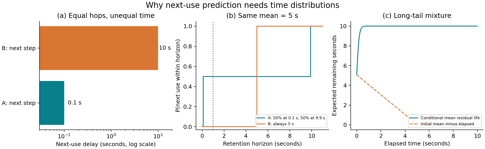

# 1. 结论与建议

**这个方向有实际问题支撑，但“从节点步距转为工具时延预测”已经有直接先行工作。建议把研究问题收敛为：在可见运行状态下，预测一个兼容 KV 前缀下一次合法复用的剩余时间分布，并验证这部分信息能否改善真实容量竞争中的决策。**

本次调研有三个尤其重要的结论：

1. 你提到的“intercept”应为 **InferCept**。它明确指出不同工具、不同调用的暂停时间有很大差异，并利用时间估计选择 preserve/discard/swap。这为动机提供直接依据，但时间感知管理本身不是新的问题。[R1]
2. **Continuum 已用按工具统计的经验时长分布选择 TTL；CacheWise 更进一步，已用工具名称、参数的 TF-IDF 聚类及已等待时间，估计剩余复用时间并排序淘汰。** 后者与你设想的方向最接近，必须作为首要对照，不能只与 KVFlow 的步距比较。[R4–R5]
3. 更值得检验的空间是：**合法复用与终止的联合时间分布、执行阶段与排队的分解、跨项目/时间漂移下的校准，以及预测误差对缓存决策的实际影响。** 这些是本报告提出的研究假设，尚不是已经确认的新颖性或性能结论。

推荐路线：**复现 CacheWise-style 条件经验分布 → 实现轻量 AFT/分位数预测 → 数据显示存在终止、删失或多阶段等待问题时，引入离散时间竞争风险模型。** 优先研究一个串行工具循环；已观测的并行依赖作为后续扩展，不要求重新引入工具调用树预测。

与当前 LeasePath 的关系也需要调整：已有的合法前缀、生命周期、事件时间和闭环回放基础可以沿用；研究贡献的中心转到预测问题及其价值验证。本文是调研和实验方案，**没有新训练预测器、运行 GPU 性能实验或修改原有研究路线文件**。

# 2. 为什么步距不足，以及究竟预测什么

## 2.1 相同步距的差别成立，但淘汰优先级还取决于条件

设 A、B 都在“下一步”复用，大小、复用概率、重算成本相同，且当前容量不足以同时保留。A 在 0.1 秒后需要，B 在 10 秒后需要。在这样的条件下，真实时间是比相同步距更有辨别力的信号。

但不能无条件推导出“10 秒的必先淘汰”：如果 B 重算代价远高于 A，或其前缀被多个工作流共享，排序可能改变；如果显存充足且普通缓存本来就会命中，则无需强行区分。**时间预测是价值判断的输入，不是完整的淘汰策略。**

另一个边界是 Belady：在固定请求序列、等大小页面、等 miss 代价的经典问题里，它优化缺页次数；不能直接把它称为可变 KV 代价、内生排队和闭环 Agent 的 JCT 最优算法。

图 1(b) 中，两种等待分布的均值都是 5 秒，但在 1 秒保护窗口内，复用概率分别为 50% 和 0%。图 1(c) 使用两个指数分布的等权混合：等待得越久，越可能属于慢调用群体，剩余期望可以升高。因此，不能一律用“初始预测时长减去已等待时间”。

## 2.2 区分四个时间终点

| 预测目标 | 含义 | 在缓存系统中的用途 |
|---|---|---|
| 工具完成时间 | 当前工具何时返回 | 最容易取得监督；只是复用的一个组成部分 |
| 下一请求 ready 时间 | 依赖、汇合与客户端处理何时完成 | 更接近后继请求的到达需求 |
| 下一请求到达/入队时间 | 请求何时被服务端看到 | 可对应 Continuum 的 inter-request interval |
| 下一次合法 cache lookup 时间 | 兼容前缀何时真正被请求访问 | 直接关系到 KV 需要保留至何时 |

在一个简单工具循环中，从当前时刻到下一次 lookup 的时间可分解为：

$$
R_{\mathrm{lookup}}
=R_{\mathrm{tool}}+D_{\mathrm{client}}
+W_{\mathrm{queue}}+D_{\mathrm{dispatch\to lookup}}.
$$

这里 $$ D_{\mathrm{client}} $$ 包含适用的结果编码、提示构造、分词、网络和编排开销。若当前正在等待多个分支，第一项应换成到依赖满足的剩余时间，不能简单相加全部工具耗时。

**推荐双目标：主要学习较可迁移的 $$ R_{\mathrm{ready}} $$，同时提供当前服务策略下的 $$R_{\mathrm{lookup}}$$ 估计。** 后者包含内生排队：缓存策略改变模型服务时间，又改变后继到达和队列。离线比较必须重新推进这些时间，不能把基线 trace 的 lookup 时刻当作所有策略的固定真值。

若系统在 enqueue 或 dispatch 就为请求获取活动引用，idle 保护只需持续到这个接管点。必须记录真实接管事件；“预测 lookup”不意味着活动请求还要依赖 idle TTL，亦不能在工具返回时过早释放所有保护。

## 2.3 标签是合法需求，而不是物理命中

对当前已驻留的前缀 $$c$$，从当前决策时刻 $$t$$ 定义：

- $$T_U$$：下一次合法复用需求发生的绝对时刻；无论当时 hit 还是 miss，都算需求。
- $$T_D$$：该被研究复用关系被明确终止的时刻，例如上下文版本永久替换、owner 明确结束。
- $$T_C$$：观察窗口结束时刻；这是右删失，不能标成“永不复用”。

合法复用必须满足实际 token 前缀与模型/adapter、tokenizer、位置编码、KV 格式等兼容条件。同一 agent 或同一工具再次运行不能替代合法性检查。一个 owner 结束，也不代表其他 owner 共享的物理块失去价值。

第一阶段宜预测 **owner–兼容前缀关系** 的下一次需求；在物理块层汇总时，明确哪个 owner 仍可能使用。共享需求之间可能相关，不能未经验证直接将各概率当独立事件相乘。

需要向策略提供的核心输出是：

$$
F_U(u\mid H_t)=
P(T_U-t\leq u,\ T_U<T_D\mid H_t,\ \text{当前仍 idle}),
$$

其中 $$H_t$$ 仅包含时刻 $$t$$ 已可见的工具、参数摘要、阶段、历史和系统状态。这是“未来 $$u$$ 秒内先发生合法复用”的累计发生概率，不只是一个秒数。

# 3. 文献地图：直接先行工作与可借鉴方法

本报告以原论文为主要依据，检索并核读截至 2026-10-27 可访问的指定版本。重点覆盖 Agent KV 生命周期、步距/复用预测、工具暂停、TTL 与学习型缓存；不是完整穷尽式系统综述。未采用搜索结果中不相关的摘要作为证据，未将预印本默认视为已通过同行评审。

| 工作 | 已有输入与机制 | 对本研究的约束 |
|---|---|---|
| InferCept [R1] | interception 时长估计；保留、分块重算、交换 | 暂停时间感知与 byte-second 已有先例 |
| KVFlow [R2] | Agent Step Graph、steps-to-execution；共享前缀、预取 | 是“步距不足”的直接结构基线；已支持 min/max 依赖 |
| PBKV [R3] | 历史调用、图与 prefill 语义；多步 agent/END 预测 | 下一 agent、终止和共享概率不是空白；主要预测轴仍是步骤 |
| Continuum [R4] | 按工具的经验 CDF；重载/重算和排队成本；TTL | “用工具时长分布决定保留多久”已被覆盖 |
| CacheWise [R5] | 工具名＋参数聚类＋elapsed；条件剩余时间与淘汰顺序 | 最直接的预测基线；覆盖语义条件化和动态更新时间 |
| MORI [R6] | 最近窗口的工具时间占比，含当前等待；分层放置 | 强轻量替代：不用精确预测也可能取得收益 |
| CacheScout [R7] | 在线转移计数、稀疏图 hop、recency 与重算权重 | 其 survival score 是步骤内复用代理，不是秒级生存分布 |
| KVTether [R8] | 消息生命周期映射；dead 清理；live-idle 层 MRU | 必须排除“只是更早清理死缓存”或简单 MRU 的收益 |
| TraceLab [R9] | 真实 coding-agent 日志、工具时间、前缀复用特征 | 为长尾和同工具内部差异提供证据与数据入口 |
| LRB [R10] | 学习近似 Relaxed Belady，关注缓存决策质量 | “预测下次使用以改进淘汰”也有传统缓存先例 |
| KVSET [R13] | LRU stack distance 与容量—命中率估计 | 可用于识别容量敏感区；不等于墙钟预测或 JCT 模型 |

## 3.1 InferCept 给出的依据，以及没有证明的事情

InferCept §2.2 区分了计算器、知识问答、虚拟环境、聊天、图像和语音等暂停。工具类型能提供时长提示，但不同来源的证据并不一致：聊天中的人类响应时间含估算成分，图像/TTS 部分也使用估算，不能把全表都当成真实网络工具实测。

§3.2 Eq.(2) 已定义保留浪费：

$$
\mathrm{Waste}_{\mathrm{Preserve}}
=T_{\mathrm{INT}}\times C\times M,
$$

即暂停时长乘上下文 token 数与每 token KV 字节数。§4.3 结合跨请求预算选择交换、保留或重算。

§4.4 对高度变化或未离线 profile 的 interception，使用
$\widehat T_{\mathrm{INT}}=t_{\mathrm{now}}-t_{\mathrm{call}}$，每个 iteration 更新。**这是一种随等待增长的估计启发式，不是经过条件化校准的剩余寿命分布。** 论文报告在其混合工作负载下达到知道准确暂停时长的 oracle 性能的约 93%；这不是 93% 的时长预测准确率，也不能外推为新 Agent 负载的收益上限。

复现时以 InferCept 原文为准。后续论文对它的简述或自建 moving-average baseline 不应倒写成原作唯一机制。

## 3.2 Continuum 已经把时间分布接入 TTL

所核读的 v7 在 §4.2 用历史工具记录构造经验 CDF：

$$
\widehat P(D_f\leq\tau)=\frac{1}{|S[f]|}
\sum_{d\in S[f]}\mathbf 1[d\leq\tau].
$$

其 Eq.(2) 的 TTL 选择可写为：

$$
\tau^*=\arg\max_{\tau\geq0}
\widehat P(D_f\leq\tau)
\left(\mathcal T\eta+C_{\mathrm{prefill/reload}}\right)-\tau.
$$

候选包括历史观测时长和 0；工具记录不足时退回全局统计，再退回默认 TTL。完整方法还调整 program-level FCFS 与 TTL 优先级，不能将全部系统收益归因于时间预测。

特别值得注意：§5.1 实际用“前一请求服务端结束到后一请求服务端到达”的间隔记录工具耗时。这个口径可能包含客户端编排与通信，不能与独立测量的工具内部执行时间混用。§5.2 也考虑了 follow-up 已在等待队列时避免提前 unpin。

## 3.3 CacheWise 与原始设想高度重合

CacheWise §5.2 明确认为，不必每次精确预测秒数，只需正确识别较晚复用的候选。其方案包括：

1. 使用工具名称和参数作为元数据，并考虑相似用户/项目的历史。
2. 对工具参数做 TF-IDF 表征和 KMeans 聚类，建立条件时长分布。
3. 已等待一段时间还没有返回时，基于剩余样本的条件分布更新预期复用时间。
4. 同一会话的块共用预测；周期性更新淘汰 heap，评估设置每 3 个 engine iterations 重建。

其 Table 3 给出同为 Bash 的不同参数模式：`python -c`、`mypy`、`docker compose`、Git 操作存在显著时间差别。不过部分簇样本很少，例如 `python -c` 为 9 个，不能将该表当作稳定普适的工具时间表。

**需要划清的边界：** CacheWise 原文主要做条件预期复用时间排序，不宜根据其他论文的概括把它简单称为“另一种 TTL”。它也已强调排序而非精确数值，因此“只预测排序”和“加入 elapsed”不能单独作为本研究创新。

它的评估按 session 随机划分训练与测试，并把漂移鲁棒性的深入研究留作未来工作。这提供了可检验的延伸方向：跨项目、跨用户和按时间向前的迁移，而不是只增加一个复杂模型。

## 3.4 真实数据支持问题，但也暴露数据可得性限制

TraceLab v2 报告约 4,300 个 coding-agent sessions、35 万 LLM steps 和 43 万 tool calls。其工具分析发现：同一工具类型也有很大的时长变化；Bash 可以从毫秒到分钟。按论文使用的口径，Claude 超过 1 分钟的调用只占约 4.9%，却占约 92% 的工具累计时间；这是累计工具时间，不是并行消重后的工作流关键路径。[R9]

公开 TraceLab README 指向 v0.0.1 的 357,161 个 rounds、432,510 条 tool records、43 位匿名用户。**这是指定 release 的统计，不能与后续 release 或论文其他口径混加。** 公开脱敏会删除原始工具输入；当前清洗代码/说明保留部分可执行文件名、命令结构与输入长度。因此，公开数据适合先验证工具、elapsed、历史和部分命令类别，不能预设可完整复现 CacheWise 的原始参数 TF-IDF 特征。

# 4. 五套可以实施的时间预测方案

以下方案按投入顺序列出。模型结构来自已有统计/机器学习方法；研究贡献需要来自新问题证据、可靠标签、跨域泛化或决策收益，不能来自“把一个现成模型放进缓存”这一组合本身。

## 方案 A：分组经验分布＋条件剩余时间

**定位：必须做的低成本基线；不是拟议核心创新。**

先按 `tool_name → 命令类别 → 参数规模档位 → 项目/执行环境` 分层。不要一开始把维度全部做笛卡尔积；细组样本不足时退回父组或全局。并复现 CacheWise-style 的 TF-IDF＋KMeans 条件分布作为更强版本。

对某组工具总时长 $$D$$，设生存函数 $$S(d)=P(D>d)$$。在已等待 $$e$$ 秒且仍未结束时，剩余时间 $$R=D-e$$ 满足：

$$
P(R\leq u\mid D>e)=1-\frac{S(e+u)}{S(e)},\qquad S(e)>0.
$$

输出若干决策时间窗内的完成概率及 P50/P90 剩余时间，比只返回均值更通用。以秒计的示例窗口为 0.1、0.3、1、3、10、30、120；它们只是起点，需按后端成本和开发数据重新冻结。

实现步骤：保存每组排序后的时长与风险集计数；二分查询条件 CDF；每次工具阶段变化、关键时间窗到期或缓存压力变化时更新一次。无须每个 token、每个 KV block 分别跑预测。

完整工具样本可用 ECDF；工具尚未结束便遭观察截断时，可在条件非信息性删失假设下用 Kaplan–Meier。**工具超时并不一律是右删失：如果 timeout 本身使工具返回，且后继模型处理错误，则它是实际完成事件。** 若讨论未被 timeout 截断的潜在运行时，那才是另一个带删失的目标。

工程重点：尾部风险集太少时禁止“除以近零生存概率后自信外推”；退回更粗分组、有限窗口概率或基线策略。滑窗/衰减权重可适应变化，但必须在新时间段独立检验校准。

预期适用：重复工具较多、项目相对稳定、样本量中等。主要不足：稀疏参数组合、未知工具、信息性取消和多阶段等待。

## 方案 B：轻量分位数树／AFT 生存回归

**定位：最推荐的第一版学习型模型。** 先验证可解释结构特征能否超越方案 A；不建议起步就用 LLM 或大型 Transformer 预测时长。

输入分四组：

| 特征组 | 决策时已可见的示例 |
|---|---|
| 工具与参数规模 | 工具 ID、命令类别、可见文件大小、目标测试数量、查询 top-k、输入长度、显式 timeout |
| 当前执行状态 | elapsed、phase、已发生的 retry 次数、已收到的进度/输出计数 |
| 历史与环境 | 过去若干同类调用分位数、项目类别、runner 负载、endpoint、缓存冷热提示 |
| 编排与服务状态 | 尚未完成依赖数、下一请求是否已入队、当前已观测队列工作量 |

不能用最终结果长度、最终重试次数、实际下一个分支、未来队列长度或未来命中情况作为输入。当前日志里没有某个字段，就把它列为采集需求，而非补成已观测值。

**B1：分位数 GBDT。** 对完成样本，以 $$y=\log(R+\epsilon)$$ 为标签，训练 P50/P80/P95，使用 pinball loss。对跨越毫秒至分钟的范围，log 目标通常比原始 MSE 稳定。输出分位数需处理交叉；单独的若干分位数不足以精确恢复任意 CDF，因此 TTL 使用分位点候选或经过校准的插值，不能假装获得完整密度。

**B2：AFT。** 用 XGBoost `survival:aft` 或同类实现拟合

$$
\log D=f_\theta(x)+\sigma Z.
$$

完整样本设区间 $$[d,d]$$；右删失样本设 $$[c,+\infty)$$。部署时从估计的 $$S(D\mid x)$$ 用方案 A 的条件化公式得到剩余分布。官方 AFT 支持区间形式标签；这比丢掉未完成工具更合理。[R11]

如果模型输入包含随执行更新的 phase/elapsed，采用 **landmark** 训练：在若干当前观测时刻生成快照，直接预测此后的剩余时间，并保留对应删失信息。避免将动态特征当作工具启动时就已存在，也避免对已条件化的剩余分布再重复条件化。

初始搜索可限制在浅树、小规模 ensemble，在开发集用概率校准和决策收益共同选择。建议把预测结果缓存到 idle context 级；只在状态变化或达到更新期限时批量刷新。

主要不足：普通分位数训练会对完成样本产生选择偏差；AFT 的分布形状假设可能难以拟合多峰；把确定 retire 当普通工具删失也不正确。出现这些问题时进入方案 C。

## 方案 C：离散时间竞争风险模型

**定位：最值得作为核心候选，但以真实数据确有相关事件为前提。**

目标不再是“这个工具多久结束”，而是“这个 owner–前缀关系何时先发生合法复用或明确终止”。沿用第 2 节的两个事件 U、D。观察结束 C 是删失，不是第三种未来结局。

在每个相对时间区间 $$k$$，输出三分类概率：

$$
h_U(k),\quad h_D(k),\quad h_0(k)=1-h_U(k)-h_D(k),
$$

分别表示在此前均未发生事件的条件下，本区间发生复用、终止或继续等待。以共享 softmax 确保概率和为 1，不能把两个独立二分类概率随意相加。

$$
S_k=\prod_{j\leq k}h_0(j),\qquad
F_U(k)=\sum_{j\leq k}S_{j-1}h_U(j).
$$

实现不必从深网开始：用 `(当前特征, time_bin)` 训练 pooled multinomial logistic regression，或小型多分类树模型。离散竞争风险的思想已有成熟先例；DeepHit 是可参考的分布学习方法，不是第一阶段必需依赖。[R12]

对于第 $$k$$ 个区间发生 U 的样本，似然为 $$S_{k-1}h_U(k)$$；发生 D 类似；观察到区间边界 $$c$$ 仍无事件的样本贡献 $$S_c$$。若删失发生在 bin 内，必须采取细化边界、区间似然或明确的近似，不能把整个未观测 bin 当已存活。训练和校准要按完整 episode/workflow 划分。

这个模型解决三个常见错误：只对最终复用的样本拟合；把观察结束当永久死亡；把工具返回等同于该 prefix 一定合法复用。但它也有边界：某次 owner 取消未必使共享块永久无用；只对确实吸收的关系定义 D，其他变化需要新 episode 或多状态模型。

**最有价值的检验：** 与 CacheWise-style 相同输入、相同运行开销和相同决策器下，正确处理删失与终止是否改善短时间窗概率和缓存收益？若 D 很少、绝大多数工具后必然复用，则该模型可能没有足够优势，不能为了复杂度强行使用。

## 方案 D：阶段感知的分解预测＋已观测依赖汇合

**定位：在工具内部差异、并行等待或排队是主要残差来源时使用。**

将等待拆成 `排队到 runner → 执行 → 结果传输/提示构造 → join → LLM 入队 → 活动接管/lookup` 中实际存在的阶段。利用当前已经发生的阶段事件更新预测，例如编译完成后重新估计测试阶段，而不是持续使用启动时的总时长均值。

如果多个前置分支正在并行执行：

$$
R_{\mathrm{AND}}=\max_i R_i,
\qquad
R_{\mathrm{OR}}=\min_i R_i
$$

仅在依赖语义确为“全部返回”或“任一返回即可”时成立。已知后续串行阶段再顺序相加。可以从各阶段条件分布采样，沿**当前已观测的依赖**推进，得到 ready 时间分布；不是预测完整未来工具调用树。

分位数不能直接代数相加或取 max：一般 $Q_p(X+Y)\neq Q_p(X)+Q_p(Y)$。同一 runner、endpoint 或用户触发的延迟还可能相关；保留相同 workload 的联合残差，或显式加入共享负载变量，比无条件独立采样更可靠。

队列模块独立评估。在单服务器 FCFS 的已知当前队列里，等待与前方请求剩余服务量有关；但预测未来 ready 时的队列还取决于期间到达，不能直接等于“当前队列长度 × 平均服务时间”。第一版可用现有因果回放器采样推进，随后验证简单队列特征回归是否够用。迁移到 batching/prefetch/offload 后需重新校准。

研究贡献不能表述成“第一次区分并行 max 与串行 sum”；可检验的是：**可见阶段和实际接管点是否解释了 CacheWise-style 工具代理无法解释的剩余误差，以及这部分误差是否影响决策。**

## 方案 E：面向决策的加权预测与鲁棒退回

**定位：最终系统优化阶段，不替代前面可解释的预测基线。**

1. 时间窗分类：直接预测 $P(R\leq0.1)$、$P(R\leq0.3)$、$P(R\leq1)$ 等策略相关概率；用生存模型或单调约束确保各窗口概率递增。
2. 代价加权排序：在同一次真实容量竞争中构造候选对，强调“昂贵且即将复用的前缀被错误排后”的损失。权重来自开发期可得的重算成本、大小与 shadow-cache 状态。
3. 阈值附近重点训练：如果两候选无论预测为 30 秒或 60 秒都会被淘汰，这部分数值误差的优先级低；重点提高那些改变保留/淘汰/TTL 选择的样本质量。
4. 可靠性退回：未知工具、风险集不足、近期校准失效时，退回已结束优先＋调优 LRU/MRU/固定 TTL。将保留预算和更新频率固定，防止不确定预测无限占用空间。

CacheWise 已经提出相对顺序的重要性，LRB 也研究决策质量，因此不能把 ranking 本身作为新颖性。真正需要验证的是**相同信息和开销下，考虑不等 miss 成本、自然命中与不确定性是否带来额外收益**。初期不建议直接上强化学习：可用的反事实标签、稳定闭环环境和样本量目前都不足。

## 4.6 如何选择，而不是五套全部做完

| 当前证据 | 优先方案 | 升级触发条件 |
|---|---|---|
| 尚无慢工具数据 | A＋CacheWise-style | 先收集/检查数据，不先建复杂模型 |
| 参数规模、环境可见且重复较多 | B | A 的同组残差存在可解释结构 |
| 较多明确终止、取消、观察截断 | C | 完成样本偏差或概率校准明显恶化 |
| 并行汇合、执行阶段或排队主导 | D | 工具完成误差小但 ready/lookup 误差大 |
| 预测指标改善而 JCT 不改善 | E 或停止 | 先判断是否有决策空间，再改损失 |

# 5. 把预测接入决策：避免预测得准却没有收益

## 5.1 第一轮只换预测器，固定策略

最容易归因的实验是：在同一个候选集、容量、调度器和淘汰权限下，分别接入步距、工具均值、CacheWise-style、AFT 和竞争风险预测。先比较预测与排序质量，再比较 JCT/重算成本。

TTL 与直接淘汰排序是不同动作空间。应各自有固定决策器，不应给新模型额外 pin 权限，却让基线只能被动淘汰；也不能把取消 CPU swap 的机制对照叫作完整 InferCept/Continuum 复现。

## 5.2 一个供实验使用的价值近似

对前缀 $$c$$ 再保护 $$\tau$$ 秒，可用如下近似组织实验：

$$
\widetilde V_c(\tau)=
\int_0^{\tau} C_c(u)q_c(u)\,dF_{U,c}(u)
-\int_0^{\tau}\lambda(t+u)B_cS_{I,c}(u)\,du
-C_{\mathrm{control}}.
$$

- $$C_c(u)$$：此次合法需求若 miss 的额外代价，必须明确是服务时间还是估计 JCT 代价。
- $$q_c(u)$$：给定此时发生需求，不额外保护时普通缓存会 miss 的条件概率。
- $$B_c$$：相对已选保护集合新增的物理 KV 字节；共享块不重复计费。
- $$S_{I,c}(u)$$：仍需 idle 保护的概率；复用接管或明确终止后不再计 idle 占用。
- $$\lambda$$：容量机会成本的换算系数，由开发集和当前压力标定；不是天然已知的物理常数。

这个式子是**启发式代理**，不是新提出的 JCT 定理。它只计下一次需求，忽略部分远期交互；容量成本使用全部保护字节，是相对于真实增量占用的近似。普通缓存本来也会保留的字节不能在严谨反事实分析中全部算成额外成本，队列耦合也必须由闭环实验验证。

保留 $$\tau=0$$ 作为候选很重要：no-pin 表示放弃额外保护，并不强制驱逐原本能自然命中的缓存。使用 shadow LRU/ghost 状态可估计 $$q_c$$，但影子策略的队列与真实策略可能不同，仍需验证其偏差。

在成本连续且上述近似成立时，继续延长保护的边际收益与

$$
C_c q_c h_U(u)-\lambda B_c,
\qquad h_U(u)=f_U(u)/S_I(u)
$$

相关。这解释为什么“下一小段时间内的复用 hazard”可能比全局均值有用，也说明为什么概率校准值得研究。它不是保证最优的在线阈值规则；多峰分布、离散时长和多对象竞争仍需显式比较候选。

## 5.3 可以把题目收敛成什么

建议工作题目：**面向 Agent KV 复用的状态条件剩余时间分布预测与决策价值评估**。

候选论文主张限定为待验证命题：

- 在未知项目和后续时间段上，当前状态与事件结局的联合建模，比参数聚类经验分布更好地校准未来若干秒内的合法复用概率。
- 在固定后端与策略下，这种改善能减少高代价的错误保留/淘汰，而不仅仅降低平均预测误差。
- 在弱信号和低压力下，退回机制使开销和性能退化可控。

不建议使用“首个时间感知 KV cache”“首个利用工具参数预测复用”“首个动态剩余时间更新”“首次概率缓存管理”等表述。本次已核实的先行工作足以否定这些宽泛主张。

# 6. 数据、标签与现有 LeasePath 的落地路径

## 6.1 现有数据能支持什么

当前 D6 验收记录包含 32 条固定 BFCL 任务、192 次实际本地模拟器调用；工具耗时中位约 **30.336 微秒**，最大约 **4.721 毫秒**。同接口有限未来候选相对冻结强基线找到约 **0.710%** 的改善。它证明采集、回放和原生多上下文 KV 可以在声明范围内对齐，但不足以支持 0.1–10 秒慢工具预测的研究结论。[L1]

这不是方向无效的证据：工具时间分布不匹配，且有限未来候选不是最优上界。也不是扩大预测器就会成功的证据：需要先换到有时间异质性和实际缓存竞争的场景。

## 6.2 建议采用三层数据

| 数据层 | 用途 | 局限与需要补齐的内容 |
|---|---|---|
| TraceLab 固定 release | 工具时长、elapsed、历史、跨用户/项目泛化 | 脱敏限制参数语义；公开日志通常不能证明真实物理 KV 或后端队列 |
| CacheWise/CATraces 公开入口 | 复现最直接基线、核验参数粒度 | 本次核读论文并确认入口，未完成数据下载和字段审计 |
| 自采可控工具任务 | 参数、phase、并行、ready/lookup/接管及实际缓存收益 | 需要对齐时钟和后端探针；避免把控制性延迟当生产数据 |

自采首先选只读检索、仓库搜索、测试/编译、不同输入大小的数据处理；覆盖快工具、慢工具、同名异构工具和多阶段工具。无需为了制造长尾盲目调用真实外部业务服务。

可在现有固定轨迹上附加 0.1–10 秒的受控延迟，做“其他条件相同”的机制实验，但必须标为**人工时间干预**。它只能验证步距失去区分能力和策略响应，不能证明这些时长可预测或代表真实 Agent。

pilot 可先审计约 100–300 个完整 sessions、至少数千次工具事件的覆盖，再决定是否扩到万级调用。这是工作量建议，不是统计充分性的保证。应检查每个工具族、时间段、长尾风险集和终止类型的有效样本，不能只报总行数。

## 6.3 最小采集字段

沿用现有事件 schema 和 label exporter，追加一个独立预测快照/标签产物，不把未来标签写入运行时特征。

| 类别 | 最小字段 |
|---|---|
| 身份与分组 | run、workflow、source/project group、owner、context version、兼容 prefix ID、tool invocation ID |
| 时间戳 | idle start、tool start/end、阶段变化、ready、enqueue、dispatch、active acquire、lookup、retire、observation end |
| 可见特征快照 | 当前工具/参数摘要、elapsed、phase、已发生 retry、当前负载、未完成依赖 |
| 标签 | 到下一合法需求/明确终止/截断的时间，event kind，label evidence，实际可复用长度 |
| 决策结果 | 当时容量/候选集、保护与淘汰动作、hit/miss、重算成本、预测与更新耗时 |

示例训练行的语义：`在 idle episode 的第 0.3 秒，此时工具仍未完成，已知这些特征；其后 2.1 秒发生 legal_demand`。即使缓存此前被淘汰，标签仍为 legal_demand。若只观察到此后 1 秒即截断，则记录右删失 1 秒，不能填成 2.1 秒或无复用。

对同一 episode 产生多个 landmark 快照时，控制每个 episode 的总权重，避免长调用因快照多而支配训练；线上 occupancy 视角若希望强调长等待，也应把这种采样目标单独说明。

## 6.4 切分和泄漏检查

至少保留两个测试设置：

1. **时间外推：** 在较早时间训练与校准，冻结模型后测试后续时间段。
2. **项目/来源外推：** 同一完整项目或来源组不跨训练与测试；同一 session 的所有 snapshots 只能在一侧。

参数聚类、词表、normalization、工具分组、TTL 网格和队列成本只能用开发数据拟合。对于共享系统状态的交互会话，性能置信区间应以完整 workload run/独立来源组为主要重采样单位，不把同一竞争负载的每个请求当独立样本。

观察窗口最好是事先固定并允许任务排空；用户取消、runner 失败、超时与数据丢失分开记录。IPCW 等删失修正依赖假设，不会自动修复信息性取消或漏记后继调用。

# 7. 实验设计：先证明信号，再证明价值

## 7.1 三个可证伪假设

**H1：时间有增量信息。** 在相同步距、相近大小/重算成本的竞争候选中，真实未来时间排序与步距 tie-break 经常不同，且这种差异位于决策敏感区。若不同时间的候选并不竞争，动机虽合理也可能没有系统收益。

**H2：可见状态能够预测这部分差异。** 相对 CacheWise-style，phase、环境、条件事件或阶段分解在独立测试上改善概率校准、相关时间窗误差或代价加权排序。若只在随机切分有效而跨项目失效，应收缩适用范围。

**H3：改善在相同策略下转成净收益。** 减少重算、错误保护或排队之后，收益大于采集、预测、刷新和控制开销。若预测更准但性能不变，应检查自然命中、决策阈值和重算占比，而不是继续堆模型。

## 7.2 必要的对照组

第一轮固定调度器、共享规则和容量，只比较机制：

- 普通 LRU/no-pin；已结束优先＋LRU；已结束优先＋MRU。
- 开发集调优 fixed TTL；全局/按工具均值；InferCept-style elapsed 提示。
- Continuum-style per-tool ECDF＋TTL；CacheWise-style 参数聚类＋条件剩余时间排序。
- 方案 B/C；在残差支持时加入 D。新模型与基线采用相同输入域的版本，同时补充更丰富输入的消融。
- 知道真实 future demand/retire 的诊断候选，用于估计可找到的空间；明确其动作空间，不称为 JCT 最优上界。

KVFlow/PBKV/CacheScout 在多 agent 场景中提供结构对照。MORI 在 CPU offload 扩展阶段应作为强基线；HBM-only 中最多借鉴其 idleness 排序，不能据此声称胜过完整 MORI。完整系统比较需要保留各自调度、交换与预取机制，并单列“只替换预测器”实验。

## 7.3 指标要对应预测输出

| 层次 | 指标 | 需要避免的误读 |
|---|---|---|
| 点预测 | log-MAE、绝对误差 P50/P95 | MAPE 会被极短工具放大；单一 RMSE 易被长尾支配 |
| 分位数 | pinball loss、区间覆盖与宽度 | 只变宽即可提高覆盖，不能只报覆盖率 |
| 时间窗概率 | Brier score、校准图、带删失处理的 integrated Brier/NLL | 不能把截断但结局未知的样本当负例 |
| 决策排序 | 同次竞争中的代价加权逆序率、被淘汰候选的近期复用率 | 全量样本排序正确不代表真实冲突处正确 |
| 系统效果 | 平均/P95 JCT、TTFT、goodput、重算 token/时间 | hit rate 不是最终目标；工具时间通常不可被缓存消除 |
| 资源与开销 | 物理保护字节时间、active headroom、预测/刷新 P50/P99、CPU/内存 | 不能只报离线模型推理速度 |

冻结时限内的窗口概率可作为主预测指标，配合状态分层的校准。对事件 D，窗口内先终止后无法复用是已知结果；对窗口前右删失则结果未知，两者不能混淆。

## 7.4 必要消融与压力扫描

建议保留六个清楚的消融轴：

1. 步距 → 工具类别 → 参数 → elapsed → phase/环境；各项逐次加入。
2. 初始均值减 elapsed → 正确条件剩余分布。
3. 只用完成样本 → 删失感知；不区分终止 → 明确事件建模。
4. tool completion → ready → lookup/active acquire，量化代理终点偏差。
5. 点值排序 → 分布决策；同一预测器下比较有无自然命中概率修正。
6. 全量刷新 → 事件触发刷新；报告新鲜度和 CPU 开销的权衡。

容量从“几乎都能自然命中”扫到明显竞争，再到严重过载；到达压力、上下文长度、长尾强度和工具组成分别控制。显式保留无收益场景：短工具、低压力、随机不可预测长尾、极高重算成本导致总是保留、极长人类等待导致总是释放。

干预队列或缓存策略后，固定外部任务输入、工具服务计划和分支，重新计算后继 ready、queue 和完成时间。固定轨迹策略实验之外，最后再做自主 Agent 的质量与动态轨迹检查；不要把两者混成同一种证据。

## 7.5 推进与停止门槛

沿用项目“约 5% 平均 JCT 改善”的筛查标准，可以作为开发阶段工程目标，但不是论文显著性的定义。更合理的验收顺序是：

1. 先证明代表性负载上存在稳定的缓存决策敏感区。
2. 再证明相对 CacheWise-style 的独立预测增益，尤其在会改变动作的窗口内。
3. 再用完整 workload 的重复实机或可信闭环校准，确认净收益和尾部退化。
4. 置信区间、校准偏差或采集开销足以翻转结论时，结论保持待定。

如果 ECDF/CacheWise-style 已接近同动作空间的强未来候选，复杂预测器路线应收缩。若弱未来启发式没找到收益，不能直接宣布不存在收益；需要精确小规模求解、可信松弛或更强参考来支持停止判断。

# 8. 四周最小研究计划

这里的“周”指工作阶段；不预设自然日期，也不承诺未测量的性能。

| 阶段 | 具体交付 | 继续条件 |
|---|---|---|
| 第 1 周：信号与数据 | 固定 TraceLab/CATraces 可用版本；字段审计；补真实慢工具 pilot；定义 tool/ready/lookup 标签；复现 A 与 CacheWise-style | 确有时间异质性、合法复用与容量竞争；关键标签可观测 |
| 第 2 周：轻量模型 | AFT/分位数树；时间与项目隔离测试；误差按 phase/工具/尾部分层；测完整预测路径开销 | 比强经验分布改善相关概率或排序，不只是训练误差 |
| 第 3 周：针对性扩展 | 若删失/终止重要则做 C；若汇合/队列重要则做 D；固定策略比较预测器 | 在同信息/同预算下有额外价值，或明确否定复杂化必要性 |
| 第 4 周：闭环与决策 | 接现有原生/回放接口；压力扫描、漂移与退回测试；归因图及 go/no-go memo | 净收益跨独立来源成立，或给出适用范围/停止结论 |

与仓库对接时可新增 `prediction_dataset`、`predictors` 与独立 predictor-evaluation 入口，沿用现有 `trace.py` 的合法需求标签和 `source_replay.py` 的因果时间推进。此次仅提出接口建议，未修改这些模块。现有后端是受控单服务器试点；不能直接把其队列估计泛化到生产 continuous batching。

**最小可交付原型：** 一个输入为“当前工具元数据、elapsed、可见状态”的 CPU 预测器，输出未来若干时间窗的合法复用概率和剩余时间分位数；与 CacheWise-style 共用同一个缓存决策器；用真实慢工具、独立项目和闭环容量竞争证明或否定其价值。

# 9. 参考资料与证据边界

所有网络资料访问日期为 2026-10-27。编号用于定位本文主张；性能数字均归属原论文或现有项目记录，不代表本次复现结果。

**[R1]** Abhyankar et al. *InferCept: Efficient Intercept Support for Augmented Large Language Model Inference*. arXiv:2402.01869v2, 2024。重点：§2.2；§3.2 Eq.(2)；§4.3–4.4。[原文](https://arxiv.org/html/2402.01869v2)

**[R2]** Pan et al. *KVFlow: Efficient Prefix Caching for Accelerating LLM-Based Multi-Agent Workflows*. arXiv:2507.07400v1, 2025。重点：§3.1 步距离/共享前缀，§3.2 预取。[原文](https://arxiv.org/html/2507.07400v1)

**[R3]** Zheng et al. *Efficient Serving for Dynamic Agent Workflows with Prediction-based KV-Cache Management*. arXiv:2605.06472v1, 2026。重点：§4.1–4.3；§5；Appendix G.1 的复用假设。[原文](https://arxiv.org/html/2605.06472v1)

**[R4]** Li et al. *Continuum: Efficient and Robust Multi-Turn LLM Agent Scheduling with KV Cache Time-to-Live*. arXiv:2511.02230v7；初版 2025，本报告核读 2026 修订版。重点：§4.1–4.3 Eq.(1–2)，§5.1–5.2。[原文](https://arxiv.org/html/2511.02230v7)

**[R5]** Tiwari et al. *CacheWise: Understanding Workloads and Optimizing KVCache Management for Efficiently Serving LLM Coding Agents*. arXiv:2606.16824v1, 2026。重点：§5.2–5.3；Table 3；§6.1、§6.5。[原文](https://arxiv.org/html/2606.16824v1)；[公开项目与数据入口](https://github.com/cachewise-project/cachewise-coding-traces)

**[R6]** *Idleness is Relative: Exploiting Tool-Call Idle Windows for Offloading in Agentic Systems with MORI*. arXiv:2606.00866v1, 2026。重点：§3.3–3.4；§4.2–4.3。[原文](https://arxiv.org/html/2606.00866v1)

**[R7]** *Learning Agent Execution for KV-Cache Management in Agentic Serving*（CacheScout）. arXiv:2608.14624v1, 2026。重点：§3.2–3.3 Eq.(6–9)，§3.4 warmup。[原文](https://arxiv.org/html/2608.14624v1)

**[R8]** *Capture the lifecycle: KV Cache management in ReAct Agents with KVTether*. arXiv:2609.39819v1, 2026。重点：§4–6；§8.3 的生命周期与 MRU 消融。[原文](https://arxiv.org/html/2609.39819v1)

**[R9]** *TraceLab: Characterizing Coding Agent Workloads for LLM Serving*. arXiv:2606.30560v2, 2026。重点：§6 工具调用，§8.1 与 CacheWise 的关系，§9 局限。[论文](https://arxiv.org/html/2606.30560v2)；[数据、清洗与分析仓库](https://github.com/uw-syfi/TraceLab)；[v0.0.1 release](https://github.com/uw-syfi/TraceLab/releases/tag/v0.0.1)。本次核读论文与 README，未下载全量 trace；主分支字段不保证与旧 release 完全一致，实验前需逐字段核验。

**[R10]** Song, Berger, Li, Lloyd. *Learning Relaxed Belady for Content Distribution Network Caching*. NSDI 2020, pp.529–544。[USENIX 原始页面及论文入口](https://www.usenix.org/conference/nsdi20/presentation/song)。本报告借鉴其决策质量与低开销设计问题，不把 CDN 的收益外推到 KV。

**[R11]** XGBoost 官方文档：*Survival Analysis with Accelerated Failure Time*。[文档](https://xgboost.readthedocs.io/en/stable/tutorials/aft_survival_analysis.html)。用于确认 AFT 目标与完整/区间/右删失标签表达，不是 KV 专用方法。

**[R12]** Lee, Zame, Yoon, van der Schaar. *DeepHit: A Deep Learning Approach to Survival Analysis with Competing Risks*. AAAI 2018, pp.2314–2321。[原始论文 PDF](https://cdn.aaai.org/ojs/11842/11842-13-15370-1-2-20201228.pdf)。作为竞争风险分布学习的方法参考，不要求采用其深网。

**[R13]** *The KV Cache Working Set: Online Capacity Planning for LLM Inference Systems*（KVSET）. arXiv:2609.27746v1, 2026。[论文入口](https://arxiv.org/abs/2609.27746v1)。本次核对元数据与摘要；容量分析可借鉴，未做全文机制复核。

**[R14]** *EfficientAgent: What Makes KV Cache Offloading Work for Concurrent Agents?* arXiv:2609.33762v1, 2026。[原文](https://arxiv.org/html/2609.33762v1)。补充阅读：§3 对可恢复前缀价值、工作集与容量边界的分析；提醒复用收益取决于存储和流量条件。

**[R15]** *Tool Waiting and Re-arrival in Compile-Time-Static LLM Serving: Cost Mechanisms and Configuration Selection*. arXiv:2609.34663v1, 2026。[原文](https://arxiv.org/html/2609.34663v1)。补充阅读：工具等待改变 re-arrival、并发与缓存命中的闭环；本报告不采用其中不同 TraceLab release 的数字替代 [R9]。

**[L1]** LeasePath 历史材料（2026-10-27，已移至原主机的项目外归档，本机未恢复）：`LeasePath-archive/2026-10-28-before-prediction-cleanup/` 下的 `reports/d6_acceptance.md`（D6 验收报告）、`docs/problem_definition.md`（问题定义）和 `leasepath_research_roadmap.md`（现有研究路线）。归档范围见 [清理记录](../docs/project_cleanup.md)。本文使用 D6 最新验收口径，未将早期工程 fixture 或旧阶段“待验收”的记录混作当前结论。

**调研未覆盖的验证：** 未复现上述论文的整套服务系统，未对新方案进行模型训练或性能测量；对“竞争风险＋阶段分解＋决策校准”的贡献空间只提出候选，不能据此次检索断言没有其他相同工作。进入投稿准备前，应围绕最终收敛机制再次做定向查新。
