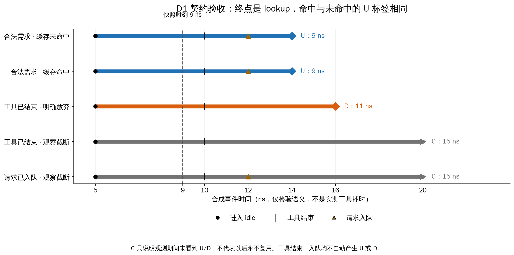
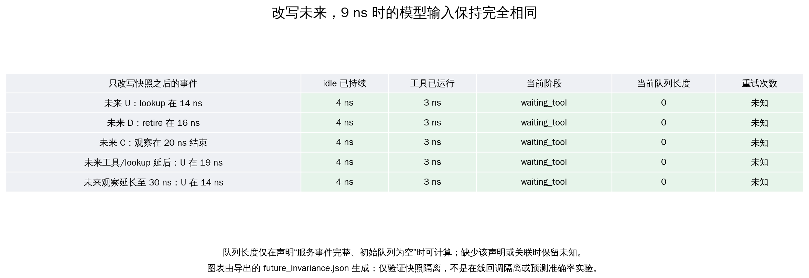

# 预测研究 D1 验收：契约能否实际执行

日期：2026-10-28（Asia/Shanghai）。结论：**D1 的受控语义与最小状态快照验收通过；真实 pilot 和在线策略回调尚未验收。**

此前 D1 只有文档和代码核查，直接写“已完成”缺少实验依据。本次补上独立人工预期、实际运行、文件导出回读、重复运行一致性和图表。这里验证的是规则能否正确执行，不是预测准确率或缓存加速。

## 验收结果

运行 `scripts/check_prediction_d1.py` 得到 **50 项检查通过**：

| 检查组 | 通过项数 | 实际检查的内容 |
|---|---:|---|
| 标签语义 | 26 | 8 个合法样例、16 个应拒绝的错误样例，另检查命中/未命中标签一致、一个 owner 终止不关闭另一个共享前缀关系。 |
| 当前状态 | 6 | 9 ns/12 ns 的快照与人工预期逐字段相同；缺失归属保持未知；拒绝空闲开始前、已结束关系及观察结束时的快照。 |
| 未来信息隔离 | 13 | 同一过去接 5 种未来，9 ns 特征不变；只给过去前缀也能生成相同快照；事件额外 payload 不进入特征；拒绝 6 类越界输入字段。 |
| 现有回放权限 | 5 | 实际调用 `source_replay.run`，4 个因果策略拒绝未来脚本，显式 `offline_script` 能执行脚本并仅作为诊断。 |

其中 24 项标签正反例使用事件契约的人工样例及独立预期（由早期 D2 样例迁移），其余 26 项是本次增加的状态、隔离、关系和权限检查，不能理解为 50 条真实工作流。另运行相关 pytest，**40 项通过**；包含同一实验写入两个独立目录后，summary 和各导出文件哈希完全相同的检查，以及未来事件 payload 无效时当前快照仍能生成的检查。

输入、未来标签、实际快照和逐项结果保存在 [结果目录](../results/prediction/d1_contract/)，[summary.json](../results/prediction/d1_contract/summary.json)记录通过项、适用边界和输入/输出 SHA-256。[D1 人工快照预期](../data/fixtures/prediction_d1_acceptance.json)与[原有人工标签预期](../data/fixtures/event_contract.json)均不由被测函数生成。

## 图一：U/D/C 到底在哪里结束



每行是一个人工事件序列，时间单位为合成 ns，便于确定性检查，不代表真实工具耗时。

- 前两行：idle 从 5 ns 开始，工具在 10 ns 结束，请求在 12 ns 入队，14 ns 才 lookup。无论命中还是 miss，U 都在 14 ns，完整 episode 时长为 9 ns。
- 第三行：工具结束本身不算终止；16 ns 的显式放弃才产生 D。
- 最后两行：观察在 20 ns 结束，仍没看到合法 lookup 或 retire，所以是 C；即使已入队，也不能提前当作复用。

虚线是 9 ns 的预测快照。这时已等待 4 ns；若未来 U 在 14 ns，模型应预测的剩余时间是 5 ns。**完整 episode 时长和快照剩余时间不同**，契约中已明确这两个起点。

## 图二：改变未来，当前输入必须不变



五条轨迹在 9 ns 之前相同，只改变之后是否复用、是否 retire、工具结束/lookup 时间和观察截止时间。离线未来标签会相应变化，而当前快照逐字段完全相同。图中展示部分字段，完整快照保存在 [future_invariance.json](../results/prediction/d1_contract/future_invariance.json)。

快照需要显式的工具/请求归属。没有 `idle_episode_id` 关联时，工具状态、phase 等保留未知；队列长度也只有声明从空队列开始完整记录服务事件时才可计算。参见[缺失状态样例](../results/prediction/d1_contract/missing_state_snapshot.json)。这些关联是本次受控样例显式提供的事实，不是从后续日志补猜出来的。

## 如何复现

在仓库根目录运行；均为 CPU 检查，不需要 GPU 或推理模型。本机项目根目录为 `/home/ma-user/takaya/leasepath`；先按 [部署说明](../docs/deployment.md) 激活 `.venv` 并清除 Ascend 的 `PYTHONPATH` 注入：

```bash
python3 -m pip install -e '.[test,measurement]'
python3 scripts/check_prediction_d1.py
python3 scripts/plot_prediction_d1.py
python3 -m pytest -q tests/test_prediction_state.py tests/test_event_contract.py tests/test_source_replay.py
```

也可输出到独立目录，保留已有证据：

```bash
python3 scripts/check_prediction_d1.py --output /tmp/leasepath-prediction-d1
python3 scripts/plot_prediction_d1.py --input /tmp/leasepath-prediction-d1
```

绘图直接读取验收导出文件，先校验结果哈希，再生成两张图的 PNG/PDF；图表与脚本来源记录在 `figures/manifest.json`。绘图需要中文字体，本次使用系统安装的文泉驿正黑。

## 通过到什么程度

**现在有证据支持的结论：** U/D/C 和 lookup 终点可复现，最小白名单快照在这些受控反事实中不受未来影响，缺失不被伪装成已知，现有 source 回放的脚本权限检查可执行。

**还没有证据支持的结论：** 真实采集是否漏报需求、retire 是否真有业务依据、全部计划特征能否测得、未来回调能否隔离、原生共享块释放是否正确，以及预测器是否准确或改善 JCT。共享 owner 本次只检查逻辑标签，不检查真实物理释放。

因此，D1 可以进入下一步真实 pilot 采集；D2–D3 要检查数据可获得性和完整性，D7 再对实际策略回调做独立隔离验收。任何自然数据或模型有效性的结论都不能由本次合成检查代替。

项目清理后，样例工具已独立为 `src/leasepath/contract_fixtures.py`，不再通过旧阶段脚本加载；历史原始结果与代码在项目外归档，当前结果重新运行并记录新路径哈希。
