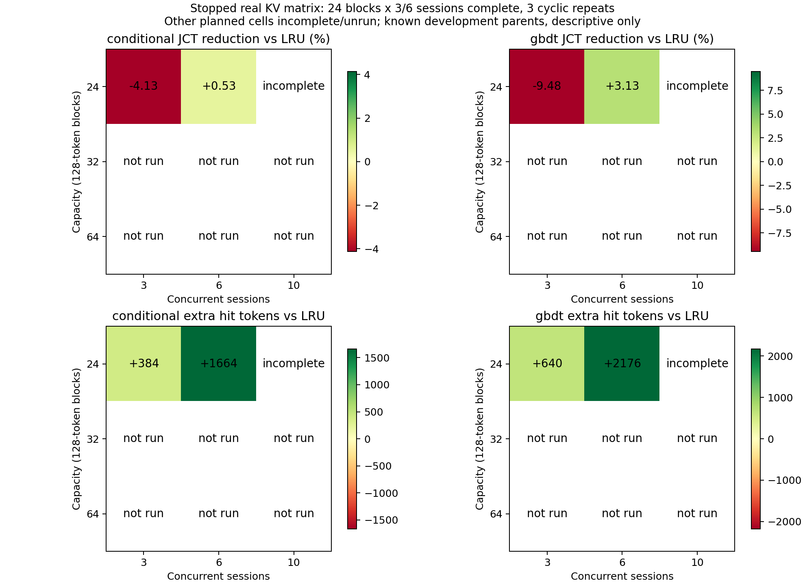
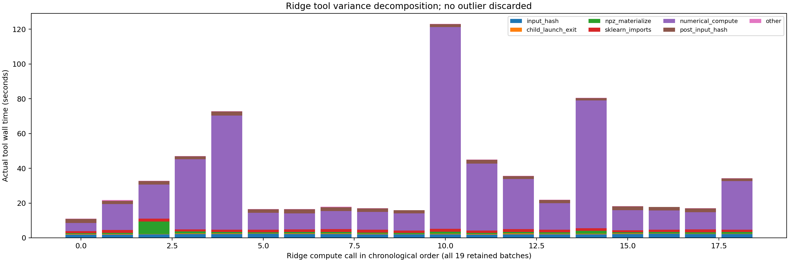

# 固定压力矩阵、真实预测排序与工具波动

2026-11-08。**预测排序在更强压力下确实改变了淘汰动作并增加命中；端到端收益尚不稳定，完整矩阵未完成。** 按冻结质量停止规则，两次尝试均在首个失败批结束后关闭，没有继续改提示、改判或补跑挑选。最终采用提示修订后的尝试 B 单独分析：19/81 批、90/91 次任务正确，24 块×3/6 会话的两格完整三轮比较；24 块×10 会话首批 9/10 正确后停止，32/64 块未运行。

## 实际资源与冻结条件

复用 `/home/liuxv/LeasePath-new-server-data`、`codex/new-server-data`，承接 `c65f365`。10 张 V100 32GB 中 GPU5/6/7 核验空闲后使用，GPU0–4 原任务保持。RAM503GiB；准备时 available260GiB，磁盘剩余约5.4TiB。32B 模型与 KV 均 F16，无量化，GPU5/6/7按层分区，单模型执行线程。固定权重 revision `381fc969f78efac66bc87ff7ddeadb7e73c218a7`，SHA256 `0c2f9e4daac78e72b24f7c054416232a523f0fd2aeb37653747d3c21f7dca078`。65,535,970,144字节复制到自有 shm并流式哈希验证，耗时1,990.876秒；A/B模型加载分别47.271/23.920秒。这些准备时间单列，不计为策略JCT。

预先固定24/32/64块×3/6/10会话，三策略释放优先LRU、条件经验、GBDT，各三轮循环错位，81批、513任务执行，预期1,539次闭环生成，另39次物理探针。每块128tokens；逻辑payload分别3,072/4,096/8,192tokens，约0.75/1/2GiB；原生context16,384cells预留约4GiB，活跃headroom2,048tokens。未截断输入。三个容量压力探针实际构造3,048/4,008/8,088tokens，均能入池；只有24块实际加载并完成物理验收。

题目固定嵌套：前三题logistic_holdout、ridge_validation、temporal_asof；6会话加入priority_top、missing_median、multi_group_anova；10会话再加入rank_sum_test、dominant_frequency、feature_information、image_regions。均是已查看的开发母题；重复执行、嵌套集合和共享来源不是独立测试样本。模型仍为40题训练的冻结经验／GBDT，固定`F_U(3s)`，无重训或horizon调优。各容量的tensor兼容身份独立，只在物理验收后显式映射统计兼容guard。

真实异步工具、单模型FCFS、每题最多6次生成／900秒、工具2线程／12GiB；所有策略承担相同来源保护、证据和同状态影子LRU诊断。JCT从共同提交至严格独立答案／产物验证，含队列、工具、模型、策略、校验和诊断；同一批工具与模型重叠，不能简单相加。进程CPU含全部BLAS线程，不能用wall-CPU推算等待。

## 全部尝试、失败与预算

| 尝试 | 提示 | 完成批 | 正确任务／总任务 | 探针／闭环生成 | 停止原因 |
|---|---|---:|---:|---:|---|
| A | stage2原提示 | 10 | 32/33 | 13/100 | priority_top最终答案漏掉`rows`根对象，产物正确仍严格拒绝 |
| B | 只增加通用JSON根对象例子 | 19 | 90/91 | 13/283 | ANOVA最终artifact ID少抄最后一个字符，答案数值正确仍拒绝 |

A的24块×3会话27/27正确，但不拼接到B。A失败后预先声明仅做一次通用提示修订；B从头执行全部格，B再次失败后停止，不自动增加第三版本或将数值正确当完整成功。B的ANOVA真实产物为`ae48c1d8bb8644ddd9d5a9b1741089d77`，最终抄为`ae48c1d8bb8644ddd9d5a9b1741089d7`。这不是上下文截断或KV入池失败。

初始总上限3,117，A实际113封口；B上限3,004（probe39/pilot2,965），实际296封口，**本阶段合计409=26探针+383闭环**。前期累计已核验512次单列，合计可核验921次；没有挪旧账本额度。10次B工具参数拒绝及预算内纠正全部保留，最终质量仍严格验证。GPU阶段A/B进程墙钟约931.520/2,380.080秒，含准备／加载／关闭，不与JCT或复制嵌套相加。无购买、无推送。

## 单独的尝试B结果

下面只描述完成三轮的24块两格；未运行格明确缺失，不给出完整矩阵总平均或最佳容量结论。JCT是同母题同轮配对，3/6母题各9/18次执行，不把重复当独立来源。

| 并发 | 策略 | 平均JCT/s | 配对差vsLRU/s | P95/s | 平均整批/s | 每批命中tokens | 每批prefill/s |
|---:|---|---:|---:|---:|---:|---:|---:|
|3|释放优先LRU|52.262|0|67.508|67.468|7,424|10.715|
|3|条件经验|54.421|+2.159|78.495|73.631|7,808|10.256|
|3|GBDT|57.215|+4.953|96.473|84.134|8,064|9.375|
|6|释放优先LRU|111.320|0|154.305|154.491|9,856|33.743|
|6|条件经验|110.729|-0.591|157.779|165.066|11,520|30.619|
|6|GBDT|107.831|-3.489|150.419|150.771|12,032|29.761|

6会话GBDT观测平均JCT降低**3.13%**，整批降低2.41%；经验平均JCT降低0.53%，整批却增加6.84%。3会话两预测策略JCT分别增加4.13%/9.48%。全部长尾保留，未剔除、未补选；不能宣称预测总体已稳定端到端加速。提示修订会改变token和生成，B与A或stage2的绝对数值不作相同工作量对照。



每次实际admission另算同状态释放优先LRU，独立检查器从实际居民块、touch、owner退役重新构建对照。3会话经验／GBDT各有6/7次淘汰集合改变，平均每批额外命中384/640tokens；6会话26/28次改变，额外命中1,664/2,176tokens。**排序带来额外真实命中**已有物理证据，6会话prefill减少3.124/3.982秒；不能把影子动作直接写成反事实JCT节省。预测耗时每批经验约1.249/8.183ms、GBDT约7.303/53.168ms（分别3/6会话），明显小于几十秒工具长尾。6会话decode仍约113秒／批。

另一个限制是目标迁移：B的LRU实际release→下次lookup中位数在3/6/10会话约11.99/36.05/58.30秒；工具结束→lookup中位数8.70/32.71/57.39秒。3秒以内复用比例均0。固定3秒训练模型仍能提供排序，但多会话模型排队使真实目标偏移；它不是已校准的并发剩余等待预测器。本轮不事后换horizon来挑收益。

## 工具波动已分解

版本化工具与worker保持旧stage2源文件字节不变。API、不可变FD、前后完整输入hash、资源／参数限制、进程组取消和产物fsync不变；诊断只进日志，不进模型结果或预测器。分开记录NPZ读取物化、NumPy/sklearn导入、数值计算、CPU用户／内核时间、缺页、I/O和主线程schedstat。扩展运算内部惰性导入仍归入计算窗口，SQL连接查询关闭合并计时；边界明确。

B的19次ridge工具墙钟**11.020–123.012秒**，中位21.759秒、P95=84.818秒；NPZ物化平均1.189秒、最大7.143秒，sklearn导入平均1.476秒，数值窗口平均27.742秒、最大116.057秒。两次输入hash合计平均4.027秒。worker用户CPU在7.693–9.584秒，**worker进程总CPU在9.165–121.532秒，内核态CPU在1.468–112.203秒**；主线程runqueue等待平均0.073秒、最大0.384秒。123秒长尾集中在计算窗口及大量内核开销，不能归因预测调用或简单CPU排队。



所有ridge的worker `read_bytes=0`，NPZ实际读取`rchar`约404MB；前置完整hash已经预热页缓存，不代表没有读数组。每10秒保留CPU/I/O/内存PSI和vmstat回收／压实／THP／NUMA计数。多个长尾窗口伴随数百至数千次全局`compact_stall`，与内存压实是相容线索；这些是共享主机计数，不能全归到某个worker。cgroup无memory.max/high限制、无OOM记录；系统THP为madvise，未改全机配置。

GPU前与权重复制并发的CPU预检，ridge曾272.349秒，前后hash分别75.545/81.954秒，worker114.546秒。这里揭示既有超时的具体边界：**240秒限制计算子进程communicate期限（扣除前hash），阻塞式前／后hash不被抢占，整次工具墙钟可能超过240秒**。此语义未改、校验未跳过；该预检不混入策略矩阵，不能用它估计收益。

追加6次纯CPU正常／本子进程禁用THP的AB/BA/AB有界诊断，均与reference一致，无模型生成，不改系统sysctl。普通工具42.879/11.191/11.335秒，禁用THP14.042/13.703/14.281秒。**第三对运行中清理了65.54GB临时权重，改变内存条件，明确标为受干扰**；前两对也仅两组共享主机样本。禁用THP波动较小、普通模式正常轮更快，不据此宣称稳定加速或修改正式工具。具体内存机制仍待干净对照，不把全局计数当根因证明。

## 审计、保存与后续落点

A/B所有409次请求独立复核实际token、物理cell并集／配额、共享引用、淘汰重算、预算一一映射、58条封口流、259次工具结果消费、124份计算分项和最终产物。实验状态保持quality_failed；审计passed指证据／停止规则完整，**不是任务全成功或矩阵通过**。源码275项、运行库8份哈希复核；旧stage2的181请求亦重查通过。最终适用回归见交付日志。GPU5/6/7已关闭回到约4MiB，自有shm副本删除，持久权重保留。

当前优先次序是：先独立解决最终产物ID逐字符复制的协议可靠性，保留严格引用检查；再用干净的CPU配对隔离内核／THP波动，避免准备或清理操作重叠；之后按新版本从头补完固定矩阵。以上不是继续调GBDT的理由。若后续引入已就绪状态、共享队列和prefill重算成本，需要作为单独消融冻结，保持基线／信息／资源对等，不把未来工具耗时加入在线特征。当前证据支持“预测能改变缓存动作并增加命中”，尚不支持“预测在完整压力矩阵稳定缩短端到端时间”。

复现：计划`configs/prediction/qwen_cache_stage3_2026-11-08.json`与`qwen_cache_stage3b_2026-11-08.json`；原始A/B分别`.artifacts/qwen-cache-stage3/run-a`、`run-b`，两账本已封口。小摘要、工具分项、动作和可导出PNG/SVG在`results/cache_policy/qwen_stage3b_2026-11-08/`，A独立摘要在`qwen_stage3a_2026-11-08/`。源检查／审计脚本保留，不复用封口账本发新请求。

```bash
PYTHONPATH=/home/liuxv/LeasePath-new-server-data/src OMP_NUM_THREADS=1 OPENBLAS_NUM_THREADS=1 \
 .artifacts/qwen-data-env/bin/python scripts/check_qwen_cache_matrix_attempt.py \
 --run .artifacts/qwen-cache-stage3/run-b \
 --ledger .artifacts/qwen-cache-stage3/attempt-b-ledger.jsonl --output /tmp/cache-stage3b-audit.json
```

恢复包见`.artifacts/checkpoints/cache-stage3-2026-11-08/`；Git bundle仅含代码和小结果，完整raw另归档。冻结输入／reference继续依赖`extension50-final`输入备份，固定运行库备份在`cache-stage2-2026-11-08`。备份仅本机，未远程推送。

最终交付适用回归 **228 passed / 1 deselected**。唯一排除项仍为依赖未恢复外部完整快照的`full_pinned_audit`；全程没有修复旧Codex路线。
