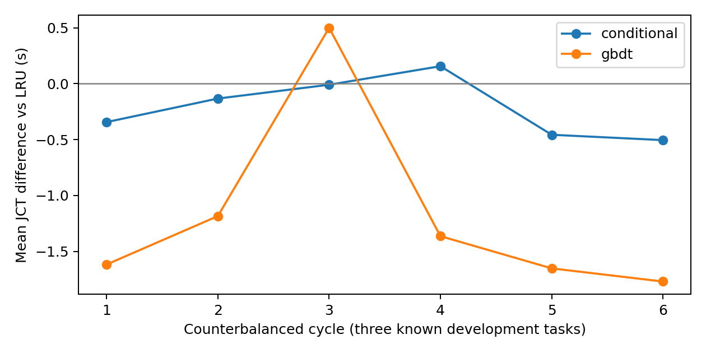

# 完整 Python 驻留与新自然 JCT 尝试

**已完成新自然轮：18批54/54正确；经验分布JCT下降0.415%，GBDT下降2.279%。75次工具调用及300次辅助进程零主缺页／零磁盘输入。仍有一轮策略收益反向、工具耗时差异及控制器4KiB未归因读取，不能宣称稳定的纯策略因果收益。最终测试245 passed，1外部数据项deselected。**

承接 `84f7aef`，遵照用户要求另开版本与账本，不追加上一轮失败账本。仍仅当前共享服务器；亲和性不是独占 CPU，其他任务及全局 THP／页缓存设置不改。

## 前瞻冻结方案

固定 Qwen2.5-Coder-32B-Instruct F16、GPU 5/6/7、F16 KV、24×128tokens 逻辑容量、16384 物理上下文、2048 headroom。仍用 logistic_holdout、ridge_validation、temporal_asof 三道已查看开发母题，输入／数值参数／SYSTEM／冻结预测器不改，预测目标仍为 F_U(3s)。三种策略六个全排列，共18批54任务；不填充工具响应、不按 JCT 或主机压力筛样本，不补跑替换。预期175次生成=13原生门控+162闭环，独立新账本上限241（probe13、pilot228），预算不当作实际完成量。

Python 3.13.9 解释器与完整标准库（不含字节码缓存）、原冻结 site-packages、当前 LeasePath 来源复制至自有 tmpfs，固定 PYTHONHOME／PYTHONPATH，逐文件 SHA256。系统依赖来自全部复制 ELF 的 ldd 传递闭包及真实三工具 strace；系统文件原地只读共享映射并 mlock，校验哈希与文件身份。完整预测运行时、模型加载后实际父进程动态库也驻留。所有策略使用同版本诊断，诊断开销包含在 JCT；strace 仅准备阶段开启。

权重专用非 GPU keeper 进程负责 PROT_READ／MAP_SHARED／mlock，父进程锁其他依赖。两进程各自遵守继承的 RLIMIT_MEMLOCK，不提高限额，不产生模型私有 COW 副本。每批前检查 keeper 存活、文件身份和 mincore；文件页驻留不意味着 CPU 页表已建立，更不等于带宽独占。

延续严格零磁盘读取／零主缺页停止规则，并扩展到完整子进程：wait4 统计解释器启动到退出的 major_faults、block_input_ops；worker 保留自 exec 以来的 read_bytes，以及原分阶段计数。逐调用记录实际解释器、sys.path、文件 open、加载映射及发生 I/O 的嵌套导入窗口。首个答案、协议、资源、来源、预算违例即停止，所有失败保留。

## 文件定位及真实工具验证

三种真实工具 strace 全部严格正确；读取与映射路径显示原先驻留清单之外还存在 `/etc/ssl/openssl.cnf`、locale 文件及缓存、时区、动态加载器缓存等。全部纳入本次清单。文件访问不能等同为发生过磁盘缺页。

后续三轮锁页真实工具共9次，全部正确、完整进程 major_faults=0、block_input_ops=0、自 exec read_bytes=0。准备期这些调用与权重复制有时间重叠，**不用于性能比较或宣称共享主机稳定**。正式 JCT 在全部准备、测试、复制完成后启动。

未重现上一轮那次主缺页。针对本账号进程实际尝试 perf_event_open 软件 major-fault 地址采样，返回 EACCES，perf_event_paranoid=4；strace 不提供内存映射故障地址。因此上一轮具体缺页文件不可追溯，本次只报告实际路径、导入窗口和当前完整进程计数，不伪造精确归因，也不请求管理员改系统设置。

初次 ldd 发现重定位后的可选标准库扩展需要原 Conda 库，已用显式符号链接保持原库字节与解析关系，实际系统目标纳入哈希／锁页；未安装或升级数值依赖。初次追踪解析器误把 read 返回的二进制内容当成路径，准备阶段报错；修正解析规则后直接重用已保存追踪，未重跑或替换这3次调用。原始错误日志一并保留，均发生在模型生成与新账本创建之前。

功能检查目前244 passed，1 deselected（外部 full_pinned_audit 数据缺失）。新自然 JCT 执行、独立审核和关闭结果将在本文件补记。

## 首次扩展门控失败及执行文件闭包补充

冻结提交 `d3ad3b0` 的首次准备在持久化输入重复复制期间受控中断，0次生成；输入磁盘复制速度低，版本化运行器 `7472dfc` 改用已有SHA256验证的同字节tmpfs准备副本。保留中断日志，不改变任务内容与策略顺序。

随后13次原生门控通过，模型加载40.225秒。加载后3个哨兵答案全部正确，但新增完整进程树门控发现logistic wait4 major_faults=1、block_input_ops=0；asof major_faults=3、block_input_ops=1656、自exec聚合read_bytes=847872。worker自身所有数值阶段、导入窗口major_faults和read_bytes仍为0。实验立即失败关闭，账本封口13 probe／0 pilot；GPU5/6/7均恢复4MiB。没有自然JCT样本，也不报策略收益。

继续读取已保存strace，发现 `ctypes.util`／线程库发现流程会启动 `/sbin/ldconfig -p`。此路径是387字节shell包装，内核需要执行 `/bin/sh`（真实目标 `/usr/bin/dash`），再执行 `/sbin/ldconfig.real`（真实目标 `/usr/sbin/ldconfig.real`，1213960字节静态ELF）。原解析器覆盖open/read/mmap，却漏掉execve及shebang隐含解释器：只锁住了包装脚本。这两份执行文件构成**证据确认的驻留缺口**；不能据此声称已取得故障地址或证明上一轮每个I/O字节归属。

对wait4的范围补充纠正：它包括已回收的后代进程，而不是仅Python自身。新增进程树版本记录每次库发现辅助进程的PID、命令和wait4资源，分别呈现worker自身和后代。原始字段和失败不改写。补锁execve目标及shebang解释器后，另做2组三工具共6次，6/6正确，完整进程树major_faults、block_input_ops和read_bytes均为0；辅助ldconfig逐次计数也全为0。

下一次独立新自然账本使用 `qwen_resident_tree_natural_2026-11-09.json`，仍原18批／54任务／六种顺序及所有严格停止规则。首次13次探针不挪入新账本，也不替换为成功。

## 新自然轮完成：18批54/54正确

进程树方案冻结于 `4552948`，与首次失败独立分账。完整权重复制及SHA256验证2050.418秒，最终模型加载34.453秒，均不进入策略JCT。完成六种策略全排列，共18批54题次，54/54严格正确，零工具参数拒绝；13原生物理门控全部通过。实际175次新生成=13探针+162真实闭环，低于241上限，账本封口。前一次失败13探针另计，因此本次任务新增总量188；承接此前可核验1087，总可核验1275。生成计数不包含CPU哨兵。

| 策略 | 平均自然JCT/s | 对LRU差/s | 对LRU差/% | 每批命中tokens | 每批prefill/s | 每批decode/s |
|---|---:|---:|---:|---:|---:|---:|
| retired_first_lru | 51.856 | 0 | 0 | 7424 | 10.691 | 53.250 |
| conditional | 51.641 | −0.215 | −0.415% | 7808 | 10.221 | 53.220 |
| gbdt | 50.675 | −1.182 | −2.279% | 8128 | 9.337 | 53.180 |

**本轮观测到GBDT的自然端到端改善，尚不能声称跨负载稳定加速。** GBDT六轮相对LRU的平均任务JCT差为−1.618、−1.185、+0.500、−1.364、−1.653、−1.770秒，5/6轮更快，1轮反向；经验为−0.343、−0.133、−0.009、+0.157、−0.457、−0.505秒，同样5/6轮更快但幅度小。六轮不是六套独立母题；这仍只有3道已查看开发母题、固定容量及并发，不能当独立测试集或宣称整个压力矩阵有效。

GBDT每批平均多命中704tokens，prefill少1.354秒，平均任务JCT少1.182秒；这些量的计时范围不同，不可按工具耗时+model wall线性相加，因为三个会话有重叠与FCFS模型排队。经验多命中384tokens、prefill少0.470秒，JCT仅少0.215秒；asof平均JCT反而增加0.569秒，logistic与ridge分别减少0.714／0.500秒。GBDT三个任务分别减少1.465／0.704／1.376秒。

输入token序列在同题同轮三策略间一致；经验与LRU所有输入及输出token逐个一致。GBDT在第1、2、4、5、6轮的asof第二次调用输出34tokens，LRU为35tokens，最终JSON完全相同；第三轮token工作量相同却JCT变慢。不能称GBDT与LRU的全部decode工作完全相同，也不按事后token差“校正”JCT。

## 驻留、工具分解和剩余波动

完整Python驻留清单22254个文件；系统／预测器清单包含新增的dash和ldconfig.real；模型加载后8个额外实际父进程映射共1151716334字节也锁页。模型keeper检查15999993页均驻留；每批检查模型、运行时、保护文件、加载后依赖均零非驻留页，未提高任何锁页上限。

独立补充检查75次compute=54正式+21加载后／轮前哨兵，全部正确。300次ldconfig库发现辅助进程都有独立PID／命令／wait4计数，worker自身、辅助进程和完整进程树 **major_faults=0、block_input_ops=0、自exec聚合read_bytes=0**。实际打开的不可变文件及加载映射均在锁页集合中。所有数值线程池仍1线程；全部75次worker的累计调度等待／wall最高1.988%，低于原5%局部门槛。这不代表旧全局主机稳定性门槛已通过。

| 策略 | logistic实际工具wall/s | ridge实际工具wall/s | asof实际工具wall/s | ridge kernelCPU/s |
|---|---:|---:|---:|---:|
| retired_first_lru | 7.435 | 15.290 | 3.805 | 3.125 |
| conditional | 7.281 | 14.833 | 3.770 | 2.990 |
| gbdt | 7.201 | 14.732 | 3.810 | 2.996 |

ridge完整工具耗时仍相差约0.46／0.56秒，构成预测策略收益的混杂因素，不能全部归因于缓存。LRU ridge平均worker12.003秒、启动导入退出0.481秒、前后输入hash共2.798秒；经验worker11.602秒、0.466秒、hash2.757秒；GBDT worker11.526秒、0.469秒、hash2.729秒。数值阶段各自wall／user／kernel／调度等待、NPZ materialize、库导入、前后hash及启动退出均在 `tool_phases.csv`，不把wall−CPU直接当I/O等待。

**仍不能称全链路零I/O。** 控制器第3轮经验批次聚合read_bytes=4096，其余17批为0；同批各工具及后代均0，故不能像旧故障一样全部归因于工具。此4KiB没有文件级追踪，来源未知。冻结方案仅对工具进程树施加零I/O硬停止，父控制器计数作为公开协变量；本轮未事后更改该规则。严格来源哈希检查、最终验证、日志和相关观测开销都计入自然JCT。

主机CPU PSI全批约15.11%–92.36%，I/O PSI约24.58%–39.49%，证明共享负载并不恒定。即使工具不读盘，共享CPU、内存带宽、调度及GPU时钟仍可能影响整题时间。结果支持继续研究GBDT排序，但不支持把2.279%当作已识别出的纯策略因果效应。没有放宽旧门槛、停止他人任务、修改全局THP／页缓存或把亲和性说成独占。

## 证据与后续工作

原生／协议／质量／账本独立审核通过：175请求、13探针、162真实请求、54/54正确、36封口流、108工具结果实际消费；逐token／cell与共享所有权、淘汰、retire、同状态shadow LRU行为均复核。首个失败尝试也独立审核通过其证据完整性，实验标签仍failed、13请求、0自然批，未合并为成功样本。

- 冻结自然方案：`configs/prediction/qwen_resident_tree_natural_2026-11-09.json`。
- 最终独立审核：`scripts/check_qwen_resident_tree_natural.py`；失败哨兵尝试回溯审核：`scripts/check_qwen_resident_preflight_attempt.py`。
- 逐批／逐题／工具阶段CSV、summary、驻留补充审核、图PNG/PDF：`results/cache_policy/qwen_resident_tree_natural_2026-11-09/`。
- 正式原始数据：`.artifacts/qwen-cache-resident-tree-natural-2026-11-09/run/`。
- 初始准备中断、失败哨兵账本及完整strace：`.artifacts/qwen-cache-resident-natural-2026-11-09/`。

下一阶段优先为父控制器4KiB读取补上完整文件归因，并在同一冻结方案下独立重复当前单元，确认GBDT方向是否复现；随后才扩大容量／并发和加入有真实agent循环的母题。固定3秒风险目标先保持，若改变horizon或训练则另开版本。当前单元观测收益不能直接外推到50母题或高并发。

收尾测试环境曾误将全局Conda site-packages加入私有运行时以加载pytest，触发pandas的可选pyarrow导入与libstdc++的CXXABI_1.3.15不兼容，得到239 passed／6 failed／1 deselected。此路径未出现在真实GPU试验环境；不改试验依赖或源码来迎合该测试环境，保留完整失败日志并回到仓库原标准环境复跑。初次图表导出在私有环境缺少matplotlib而中止，CSV与summary已经写出；随后用原绘图环境导出相同审核数据的PNG/PDF，未重算或改动观测值。

原始内存盘与磁盘副本独立审核逐项一致，723文件共1241484519字节复制后逐文件SHA256通过；同字节输入只保留正式run中的一份，其他尝试保留输入清单／身份，避免重复约1GB输入。旧失败账本保持封口，GPU5/6/7均恢复4MiB，所有其他用户GPU任务不变。

最终回到仓库标准环境完整复跑 **245 passed，1 deselected，115.99秒**；唯一排除项仍是依赖缺失外部数据的 `full_pinned_audit`。测试混用失败与一次被中断的冗余复跑均保留日志，不覆盖为通过。正式GPU测量期间未并行进行测试、复制或归档。PNG/PDF已完成导出；所有结果由封口账本对应的审核数据生成。

归档 `.artifacts/checkpoints/cache-resident-natural-2026-11-09/raw-evidence.tar.gz` 共593923841字节（约594MB），SHA256 `685cf233515fd966a7fe9e6c01c2be4fb6d6cd3f60cd5e8fdbf9455ac14098f6`，779个归档文件逐一与磁盘原件核验通过。最终测试日志与补充状态另存同目录。首次归档校验检测到收尾状态文件追加测试结果时的变化，恢复原始归档字节并将测试另存后复验通过；原始测量数据始终未修改。自有9个tmpfs路径在校验归档后清理，GPU退出确认与清理清单留存；Git bundle仅本地保存，不推送。
