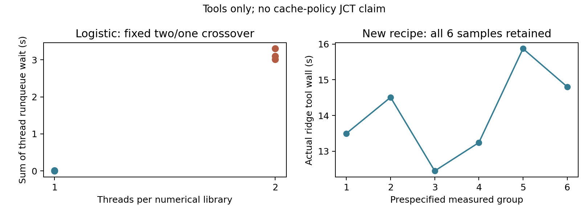
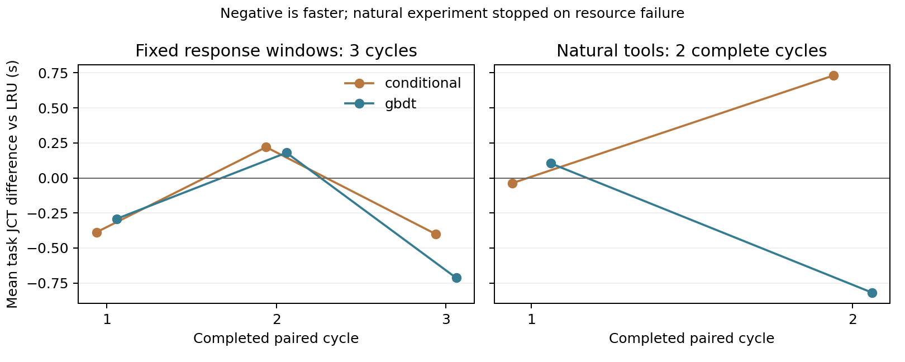

# 共享服务器上的线程竞争诊断与后续配对试验

2026-11-09。用户确认只有当前共享服务器，当前账号无法预留独占CPU或限制其他用户进程。承接`d1f577f`；单线程方案冻结于`43ef47f`，共享主机配对方案冻结于`b9c0343`，哨兵严格校验补充于`54cc88e`。原有两轮资源门控失败标签不改。

## 已完成的真实工具诊断

同一logistic输入、相同参数、相同CPU14/16、NUMA node1、子进程THP关闭、tmpfs输入／依赖及完整前后哈希。先各预热一次，再按两线程／单线程、单线程／两线程、两线程／单线程固定次序执行，8/8答案通过独立参考验证。每个阶段边界记录所有线程的schedstat、亲和性、状态以及实际线程池。该试验是线程配方对照，主机仍共享，不能证明所有等待都来自自身。

| 每套数值库线程数 | 正式调用 | 平均真实工具wall/s | 各线程累计调度等待/s | 观测峰值线程数 |
|---|---:|---:|---|---|
| 2 | 3 | 6.945 | 3.105, 3.014, 3.301 | 3,3,3 |
| 1 | 3 | 5.789 | 0.0013, 0.0146, 0.0006 | 1,1,1 |

Qwen执行环境实际加载NumPy和SciPy的两套pthreads OpenBLAS，并加载OpenMP。各库“2线程”不等于整个进程只有2线程。统一单数值线程后，活动数值线程及其竞争显著减少；选择单线程的理由是移除辅助数值线程，不按最快均值挑参数。不同配方的绝对耗时不拼入此前策略JCT。

## 单线程第二轮预检

每工具固定包含两颗物理核及其SMT兄弟的4个逻辑CPU：logistic22/24/50/52、ridge20/21/48/49、asof15/23/43/51；它们只是亲和性允许集合，不是独占预留。保留原稳定性门槛，不因结果放宽。

1组预热、6组测量，21/21正确，其中正式18/18保留。ridge13.499、14.507、12.449、13.242、15.869、14.804秒，CV=8.006%、max/min=1.2747。调度等待比例最高0.2256%，已通过5%门槛；仍因ridge max/min>1.25和全局I/O PSI范围6.342个百分点>5失败。独立证据复核通过，实验门控未通过，0新增模型生成。

## 后续设计的边界

独占节点不可用，因此不再把全局共享环境说成恒定。新的两组方案均使用同题、同单线程工具、同冻结预测器、同SYSTEM与严格答案检查，三策略都是真实Qwen32B F16及真实数值工具。新统计口径前瞻冻结，原门控不改标。

第一组为固定工具响应窗口的机制试验：每次实际执行计算，保留结果与数值耗时，完成后等到固定期限交付；无法按时计算或交付（容忍0.1秒）则失败停止。inspect预算分别2/5/1秒，compute预算分别10/25/4秒，view为1秒；这些时间按工具类别事前确定，三策略相同，不能当作自然JCT加速。3种循环错序共9批27次任务。

第二组为自然真实工具的端到端验证：不给工具加等待，按三策略六种全排列各跑一次，18批54次任务。每同题同轮做配对，同时公开原始工具耗时、输入输出token是否相同、主机CPU/I/O/内存压力及GPU状态。六轮不是六份独立数据源；仅三道已查看开发母题，不能当作独立最终测试集。共享CPU与内存带宽不独占，结果解释必须保留该限制。

完整新增生成预期256（13物理门控+81窗口组+162自然组）；独立新账本硬上限175+229=404，全部账本封口且旧账本不追加。模型及输入/依赖在准备后锁住只读文件页，避免磁盘换页；记录并检查worker实际read_bytes/major_faults=0，模型加载后工具哨兵同样严格验答案。首个最终协议/答案错误、窗口超时、外来GPU进程、worker磁盘读取、来源变化或预算超限均停止，保留所有失败，不修提示或补跑替换。

此前`mmap.ACCESS_COPY`加mlock可能产生私有COW页。新方案通过只读共享mmap锁住原始文件页，并用smaps专项验证Anonymous=0；此前工具预检的锁页记录仍按实际实现解释，新方案不把这种内存差异隐藏成单因素收益。

原始诊断与预检：`.artifacts/qwen-cache-controlled-next-2026-11-09/`。配对运行准备与执行证据：`.artifacts/qwen-cache-paired-shared-2026-11-09/`。执行结果与停止证据见下文。

## 本轮真实GPU执行结果

**固定窗口组完成，自然工具组因资源失败提前停止；没有得到稳定的自然端到端加速。** 完成17批51次任务，51/51严格正确，零工具参数拒绝。新增166次模型生成=13物理探针+81窗口组闭环+72自然组闭环；旧累计921单列，总可核验1087。没有把预期256或预算404写成实际完成量。

权重65,535,970,144字节经完整SHA256验证，复制耗时1671.552秒；模型加载32.840秒，均排除出策略JCT。固定模型、F16权重／KV、GPU5/6/7、24块×128tokens、context16384、headroom2048保持。13次原生探针全部通过，独立检查真实单元共享、retire后保留、压力物理淘汰、停止／超时／取消后清理，以及token对应。

### 固定响应窗口：完整9批，27/27正确

54次真实工具调用都按期限交付，无计算或窗口超时。交付唤醒最大迟到0.282毫秒，包含小日志重写后的返回最大迟到3.865毫秒，均低于事前100毫秒上限。真实计算阶段的原始wall、kernel CPU及补加等待保留。三轮中LRU的ridge实际工具wall15.316/15.627/15.779秒，经验13.798/14.681/14.146秒，GBDT14.064/13.032/13.663秒，但每次compute响应统一到25秒。这消除了这些完成时间差对交付时序的直接影响，仍不能保证GPU调度与内存带宽相同。

| 策略 | 平均JCT/s | 对LRU差/s | 对LRU差/% | 每批命中tokens | 每批prefill/s |
|---|---:|---:|---:|---:|---:|
| retired_first_lru | 55.759 | +0.000 | +0.000% | 8320 | 9.506 |
| conditional | 55.570 | -0.190 | -0.340% | 8064 | 9.591 |
| gbdt | 55.484 | -0.275 | -0.493% | 8576 | 8.820 |

GBDT平均多命中256tokens／批，prefill减少0.686秒，平均JCT只减少0.275秒；三轮配对差为−0.291、+0.180、−0.713秒，方向不一致。经验反而少命中256tokens／批，prefill增加0.085秒，却观测JCT减少0.190秒；不能将其解释为经验缓存排序成功。三策略的输入token序列相同，但部分asof工具调用输出有1个协议token差异，最终JSON相同，decode工作量不完全一致。**窗口组只支持条件时序下的小幅观测差，不支持稳定加速或自然JCT结论。**

### 自然工具：8/18批，24/24正确，第三轮中途资源停止

前两轮三策略各2批完整，作为同样本配对主表。第三轮经验和LRU已完成而GBDT未运行；它们全部留在逐次CSV和总审计，不混成三策略等样本均值。这里只因三策略配对未完整而将第三轮单列，不因其速度好坏筛选。

| 策略 | 共同两轮平均JCT/s | 对LRU差/s | 对LRU差/% | 每批命中tokens | 每批prefill/s |
|---|---:|---:|---:|---:|---:|---:|
| retired_first_lru | 52.564 | +0.000 | +0.000% | 7424 | 10.743 |
| conditional | 52.911 | +0.347 | +0.659% | 7808 | 10.465 |
| gbdt | 52.207 | -0.357 | -0.679% | 8000 | 9.521 |

两轮经验配对差−0.038、+0.731秒，GBDT+0.104、−0.818秒，均反向。GBDT平均多命中576tokens、prefill减少1.221秒，但JCT只低0.357秒；经验多命中384tokens而JCT高0.347秒。模型排队、完成顺序、decode与观测开销共同决定JCT，prefill差不能逐秒等同为整题JCT差。

第三轮经验平均JCT52.814秒，LRU53.553秒（仍保留资源失败批）。若把经验所有3轮对LRU所有3轮配对，差为−0.015秒／−0.029%；GBDT只有2轮，不能用其2轮均值对LRU3轮算收益。所有可配对值、完整与不完整循环都在summary.json中分别标注。

停止批为natural／repeat2／retired_first_lru，3个答案均正确，但asof worker read_bytes122880、major_faults1；logistic read_bytes4096、major_faults0，ridge仍0／0。asof读取发生在numerical_compute阶段，该阶段还包含 `execute_extended` 的懒加载SciPy导入；logistic读取发生在sklearn_imports阶段。记录没有具体缺页文件路径，不能断言是哪份库、stdlib、系统配置文件或设备，也不能将计数器全部解释为新增数值计算或直接磁盘服务时间。**本轮锁住模型、site-packages、输入和受保护来源，未完整锁住系统Python／标准库及所有系统依赖；这次试验没有实现全链路零I/O。**

所有窗口组父进程read_bytes为0，自然前7批为0；停止批父进程聚合read_bytes126976，与两个子进程合计一致，不能据此把读取归因于父进程本身。全局主机CPU PSI在自然第二轮达到10.55/32.98/36.32%，说明其他负载也发生明显变化。此前两轮预检的失败不是被新设计证明“无影响”。本轮各策略的CPU与内存带宽仍非独占。

## 复核、关闭及下一步

独立只读审计通过：全部166个生成预约与实际模型请求对应，13探针+153闭环；17批51/51正确；34条sealed stream、102次真实工具结果消费、51次compute记录、真实native token／cell、同状态shadow LRU重新推演、产物、JCT边界及停止规则均核验。资源违例仍明确标为失败；审核通过不等于实验通过。加载后及各轮工具哨兵21/21正确，与此前8次线程诊断及21次单线程预检分账，共本轮相关真实compute101次全部正确，不重复算作模型生成。

完整窗口组通过了局部时序控制，但JCT差约0.2–0.3秒且逐轮有反向。自然组未完成六种顺序，只能报告部分观测，**现在不支持“预测排序已稳定缩短端到端时间”。** GPU5/6/7在停止路径释放，复查均恢复4MiB，其他GPU任务保持。

下一步优先把Python／stdlib／系统依赖也纳入可验证的驻留集合，并记录实际文件I/O来源；另需检查固定3秒模型在几十秒并发等待下是否只提供弱排序。任何新时序或horizon都要另开版本与账本，保留本次失败，不能直接补齐剩余批次或拼成原六轮实验。一次性收集更完整运行证据后，再决定是否值得扩容量／并发；当前更大的矩阵不能解决这次识别出的控制缺口。

- 冻结方案：`configs/prediction/qwen_shared_server_paired_2026-11-09.json`。
- 独立检查器：`scripts/check_qwen_shared_server_paired_attempt.py`，版本化读取资源停止的失败尝试；原冻结检查器不修改。
- 全部逐批、逐题、工具、哨兵CSV及汇总：`results/cache_policy/qwen_shared_server_paired_2026-11-09/`。
- 配对图PDF：`results/cache_policy/qwen_shared_server_paired_2026-11-09/paired_jct.pdf`。
- 原始与已封口账本：`.artifacts/qwen-cache-paired-shared-2026-11-09/run/`。
- 所有调用保留，不购买、不推送；模型准备、功能测试、归档均未与策略测量并行。

最终测试 **238 passed, 1 deselected**，50.09秒；唯一排除项为依赖缺失外部数据的`full_pinned_audit`。磁盘副本重新独立审核，与内存盘原始审核逐项一致。原始证据和Git bundle保存于`.artifacts/checkpoints/cache-shared-paired-2026-11-09/`，归档按逐文件SHA256核验后清理本轮自有内存盘。
